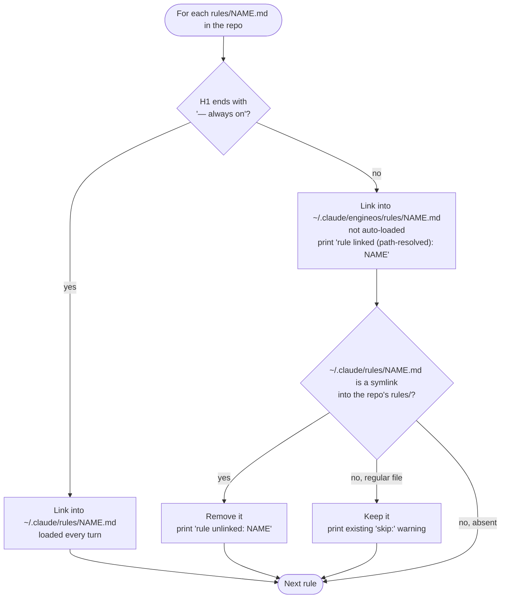
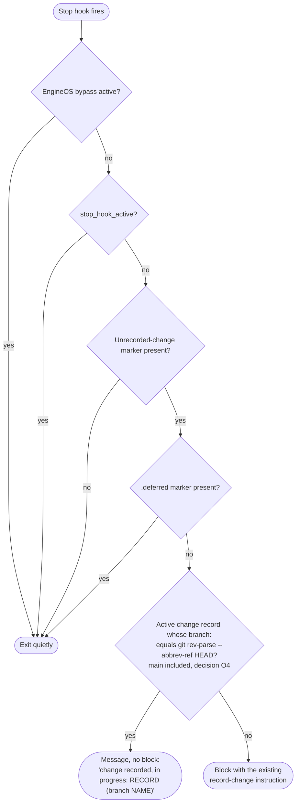

# Session-retro improvements — decision flows

Diagrams of the two contracts in `plan.md@sri-v1` that branch. The tickets stay
authoritative. Archify renderings (interactive HTML, all four finalize gates
passed 2026-10-13):

- C1: `.archify/workflow-installer-rule-split-20261013-073628/installer-rule-split.html`
- C2: `.archify/workflow-record-gate-20261013-073628/record-gate.html`

The Mermaid below is the plain-text source of the same flows.

## C1 — installer rule split (ticket 02, `install.sh` / `install.ps1` step 4d)

Agents, skills, commands and templates still name rules as `rules/NAME.md`.
On an installed machine, the sentence added to `CLAUDE.md` and `AGENTS.md`
resolves a routed or deprecated rule to `~/.claude/engineos/rules/NAME.md`.

## C2 — record gate (ticket 03, `record-verify` Stop hook)

Checks run top to bottom; the first that applies answers.

