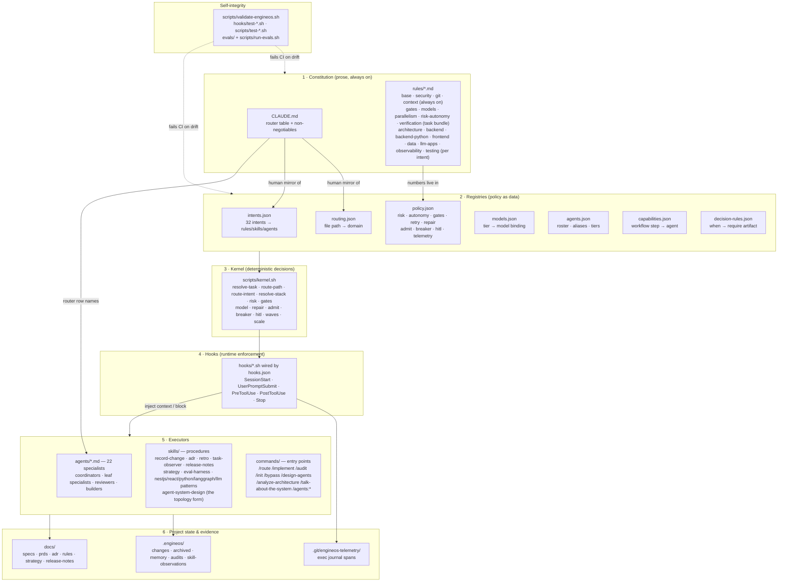
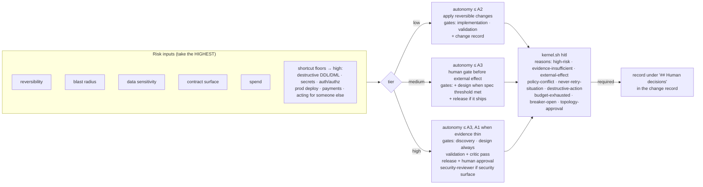
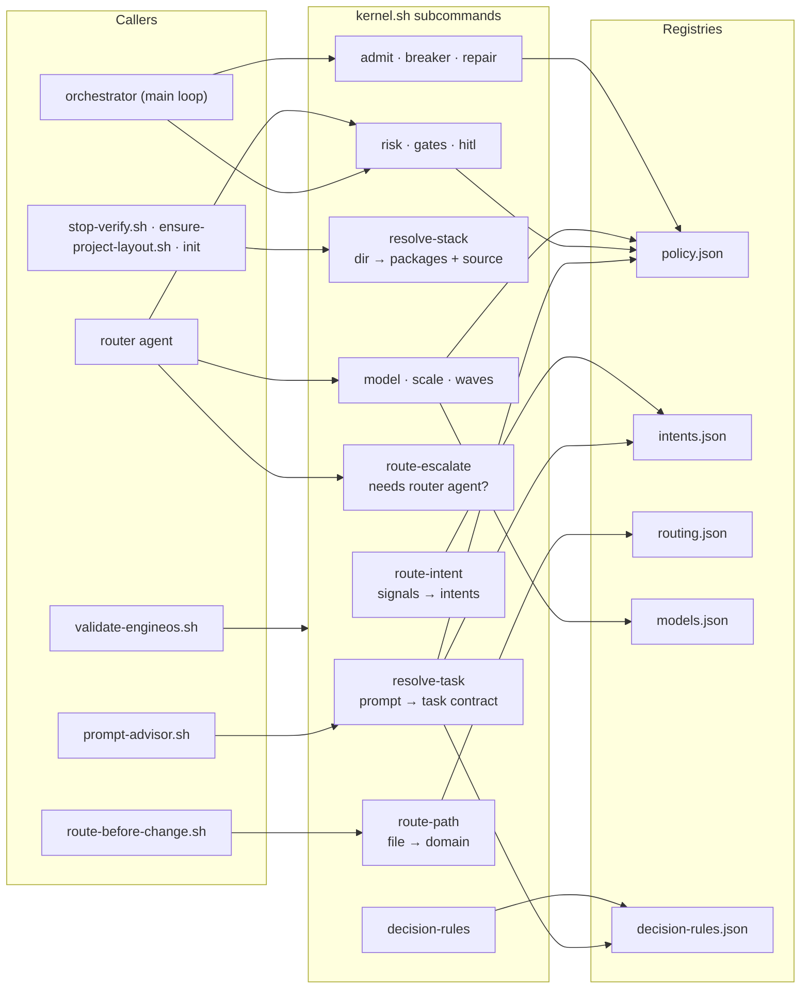
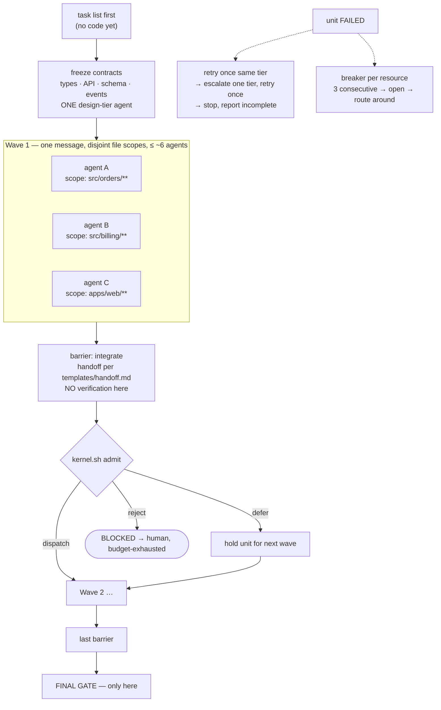
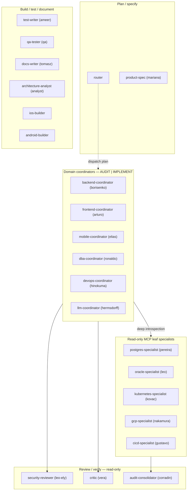
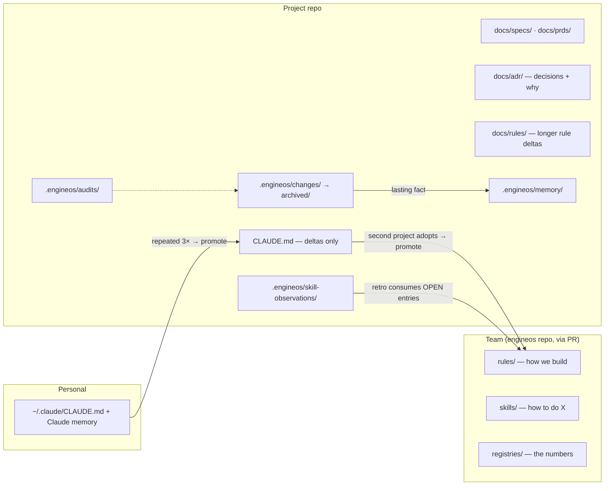
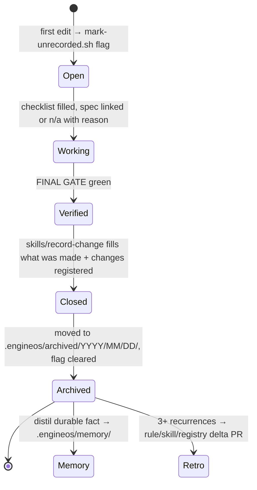

# EngineOS — Big Picture & Flowcharts

One-page map of how EngineOS is put together and how a request travels through
it. Consult this when you need to answer "what fires when, and who decides".
Every box names the file that owns it; the file is the source of truth, this
page is the map.

> New to the day-to-day? Read [`START.md`](START.md). Installing? [`ADOPTION.md`](ADOPTION.md).
> Why it is shaped this way? [`METHODOLOGY.md`](METHODOLOGY.md).

---

## 1. The system in one picture

Six layers. Prose at the top decides *what* should happen; data in the middle
makes it deterministic; hooks and scripts at the bottom enforce it at runtime.

**Reading the picture.** A rule says *"cap concurrency at ~6"*; the number lives
in `registries/policy.json`; `kernel.sh admit` reads it; `rules/parallelism.md`
tells the orchestrator to ask the kernel before dispatching. Prose, data,
decision, enforcement — one fact, four homes, one owner each.
`scripts/validate-engineos.sh` keeps the prose and the data from drifting apart.

---

## 2. Request lifecycle — the main flowchart

What happens between "you type a request" and "done".

> Prefer to watch it? [`BIG-PICTURE-lifecycle.html`](BIG-PICTURE-lifecycle.html) walks a
> worked example (CSV export of invoices) through every actor: hooks, kernel, router,
> coordinators, reviewer, writers, with the technique behind each step.

```mermaid
flowchart TD
    U([You type a request]) --> UPS

    subgraph UPS["UserPromptSubmit"]
        PA["hooks/prompt-advisor.sh"] --> RT["kernel.sh resolve-task"]
        RT --> TC["task contract injected:<br/>intents · policy rules · skills · agents<br/>risk floor · autonomy ceiling · gates · hitl"]
    end

    TC --> BYP{bypass active?}
    BYP -->|yes| BYPASSED["reply opens '[engineos] bypassed'<br/>no router, no agents, no gates"]
    BYPASSED --> WORK

    BYP -->|no| Q{pure question<br/>or explanation?}
    Q -->|yes| ANSWER([answer directly, no routing])
    Q -->|no| ROUTER["[router] line:<br/>intent · risk · autonomy · loaded · agent"]

    ROUTER --> RISK["classify risk BEFORE first write<br/>rules/risk-autonomy.md"]
    RISK --> ESC{kernel says<br/>escalate=true?}
    ESC -->|yes| RA["router agent → dispatch plan<br/>(never edits, never dispatches)"]
    ESC -->|no| TOPO
    RA --> TOPO

    TOPO{"more than one agent?<br/>(agent-system intent or<br/>rule-multi-agent-design)"}
    TOPO -->|yes| FORM["/engineos:design-agents<br/>llm-coordinator walks the 12-step form, one step at a time<br/>→ docs/specs/&lt;date&gt;-&lt;slug&gt;-agent-topology.md"]
    FORM --> APPROVE["developer approval line<br/>(hitl reason topology-approval)<br/>recorded in the change record"]
    TOPO -->|no| SPEC

    SPEC{"> 2 files or<br/>new feature?"}
    SPEC -->|yes| BRAIN["superpowers:brainstorming<br/>→ docs/specs/ design + plan"]
    SPEC -->|no| REC
    BRAIN --> REC["open change record<br/>.engineos/changes/&lt;date&gt;-&lt;slug&gt;.md"]
    APPROVE -->|approved — only then| REC

    REC --> FAN{"> 3 files, > 1 domain,<br/>or ≥ 3 independent tasks?"}
    FAN -->|yes| WAVES["freeze contracts → waves<br/>kernel.sh admit per dispatch<br/>rules/parallelism.md"]
    FAN -->|no| ONE["dispatch the agent the row names<br/>rules/subagents.md"]
    WAVES --> WORK
    ONE --> WORK

    subgraph WORK["Work — every edit passes through hooks"]
        direction TB
        PRE["PreToolUse Edit|Write<br/>route-before-change.sh → kernel route-path<br/>injects domain rules / specialist"]
        EDIT["edit lands"]
        POST["PostToolUse Edit|Write<br/>mark-unrecorded.sh sets the flag"]
        PRE --> EDIT --> POST
        AD["PreToolUse Agent|Task<br/>announce-agent-dispatch.sh (green banner)"]
        AR["PostToolUse Agent|Task<br/>announce-agent-return.sh (status, span)"]
        AD --> AR
        BASH["PreToolUse Bash<br/>git-write-guard.sh → git/forge write?<br/>permission prompt under ENGINEOS_GIT_WRITES=ask<br/>read-only git silent · survives bypass"]
    end

    WORK --> INT["integrate at wave barrier<br/>handoff per templates/handoff.md"]
    INT --> GATE["FINAL GATE — once, at the end<br/>Node: lint and typecheck · Python: ruff and pyright<br/>tests only if ON — rules/verification.md"]
    GATE -->|red| FIX["bounded fix loop<br/>kernel.sh repair: 2 attempts, 1 escalation"]
    FIX -->|still red| RED([report red honestly])
    FIX -->|green| RECORD
    GATE -->|green| RECORD["skills/record-change<br/>fill 'what was made', move to .engineos/archived/"]

    RECORD --> STOP

    subgraph STOP["Stop hooks"]
        SV["stop-verify.sh<br/>code changed but gate not run? → block once<br/>Python: .venv → uv → compose, skips loudly when none"]
        RV["record-verify.sh<br/>code changed but not recorded? → block once"]
    end

    STOP -->|blocked| GATE
    STOP -->|pass| OFFER["offer the output artifact<br/>(CLAUDE.md · Output artifact)"]
    OFFER --> DONE([done])
```

Key properties the flow encodes:

- **Classification precedes writing.** The `[router]` line and the risk tier come
  before the first edit, never after.
- **Verification happens once.** No per-edit test runs; the final gate is the
  single verification point, and the Stop hooks only check that it ran.
- **Every change leaves a record.** `mark-unrecorded.sh` raises a flag on the first
  edit; `record-verify.sh` refuses "done" until `record-change` clears it.
- **Bypass is loud.** When `/engineos:bypass` is on, the reply says so and the
  whole middle of the diagram is skipped — except `git-write-guard.sh`, which is
  the developer's own setting, not the constitution's.
- **Topology before graph code.** A request for more than one agent goes through
  `/engineos:design-agents` first; implementation starts only after the developer's
  approval line (`topology-approval`) is in the change record, and
  `langgraph-patterns` loads after that, never to choose for you.

---

## 3. Hook event map

Which script fires on which harness event, and what it may do.

| Event | Matcher | Hook | Effect | Runtime |
|---|---|---|---|---|
| `SessionStart` | all | `ensure-project-layout.sh` | Scaffolds `.engineos/{changes,archived,memory}` + `docs/{specs,prds,rules}` when the project opted in (`.engineos/` present or `ENGINEOS_SCAFFOLD=1`); prints one `[engineos] stack: <framework>@<dir> · … · runners: …` line from `kernel.sh resolve-stack`. In a greenfield repo (no `.engineos/config.json`, no package manifest within depth 3; also outside git, never in `$HOME`) it prints the `[engineos] no stack declared` note instead, so the first reply asks the developer for the stack Non-blocking | node |
| `UserPromptSubmit` | all | `prompt-advisor.sh` | Calls `kernel.sh resolve-task`, injects one task contract; writes a `router` span; appends the `no stack declared` note on stack-dependent intents in a greenfield repo; announces `BYPASS ACTIVE` when bypassed | node |
| `PreToolUse` | `Edit\|Write\|NotebookEdit` | `route-before-change.sh` | `kernel.sh route-path` on the file → injects the domain's rules/skill/agent (precedence: security → test → backend → dba → backend-python → ios-release → android-release → devops → mobile → frontend → llm) | node |
| `PreToolUse` | `Agent\|Task` | `announce-agent-dispatch.sh` | Re-injects the green `[agent] … \| model \| mode \| scope` banner | node |
| `PreToolUse` | `Bash` | `git-write-guard.sh` | Turns a git or forge **write** (`add`, `commit`, `push`, `checkout`, `gh pr create`, …) into a permission prompt tagged `[engineos] git write: <command>` while `ENGINEOS_GIT_WRITES` is `ask` (the default); read-only git is silent; never denies. Bypass does NOT silence it | node |
| `PostToolUse` | `Edit\|Write\|NotebookEdit` | `mark-unrecorded.sh` | Sets the unrecorded-change flag in the git dir | node |
| `PostToolUse` | `Agent\|Task` | `announce-agent-return.sh` | Green `-> done / FAILED` line; writes an `agent` span with duration + status floor | node |
| `Stop` | all | `stop-verify.sh` | Blocks once if code changed and the scoped gate did not run — Node: lint+typecheck; Python: ruff+pyright through `.venv` → `uv` → the `compose_service` in `.engineos/config.json`, skipped loudly when none exists; tests join only when ON (`ENGINEOS_VERIFY_TESTS=1` or in scope); `ENGINEOS_VERIFY_BUDGET_S` raises the per-target timeout | node |
| `Stop` | all | `record-verify.sh` | Blocks once if code changed and no change record was closed | node |
| not wired | — | `post-edit-check.sh` | Per-edit typecheck+lint, retired from default wiring; opt-in only | node |

Every hook is a shim that `exec`s `dist/engineos.cjs`, so all of them need node
>= 18 on the hook PATH and none of them needs `jq` any more. If you never see
`[router]` context on edits, check which node the hook PATH resolves to before
suspecting the routing.

---

## 4. Risk → autonomy → gates

Every other ceremony is proportional to the risk tier. Classify first, then the
tier decides how far you may go alone and which gates apply.

Gate ladder (`rules/gates.md`): **Discovery → Design → Implementation →
Validation → Release**. The Stop hooks are the Validation gate. They know nothing
about owners or rollback, so a green Stop is never the Release gate.

---

## 5. Kernel — who asks what

`scripts/kernel.sh` is the only place policy numbers become decisions. Callers
never read `policy.json` themselves.

| Question | Command | Answer vocabulary |
|---|---|---|
| What does this prompt need? | `resolve-task` | intents, rules, skills, agents, risk floor, autonomy ceiling, gates, `hitl` |
| Which domain owns this file? | `route-path` | one domain (first match in precedence) |
| Which stack does this repo run? | `resolve-stack [dir]` | `packages[]` (dir, language, framework, compose_service, python_env) + `source` = `config` (`.engineos/config.json`) or `detected` |
| Can I dispatch another agent? | `admit --inflight N --queued M` | `dispatch` / `defer` / `reject` |
| Should I keep calling this resource? | `breaker --state S --failures N` | `closed` / `open` / `half-open` |
| Fix loop on a red check? | `repair --check C --attempt N` | 2 attempts, 1 tier escalation, then red |
| Does a human have to decide? | `hitl --risk T --autonomy A …` | `required` + reason ids |

---

## 6. Fan-out — waves, contracts, barriers

Parallel is the default past >3 files, >1 domain, or ≥3 independent tasks.

Hard rules: no two agents write the same file; sub-agents never spawn sub-agents
(flat graph); a failed unit blocks its wave's barrier; `BLOCKED` and `FAILED`
are real answers, never hidden by a green summary.

---

## 7. Agent roster by role

Model tiers (`rules/models.md`): spec/PRD → **most capable** (`fable`);
design, security, adversarial review → **design** (`opus`); code against a
spec → **build** (`opus`); mechanical → **cheap** (`haiku`). The tier is the
contract; the model name is today's binding.

---

## 8. Where knowledge lives

One home per fact. Duplication drifts.

---

## 9. Change-record lifecycle

---

## 10. Self-integrity — how EngineOS checks itself

| Check | Runs | Fails when |
|---|---|---|
| `scripts/validate-engineos.sh` | CI + manual | CLAUDE.md router table ≠ `routing.json`; `rules/models.md` ≠ `models.json`; a row's load list is not closed; a registry points at a missing agent/tier |
| `src/docs/prose-layer.e2e.test.ts` + `registries/docs-ledger.json` | `npm test` (CI + manual) | dangling rule/agent/skill pointer; orphaned agent; `commands/agents/` drift; single-source-of-truth budget exceeded |
| `src/**/*.e2e.test.ts` | `npm test` (CI + manual) | a hook, CLI or kernel contract regresses |
| `evals/` + `scripts/run-evals.sh` | manual / CI | routing or advisor output drifts from the golden set |
| `scripts/exec-journal.sh validate` | manual | a telemetry span breaks the line format or slug class |

Public surface (rule paths, agent names, aliases, commands, hook contracts,
return envelope) is versioned per [`COMPATIBILITY.md`](COMPATIBILITY.md): a
rename is a deprecation with a window, never a silent move.

---

## Glossary — the ten words that carry the system

| Word | Means |
|---|---|
| **Router** | The intent table in `CLAUDE.md` + `kernel.sh resolve-task`; decides what to load and who to dispatch |
| **Task contract** | The one block `prompt-advisor.sh` injects per prompt: intents, rules, agents, risk floor, gates |
| **Risk tier** | low / medium / high, classified before the first write; everything else is proportional to it |
| **Autonomy ceiling** | A0–A4; how far you may go without a human, given the tier |
| **Gate** | Discovery / Design / Implementation / Validation / Release, with its mechanism and honest strength |
| **Final gate** | Lint and typecheck run once at the end (tests only when ON); the Validation gate |
| **Change record** | `.engineos/changes/<date>-<slug>.md`; opened on first edit, closed by `record-change`, archived |
| **Wave** | One message of parallel agents over disjoint file scopes, ended by a barrier |
| **Kernel** | `scripts/kernel.sh`; turns registry data into decisions so no caller reads policy directly |
| **Bypass** | `/engineos:bypass`; turns every guardrail off, loudly, until the next session or toggled back |
