# EngineOS — Big Picture & Flowcharts

One-page map of how EngineOS is put together and how a request travels through
it. Consult this when you need to answer "what fires when, and who decides".
Every box names the file that owns it; the file is the source of truth, this
page is the map.

> New to the day-to-day? Read [`START.md`](START.md). Installing? [`ADOPTION.md`](ADOPTION.md).
> Why it is shaped this way? [`METHODOLOGY.md`](METHODOLOGY.md).

## 1. The system in one picture

`CLAUDE.md` routes requests; `rules/` owns behavior; `registries/` owns policy
values; the TypeScript kernel resolves them; Claude Code hooks inject context and
block supported gates; scoped agents/skills execute; project records preserve evidence.

`dist/engineos.cjs` is the committed runtime. `hooks/hooks.json` invokes Node
handlers directly; shell entrypoints are compatibility shims. Node >= 18 is
required. Application backends use NestJS, UIs Next.js/React, LLMs Mastra within
NestJS providers. Python/LangGraph public paths remain deprecated compatibility.

| Layer | Home |
|---|---|
| Constitution and task loads | `CLAUDE.md`, `rules/`, `skills/`, `commands/` |
| Routes, tiers, gates, repair, admission, HITL | `registries/{intents,routing,models,policy,decision-rules}.json` |
| Roster and workflow bindings | `registries/{agents,capabilities}.json` |
| Deterministic decisions | `scripts/kernel.sh` → `src/kernel/` |
| Harness integration | `hooks/hooks.json` → `src/hooks/` |
| Evidence | `.engineos/`, `docs/`, `.git/engineos-telemetry/` |

## 2. Request lifecycle — the main flowchart

Read this section for request sequencing; the remaining sections are optional lookups.

```mermaid
flowchart TD
    U([You type a request]) --> UPS

    subgraph UPS["UserPromptSubmit"]
        PA["hooks/prompt-advisor.sh"] --> RT["kernel.sh resolve-task<br/>keyword floor + stack rebind"]
        RT --> DL{"decision layer<br/>ENGINEOS_ROUTER + repo router.mode<br/>(more restrictive wins)"}
        DL -->|keyword| KW["keep the keyword floor's intents"]
        DL -->|llm| LLM["keep the floor's intents<br/>generic-only or no match: escalate"]
        DL -->|jev| JEV["TypeSafe Jev chooses<br/>among stack-allowed intents"]
        JEV -.->|"no key / timeout / bad answer"| FB["fallback to llm, announced:<br/>'[engineos] router: llm (jev unavailable)'"]
        KW --> TC
        LLM --> TC
        JEV --> TC
        FB --> TC
        TC["task contract injected:<br/>intents · policy rules · skills · agents<br/>risk floor · autonomy ceiling · gates · hitl<br/>router=mode/confidence"]
    end

    TC --> BYP{bypass active?}
    BYP -->|yes| BYPASSED["reply opens '[engineos] bypassed'<br/>no router, no agents, no gates"]
    BYPASSED --> WORK

    BYP -->|no| Q{pure question<br/>or explanation?}
    Q -->|yes| ANSWER([answer directly, no routing])
    Q -->|no| ROUTER["[router] line:<br/>intent · risk · autonomy · loaded · agent"]

    ROUTER --> RISK["classify risk BEFORE first write<br/>rules/risk-autonomy.md"]
    RISK --> ESC{"kernel says escalate=true,<br/>or router could not decide?"}
    ESC -->|yes| RA["router agent → dispatch plan<br/>(never edits, never dispatches)"]
    ESC -->|no| TOPO
    RA --> TOPO

    TOPO{"more than one agent?<br/>(agent-system intent or<br/>rule-multi-agent-design)"}
    TOPO -->|yes| FORM["/engineos:design-agents<br/>llm-coordinator walks the 12-step form, one step at a time<br/>→ docs/specs/&lt;date&gt;-&lt;slug&gt;-agent-topology.md"]
    FORM --> APPROVE["developer approval line<br/>(hitl reason topology-approval)<br/>recorded in the change record"]
    TOPO -->|no| SPEC

    SPEC{"> 2 files or<br/>new feature?"}
    SPEC -->|yes| BRAIN["superpowers:brainstorming<br/>→ docs/specs/ design + plan"]
    SPEC -->|no| REC
    BRAIN --> REC["open change record<br/>.engineos/changes/&lt;date&gt;-&lt;slug&gt;.md"]
    APPROVE -->|approved — only then| REC

    REC --> FAN{"> 3 files, > 1 domain,<br/>or ≥ 3 independent tasks?"}
    FAN -->|yes| WAVES["freeze contracts → waves<br/>kernel.sh admit per dispatch<br/>rules/parallelism.md"]
    FAN -->|no| ONE["dispatch the agent the row names<br/>rules/subagents.md"]
    WAVES --> WORK
    ONE --> WORK

    subgraph WORK["Work — every edit passes through hooks"]
        direction TB
        PRE["PreToolUse Edit|Write<br/>route-before-change.sh → kernel route-path<br/>injects domain rules / specialist"]
        EDIT["edit lands"]
        POST["PostToolUse Edit|Write<br/>mark-unrecorded.sh sets the flag"]
        PRE --> EDIT --> POST
        AD["PreToolUse Agent|Task<br/>announce-agent-dispatch.sh (green banner)"]
        AR["PostToolUse Agent|Task<br/>announce-agent-return.sh (status, span)"]
        AD --> AR
        BASH["PreToolUse Bash<br/>git-write-guard.sh → git/forge write?<br/>permission prompt under ENGINEOS_GIT_WRITES=ask<br/>read-only git silent · survives bypass"]
    end

    WORK --> INT["integrate at wave barrier<br/>handoff per templates/handoff.md"]
    INT --> GATE["FINAL GATE — once, at the end<br/>Node: lint and typecheck · Python: ruff and pyright<br/>tests only if ON — rules/verification.md"]
    GATE -->|red| FIX["bounded fix loop<br/>kernel.sh repair: 2 attempts, 1 escalation"]
    FIX -->|still red| RED([report red honestly])
    FIX -->|green| RECORD
    GATE -->|green| RECORD["skills/record-change<br/>fill 'what was made', move to .engineos/archived/"]

    RECORD --> STOP

    subgraph STOP["Stop hooks"]
        SV["stop-verify.sh<br/>code changed but gate not run? → block once<br/>Python: .venv → uv → compose, skips loudly when none"]
        RV["record-verify.sh<br/>code changed but not recorded? → block once"]
    end

    STOP -->|blocked| GATE
    STOP -->|pass| OFFER["offer the output artifact<br/>(CLAUDE.md · Output artifact)"]
    OFFER --> DONE([done])
```

New features use `/engineos:new-feature`: PRD + ADR + SPEC + TASKS before code.
Topology approval applies to a project's multi-agent system, not the delivery
workers or a single Mastra chatbot. Keep related work on the current branch/PR;
only user direction changes it. No routine reviewer/test chain during building;
risk-required independent/security reviews remain.

- **Classification precedes writing.** The `[router]` line and the risk tier come
  before the first edit, never after.
- **Verification happens once.** No per-edit test runs; the final gate is the
  single verification point, and the Stop hooks only check that it ran.
- **Every change leaves a record.** `mark-unrecorded.sh` raises a flag on the first
  edit; `record-verify.sh` refuses "done" until `record-change` clears it.
- **Bypass is loud.** When `/engineos:bypass` is on, the reply says so and the
  whole middle of the diagram is skipped — except `git-write-guard.sh`, which is
  the developer's own setting, not the constitution's.
- **The decision layer only chooses.** Inside `UserPromptSubmit` a setting, never a
  model, picks `keyword`, `llm` or `jev`; whichever runs may only choose among the
  intents the repository's stack allows, any failure falls back to `llm` on a
  visible line (never silently to the keyword floor, which runs only when a setting
  names it), and an undecided prompt goes to the `router` agent before any write.
  Rules, risk and gates stay with the kernel.
- **Topology before graph code.** A request for more than one agent goes through
  `/engineos:design-agents` first; implementation starts only after the developer's
  approval line (`topology-approval`) is in the change record, and
  `langgraph-patterns` loads after that, never to choose for you.

---

Stop hooks verify and record under Claude Code. Codex has no hooks: follow
`templates/adapters/codex.md`. The older worked-example visualization remains
at [BIG-PICTURE-lifecycle.html](BIG-PICTURE-lifecycle.html); current rules own policy.

---

## 3. Hook event map

| Event | Matcher | Hook | Effect |
|---|---|---|---|
| `SessionStart` | all | `ensure-project-layout` | Opt-in scaffold, stack hint/question, expire repo bypass |
| `UserPromptSubmit` | all | `prompt-advisor` | Unified task contract; announce bypass |
| `PreToolUse` | `Edit\|Write\|NotebookEdit` | `route-before-change` | Highest-precedence path route, never blocks |
| `PreToolUse` | `Agent\|Task` | `announce-agent-dispatch` | Dispatch banner and span |
| `PreToolUse` | `Bash` | `git-write-guard` | Git/forge write approval under `ask`; survives bypass |
| `PostToolUse` | `Edit\|Write\|NotebookEdit` | `mark-unrecorded` | Unrecorded-change flag |
| `PostToolUse` | `Agent\|Task` | `announce-agent-return` | Return banner and span |
| `Stop` | all | `stop-verify` | Scoped JS/TS lint + typecheck; tests never automatic |
| `Stop` | all | `record-verify` | Block unrecorded completion |
| unwired | — | `post-edit-check` | Retained opt-in per-edit checking; retired default |

| Event | Matcher | Hook | Effect | Runtime |
|---|---|---|---|---|
| `SessionStart` | all | `ensure-project-layout.sh` | Scaffolds `.engineos/{changes,archived,memory}` + `docs/{specs,prds,rules}` when the project opted in (`.engineos/` present or `ENGINEOS_SCAFFOLD=1`); prints one `[engineos] stack: <framework>@<dir> · … · runners: …` line from `kernel.sh resolve-stack`. Non-blocking | node |
| `UserPromptSubmit` | all | `prompt-advisor.sh` | Calls `kernel.sh resolve-task`, then the decision layer (`keyword`, `llm` or `jev`, chosen by `ENGINEOS_ROUTER` and the repo's `router.mode`; any failure falls back to keyword with a visible `[engineos] router: keyword (…)` line); injects one task contract carrying `router=<mode>[/<confidence>]`; writes a `router` span; announces `BYPASS ACTIVE` when bypassed | node |
| `PreToolUse` | `Edit\|Write\|NotebookEdit` | `route-before-change.sh` | `kernel.sh route-path` on the file → injects the domain's rules/skill/agent (precedence: security → test → backend → dba → backend-python → ios-release → android-release → devops → mobile → frontend → llm) | node |
| `PreToolUse` | `Agent\|Task` | `announce-agent-dispatch.sh` | Re-injects the green `[agent] … \| model \| mode \| scope` banner | node |
| `PreToolUse` | `Bash` | `git-write-guard.sh` | Turns a git or forge **write** (`add`, `commit`, `push`, `checkout`, `gh pr create`, …) into a permission prompt tagged `[engineos] git write: <command>` while `ENGINEOS_GIT_WRITES` is `ask` (the default); read-only git is silent; never denies. Bypass does NOT silence it | node |
| `PostToolUse` | `Edit\|Write\|NotebookEdit` | `mark-unrecorded.sh` | Sets the unrecorded-change flag in the git dir | node |
| `PostToolUse` | `Agent\|Task` | `announce-agent-return.sh` | Green `-> done / FAILED` line; writes an `agent` span with duration + status floor | node |
| `Stop` | all | `stop-verify.sh` | Blocks once if code changed and the scoped gate did not run — Node: lint+typecheck; Python: ruff+pyright through `.venv` → `uv` → the `compose_service` in `.engineos/config.json`, skipped loudly when none exists; tests join only when ON (`ENGINEOS_VERIFY_TESTS=1` or in scope); `ENGINEOS_VERIFY_BUDGET_S` raises the per-target timeout | node |
| `Stop` | all | `record-verify.sh` | Blocks once if code changed and no change record was closed | node |
| not wired | — | `post-edit-check.sh` | Per-edit typecheck+lint, retired from default wiring; opt-in only | node |

Every hook is a shim that `exec`s `dist/engineos.cjs`, so all of them need node
>= 18 on the hook PATH and none of them needs `jq` any more. If you never see
`[router]` context on edits, check which node the hook PATH resolves to before
suspecting the routing.

---

`ENGINEOS_VERIFY_TESTS` is deprecated: final tests require explicit current-task
approval. `ENGINEOS_VERIFY_BUDGET_S` bounds target execution time. Routing
precedence belongs to `registries/routing.json`, not this overview.

---

## 4. Risk → autonomy → gates

Take the highest risk across reversibility, blast radius, data sensitivity,
contract surface and spend. Shortcut floors include destructive DDL/DML,
secrets/auth, production deploy, payments and acting for someone else.

| Tier | Ceiling and gates |
|---|---|
| low | ≤A2; Implementation + Validation; change record |
| medium | ≤A3; Design at spec threshold; human gate before external effect; Release when shipping |
| high | ≤A3, A1 with thin evidence; Discovery + Design + Validation + independent critic; Release + human approval; security review for security surface |

`rules/risk-autonomy.md` and `rules/gates.md` own these mappings. The ladder is
Discovery → Design → Implementation → Validation → Release. Green Stop proves
Validation, not Release. HITL has 9 closed reasons in `policy.json`:
high-risk, evidence-insufficient, external-effect, policy-conflict,
never-retry-situation, destructive-action, budget-exhausted, breaker-open,
topology-approval. Record required decisions under `## Human decisions`.

## 5. Kernel — who asks what

`scripts/kernel.sh` is the only place policy numbers become decisions. Callers
never read `policy.json` themselves.

| Question | Command | Answer vocabulary |
|---|---|---|
| What does this prompt need? | `resolve-task` | intents, rules, skills, agents, risk floor, autonomy ceiling, gates, `hitl` |
| Which domain owns this file? | `route-path` | one domain (first match in precedence) |
| Which stack does this repo run? | `resolve-stack [dir]` | `packages[]` (dir, language, framework, compose_service, python_env) + `source` = `config` (`.engineos/config.json`) or `detected` |
| Can I dispatch another agent? | `admit --inflight N --queued M` | `dispatch` / `defer` / `reject` |
| Should I keep calling this resource? | `breaker --state S --failures N` | `closed` / `open` / `half-open` |
| Fix loop on a red check? | `repair --check C --attempt N` | 2 attempts, 1 tier escalation, then red |
| Does a human have to decide? | `hitl --risk T --autonomy A …` | `required` + reason ids |

## 6. Fan-out — waves, contracts, barriers

One top-level supervisor freezes shared contracts and records branch/PR identity.
Workers own disjoint files, make no git/forge writes, and never spawn workers.
Maintain prerequisite ids and contract revisions in the task ledger. Dispatch
ready units together up to min(policy cap, available host worker slots), reserving
the supervisor slot; refill on returns. One owner holds shared generated output.

Integrate scoped returns read-only before releasing dependents. Failed units
block their dependents, not unrelated work. Contract drift pauses only affected
consumers, routed through the single owner. No intermediate builds/tests; final
non-test validation runs after integration, tests/evals only after final consent.

`kernel.sh admit`: dispatch/defer/reject; queue bound 12. `reject` requires a
human budget-exhausted decision. Per-unit failure policy: retry once same tier,
escalate once, then stop and report incomplete. Resource breaker: 3 consecutive
failures → open, 1 cooldown wave, 1 half-open probe. Never retry security risk,
possible data loss, unclear irreversible gates, or unresolved ambiguity.
`rules/parallelism.md` owns the complete policy.

## 7. Agent roster by role

Use `registries/agents.json` for canonical names/aliases and `agents/<name>.md`
for the executor contract. The 22 roles comprise 6 coordinators, 5 MCP leaves,
2 store builders, 4 reviewers/planners, and 5 standalone writers/analysts.

Coordinators: backend, frontend, mobile, DBA, DevOps and LLM (AUDIT read-only,
IMPLEMENT scoped writes). MCP leaves: Postgres, Oracle, Kubernetes, GCP and CI.
Review lenses: `critic` (vera) for required independent correctness;
`security-reviewer` (leo-ely) for security; `audit-consolidator` merges reports.
`router` returns plans only. Store submission requires explicit instruction.
Test/QA agents work only in an approved final test scope.

Model tiers are resolved from `rules/models.md` and `registries/models.json`:
most-capable (spec/PRD), design (architecture/security/adversarial review), build
(implementation), cheap (mechanical). Bindings are configuration, not role names.

## 8. Where knowledge lives

| Knowledge | Home |
|---|---|
| Team behavior/procedures/policy values | `rules/`, `skills/`, `registries/` via repo PR |
| Project deltas | project `CLAUDE.md`; longer deltas in `docs/rules/` |
| Plans and decisions | `docs/{specs,prds,adr}/` |
| Task evidence → durable facts | `.engineos/changes/` → `archived/` → `memory/` |
| Friction/audit evidence | `.engineos/{skill-observations,audits}/` |
| Personal preferences | personal `~/.claude/CLAUDE.md` and memory |

Load only relevant sections. Search dated evidence on demand; do not import all
history into each task. Repeated observations (3+) can propose policy changes;
a second project needing a project delta can justify team promotion.

## 9. Change-record lifecycle

Open → scope/checklist/spec link → work → final validation → record what was
made/files/movements/evidence → close → archive under
`.engineos/archived/YYYY/MM/<domain>/`; clear the unrecorded flag. Distil durable
facts into memory; use repeated records for retro proposals. Git moves follow
`rules/git.md`. Unapproved tests remain explicitly pending, never reported passed.

## 10. Self-integrity — how EngineOS checks itself

| Check | Runs | Fails when |
|---|---|---|
| `scripts/validate-engineos.sh` | approved final CI/manual | CLAUDE.md router table ≠ `routing.json`; `rules/models.md` ≠ `models.json`; a row's load list is not closed; a registry points at a missing agent/tier |
| `src/docs/prose-layer.e2e.test.ts` + `registries/docs-ledger.json` | approved final `npm test` | dangling rule/agent/skill pointer; orphaned agent; `commands/agents/` drift; single-source-of-truth budget exceeded |
| `src/**/*.e2e.test.ts` | `npm test` (CI + manual) | a hook, CLI or kernel contract regresses |
| `evals/` + `scripts/run-evals.sh` | approved final manual/CI | routing or advisor output drifts from the golden set |
| `scripts/exec-journal.sh validate` | approved final manual | a telemetry span breaks the line format or slug class |

Public surface (rule paths, agent names, aliases, commands, hook contracts,
return envelope) is versioned per [`COMPATIBILITY.md`](COMPATIBILITY.md): a
rename is a deprecation with a window, never a silent move.

## Glossary — the ten words that carry the system

| Word | Means |
|---|---|
| **Router** | The intent table in `CLAUDE.md` + `kernel.sh resolve-task`; decides what to load and who to dispatch |
| **Task contract** | The one block `prompt-advisor.sh` injects per prompt: intents, rules, agents, risk floor, gates |
| **Risk tier** | low / medium / high, classified before the first write; everything else is proportional to it |
| **Autonomy ceiling** | A0–A4; how far you may go without a human, given the tier |
| **Gate** | Discovery / Design / Implementation / Validation / Release, with its mechanism and honest strength |
| **Final gate** | Final scoped non-test checks; approved tests/evals separate; the Validation gate |
| **Change record** | `.engineos/changes/<date>-<slug>.md`; opened on first edit, closed by `record-change`, archived |
| **Wave** | A dependency group; unrelated work has no whole-wave barrier |
| **Kernel** | `scripts/kernel.sh`; turns registry data into decisions so no caller reads policy directly |
| **Bypass** | `/engineos:bypass`; turns every guardrail off, loudly, until the next session or toggled back |
