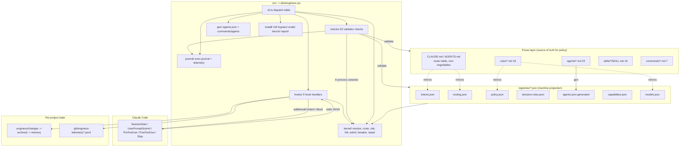
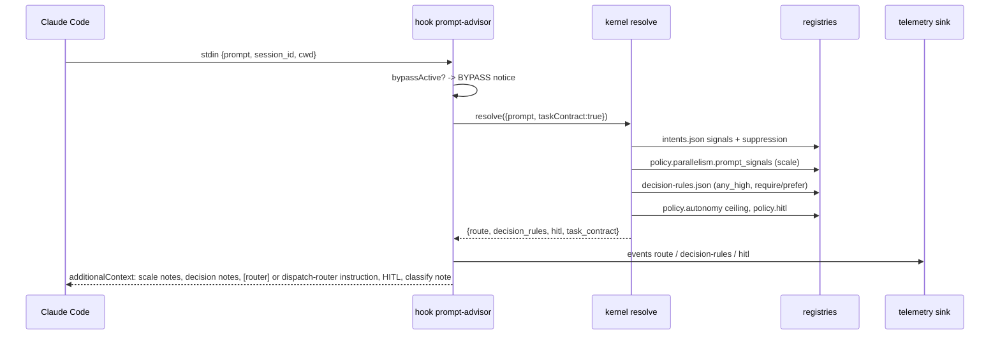
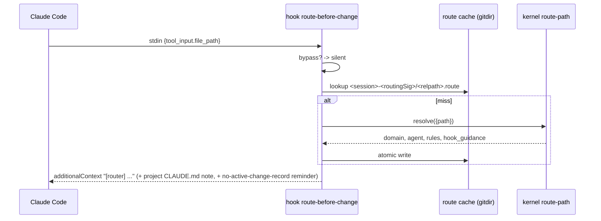
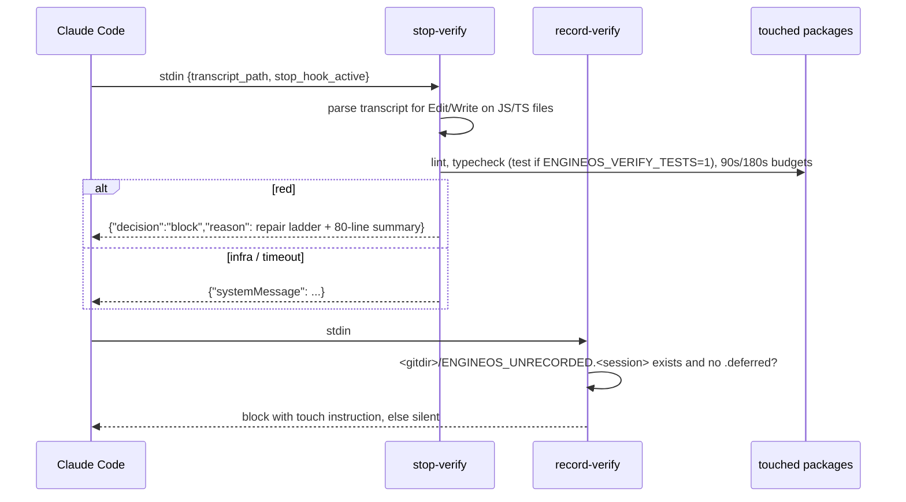
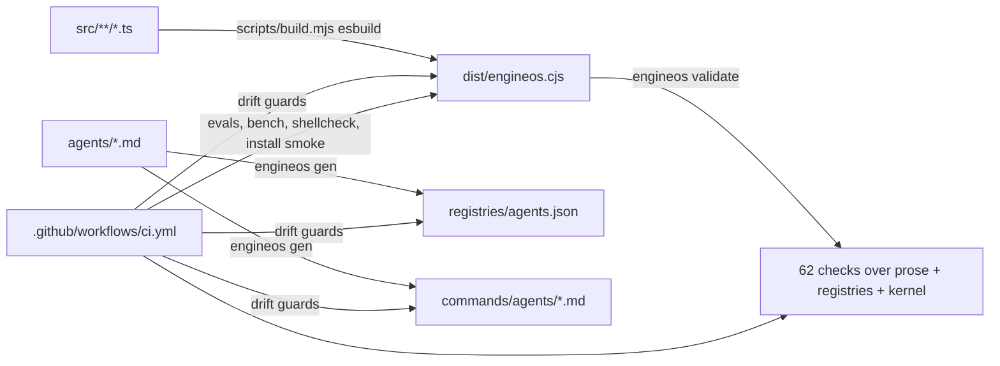

# Codebase Map

> Auto-generated by Cartographer. Last mapped: 2026-09-08T12:29:03Z

EngineOS is an "engineering constitution" for Claude Code (and, degraded, for
Codex / Cursor / Copilot): a prose layer of rules, agents and skills; a
machine-readable projection of that prose in `registries/*.json`; a
deterministic TypeScript kernel that turns a prompt or a file path into a
task contract; and a set of Claude Code hooks that inject that contract into
the session and gate the Stop event. A validator (62 checks) keeps prose and
registries from drifting.

Two release lines matter for reading the code: 1.6.0 added the runtime
governance blocks (admit / breaker / hitl / repair); 1.7.0 replaced the bash +
jq runtime with one committed Node bundle, `dist/engineos.cjs`. Every
`hooks/*.sh` and `scripts/*.sh` left in the tree is a compatibility shim that
`exec`s that bundle.

## System Overview



## Directory Structure

```
engineos/
  CLAUDE.md              Claude Code constitution + router table (hub of the prose layer)
  AGENTS.md              Same constitution for Codex; front-loads 11 always-on rules (no hooks there)
  CONTEXT.md             Vocabulary glossary for EngineOS itself (Task, Route, Gate, Span ...)
  README.md              Install (script vs plugin), what's inside, change lifecycle
  install.sh / install.ps1   Machine install: symlinks into ~/.claude, settings-merge, secrets gate
  package.json / tsconfig.json / scripts/build.mjs   esbuild -> dist/engineos.cjs (committed)
  dist/engineos.cjs      The runtime. Never edit; CI fails on drift from src/
  rules/                 19 policy files; 11 always-on, 8 routed per intent
  agents/                22 agent definitions (frontmatter: name, tools, model, tier)
  skills/                10 SKILL.md procedures (adr, record-change, retro, eval-harness ...)
  commands/              7 orchestrator commands + commands/agents/ (41 generated aliases)
  templates/             handoff, project CLAUDE.md, permissions/mcp JSON, adapters, GitHub workflows
  patterns/              architecture-analyst prompts (ANALYZE / INTERVIEW)
  registries/            9 JSON registries (intents, routing, policy, decision-rules, agents, ...)
  hooks/                 hooks.json (plugin wiring) + 10 .sh shims + 2 sourced bash libs
  scripts/               .sh shims over dist/engineos.cjs; build.mjs
  src/                   TypeScript runtime (see Module Guide)
  test/fixtures/         Pinned legacy bash CLIs + registries for byte-parity tests
  evals/                 Golden set (33 intent cases, 16 agent cases) + RUBRIC.md
  docs/                  BIG-PICTURE, METHODOLOGY, COMPATIBILITY, ADOPTION, START, adr/, specs/, release-notes/
  console/               Standalone Next.js 15 admin console (skills vertical only; not in CI)
  .engineos/             This repo's own governance store (21 active, 90 archived change records)
  .claude-plugin/        plugin.json + marketplace.json (plugin-mode install)
  .agents/ .trae/ .windsurf/   Byte-identical vendored copies of an unrelated "caveman" skill set
  .cursor/rules/         2 hand-written Cursor mirrors (subagents, testing-opt-in)
  .superpowers/          Untracked plugin scratch (git info/exclude)
```

## Module Guide

### Prose layer: `CLAUDE.md`, `rules/`, `agents/`, `skills/`, `commands/`, `templates/`

**Purpose**: state policy in prose an LLM follows. Every enforcement claim points at a registry or hook rather than claiming self-enforcement.
**Entry point**: `CLAUDE.md` (router table: intent -> rules/skills -> agent; 11 non-negotiables; output-artifact protocol).

| File / dir | Purpose | Tokens |
|---|---|---|
| `CLAUDE.md` | Router + constitution; imports only base, security, git, context directly | 4.2k |
| `AGENTS.md` | Codex port; 11 always-on rules to compensate for no hooks | 4.3k |
| `rules/*.md` | 19 rules. Always-on: base, security, git, context, memory, parallelism, models, subagents, verification, risk-autonomy, gates. Routed: architecture, backend, frontend, data, llm-apps, observability, testing, production-backend-standards | 17.8k |
| `agents/*.md` | 22 agents; 21 opus, 1 fable (`product-spec`). Shared `## Return format` envelope with status OK/DEGRADED/CRITICAL/BLOCKED/FAILED | ~35k |
| `skills/*/SKILL.md` | 10 skills; each declares which rule it must not restate | ~20k |
| `commands/*.md` | audit, implement, route, bypass, init, analyze-architecture, talk-about-the-system | ~5k |
| `commands/agents/*.md` | 41 generated aliases; 6 hand-customized (marker removed) | 6.7k |
| `templates/` | handoff.md (headings pinned by intents.json), project-claude.md, permissions/mcp JSON, adapters (cursor/codex/copilot), GitHub review workflows | ~7k |

**Agent taxonomy**: 6 dual-mode coordinators (backend, frontend, mobile, dba, devops, llm) hold Edit/Write; 5 read-only MCP leaves (kubernetes, gcp, postgres, oracle, cicd) hold exactly one MCP server; 2 store builders (ios, android) with no alias; 4 reviewers (critic, security-reviewer, router, audit-consolidator); 5 standalone leaves (architecture-analyst, docs-writer, product-spec, test-writer, qa-tester).

**Exports**: the router table, the rule set, agent contracts.
**Dependencies**: none at runtime; consumed by the model.
**Dependents**: `src/gen` (agents.json + command aliases from agent frontmatter), `src/checks` (mirror rows assert prose names registry values), `src/docs/prose-layer.e2e.test.ts`.

### `registries/*.json`

**Purpose**: machine-readable projection of the prose. The kernel reads only these.

| Registry | Shape | Consumers |
|---|---|---|
| `intents.json` | intents[] with signals, rules, skills, agents, risk_floor, model_tier, suppressible/suppressed_by, required_sections (handoff, record-change archive contract) | kernel route-escalate, resolve-task; C16, C18d, C19, C21 |
| `routing.json` | domains[] with match/excluded globs, sample_path, agent, rules, skills; precedence chain; excluded.self_dirs | kernel route-path; route-before-change hook; mark-unrecorded; C6-C8, C14, C17 |
| `policy.json` | parallelism (wave cap, backpressure, prompt_signals), retry, repair, breaker, hitl, autonomy, risk, telemetry, exec_journal, router.escalate_when + fixtures | kernel admit/breaker/hitl/repair/risk; journal; hooks; C16, C20-C27 |
| `decision-rules.json` | rules[] with regex signals, require/prefer artifacts, gate, risk, priority | kernel decisions; prompt-advisor notes; C14 |
| `models.json` | tier -> model binding (fable / opus / haiku) | gen agent-registry, journal enums, C15, C31 |
| `agents.json` | GENERATED from agents/*.md frontmatter | announce-agent-return (model tier), C15, C18 |
| `capabilities.json` | capability id -> agent -> model_tier | telemetry span typing, C15, C18 |
| `layout-manifest.json` | dirs/seeds for `.engineos/` + `docs/` scaffold | scaffold.ts, hooks/layout-manifest.sh (literal copy) |
| `docs-ledger.json` | closure_exceptions, marker_budgets, external_skills, alias_exempt | prose-layer e2e test |

### `src/kernel/` + `src/registry/` + `src/lib/`

**Purpose**: the deterministic decision kernel. No model calls. Byte-parity with the retired `scripts/kernel.sh`, pinned by `test/fixtures/legacy-kernel/`.
**Entry point**: `src/kernel/cli.ts` (`engineos kernel <command>`), `resolve()` in `src/kernel/resolve.ts`.

| Command | Inputs | Reads | Output |
|---|---|---|---|
| `resolve` / `resolve-task` | `--prompt`, `--path`, `--facts`, `--task-contract` | intents, routing, policy, decision-rules | Answer envelope: route, decision_rules, hitl, task_contract |
| `route-path` | file path | routing.json (first match in precedence) | domain, agent, rules, hook_guidance |
| `route-escalate` | prompt | intents signals + suppression, policy.router | escalate, reasons, intents, agents, model_tier, risk_floor, scale |
| `risk` | five inputs | policy.risk | tier (max, never average) |
| `hitl` | `--risk --autonomy [--evidence thin] [--external-effect] [--situation]` | policy.hitl, policy.autonomy | required, reasons (closed 8-id vocabulary), autonomy_after, record_home |
| `admit` | `--inflight --queued` | policy.parallelism (wave cap reused as capacity) | dispatch / defer / reject |
| `breaker` | `--state --failures` | policy.breaker | closed / open / half-open + allow |
| `repair` | attempt, situation | policy.repair | continue / escalate / stop |

`src/registry/*` are typed, normalizing loaders (fail-closed on malformed JSON, coerce out-of-vocabulary fields to safe defaults). `src/lib/` holds `json.ts` (`isRecord`, `KernelError`), `deferrals.ts` (rule cross-reference closure), `git.ts`, `glob.ts`, `slug.ts` (`hookSlug` sanitizes, `hookPathSlug` also drops `.` and `/` so a slug is safe as a path component), `time.ts`.

**Gotcha**: `src/checks` deliberately reads several registries raw instead of through these loaders because the loaders coerce exactly the malformations the checks must report.

### `src/hooks/` + `hooks/`

**Purpose**: Claude Code integration. `hooks/hooks.json` calls `node dist/engineos.cjs hook <name>` directly; the `.sh` shims are for external callers only.
**Entry point**: `src/hooks/cli.ts` (`HOOKS` map of 9 handlers), `src/hooks/envelope.ts` (decode stdin), `src/hooks/output.ts` (the only module that writes stdout / picks exit code).

| Event | Matcher | Handler | Emits |
|---|---|---|---|
| SessionStart | `""` | `ensure-project-layout.ts` | expire repo bypass marker, reap stale flags/cache/telemetry, scaffold `.engineos/` (opt-in), context hint |
| UserPromptSubmit | `""` | `prompt-advisor.ts` | one in-process `resolve({taskContract:true})`; additionalContext with scale / decision-rule / route / HITL / classify notes; the only hook that speaks while bypassed |
| PreToolUse | `Edit\|Write\|NotebookEdit` | `route-before-change.ts` | `[router] ...` context from route-path; per-session file cache under `<gitdir>/engineos-route-cache`; never blocks |
| PreToolUse | `Agent\|Task` | `announce-agent-dispatch.ts` | green banner instruction; opens a span |
| PostToolUse | `Edit\|Write\|NotebookEdit` | `mark-unrecorded.ts` | silent; writes `<gitdir>/ENGINEOS_UNRECORDED.<session>` for code extensions |
| PostToolUse | `Agent\|Task` | `announce-agent-return.ts` | return banner; closes span, status from structural fields only |
| Stop (1) | `""` | `stop-verify.ts` | scoped lint + typecheck per touched package (tests only with `ENGINEOS_VERIFY_TESTS=1`); no-op in projects without `.engineos/`; `block` on genuine red, `message` on infra |
| Stop (2) | `""` | `record-verify.ts` | `block` while the unrecorded marker exists and no `.deferred` sibling |
| unwired | | `post-edit-check.ts` | registered in `HOOKS`, deliberately absent from hooks.json since 2026-08-08 |

Wire formats (`output.ts`): `context` -> `{"hookSpecificOutput":{"hookEventName","additionalContext"}}`; `block` -> `{"decision":"block","reason"}` with exit 0; `message` -> `{"systemMessage"}`; `fail` -> stderr + exit 2. A hook body that throws is caught and rendered silent.

**Bypass** (`src/hooks/bypass.ts`, `src/bypass/cli.ts`): any of `ENGINEOS_BYPASS=1`, `~/.claude/engineos.bypass`, `<gitdir>/ENGINEOS_BYPASS`. Only the repo marker auto-expires (next SessionStart).

**Node guard** (`src/node-guard.ts`, `src/cli.ts`): floor 18; re-execs a newer nvm/homebrew node when found; silent hooks (`route-before-change`, `mark-unrecorded`, `record-verify`, `prompt-advisor`) exit 0 with no output on old node, others print `[engineos] <hook> skipped`.

### `src/journal/` + telemetry

**Purpose**: two deliberately separate append-only JSONL logs.
- Exec journal (`exec-journal.ts`, `schema.ts`): 22-field span rows in `.git/engineos-telemetry/<session>.exec.jsonl`; `span_kind` router|coordinator|agent|tool|model|verification; slug guard `^[A-Za-z0-9@_./:-]+$` on every field but `note`; max value length 256 (reject, not truncate); errors as plain stderr text.
- Telemetry (`telemetry.ts`): kernel-decision events (route, decision-rules, hitl, verify) in `<session>.jsonl`, schema from `policy.json.telemetry`; errors as `{"error"}` on stdout; `jqCompact` reproduces `jq -c` byte for byte.

`src/hooks/telemetry.ts` + `span-writer.ts` are the hook-side sink (gate order: `ENGINEOS_TELEMETRY=0`, bypass, then project has `.engineos/`). Consumers today: `src/report/usage.ts` only.

### `src/checks/` + `src/validate/`

**Purpose**: the 62-check integrity harness behind `engineos validate` (`scripts/validate-engineos.sh`). Asserts the prose, registries, hooks and kernel agree.
**Entry point**: `src/validate/cli.ts::runValidate` -> `src/checks/index.ts::CHECKS`.

| Family | Checks | Asserts |
|---|---|---|
| rules | C1-C5b | node floor, always-on imports resolve, every `rules/X.md` reference resolves, load-list closure |
| registries | C6-C8, C14, C15, C15b | routing targets exist, registry coherence, capability/agent/tier joins |
| agents/skills | C9-C13, C31 | frontmatter, return format, alias commands, SKILL.md shape, tier vs models.json |
| decision registries | C16 | intents/policy/models well-formed, intent count equals CLAUDE.md table rows, metasyntax ban on signals |
| kernel | C17*, C18* | routing sample paths self-route (live kernel), router agent binding, suppression graph, prompt_signals compile |
| contracts | C19*, C21* | handoff template and archive contract triangles; walks every archived change record |
| runtime governance | C20-C26 | repair / telemetry / constitution / backpressure / breaker / hitl blocks, each with live in-process kernel canaries |
| runtime surface | C27-C30 | exec-journal round trips, span-writer wiring, adoption entrypoint, hook file modes |

Pattern: checks never shell out. They call `runKernel`, `runTelemetry`, `runJournal` in-process against a `memoryIo` rooted at the checkout under test. Findings are typed codes (declaration-merged `CheckCodes`), graded ok / fail / skip. `mirrors.ts` is a declarative table of ~30 "registry value must appear under doc anchor" rows; empty anchor body or empty registry list is a failure, never a vacuous pass.

### `src/gen/`, `src/install/`, `src/init/`, `src/evals/`, `src/bench/`, `src/report/`, `src/testing/`

| Module | Command | What it does |
|---|---|---|
| `gen/` | `engineos gen agent-registry \| agent-commands` | agents/*.md frontmatter -> `registries/agents.json`; one alias command per agent name/alias with a `@generated` marker (marker removed = hand-customized, preserved) |
| `install/` | `engineos settings-merge` | merges hooks.json + permissions template into `~/.claude/settings.json`; scrubs both old `.sh` and new node hook forms; atomic write, write-once `.engineos.bak` |
| `init/` | `engineos init` (`scripts/init-project.sh`, `/engineos:init`) | scaffold `.engineos/{changes,archived,memory}` + `docs/{specs,prds,rules}`; refuses inside the EngineOS checkout (exit 3) |
| `evals/` | `engineos evals` | deterministic tier (always; 7 checks over `evals/*.jsonl`, coverage floor 25) + live tier (`ENGINEOS_EVAL_LIVE=1`, grades `[router]` announcement) |
| `bench/` | `engineos bench` | five budgets: route-intent 250ms, resolve-task 500ms, prompt-advisor 600ms, route-before-change cache hit 150ms, always-on context 32000 bytes |
| `report/` | `engineos usage-report [days]` | mines `~/.claude/projects` transcripts + telemetry for skill/agent/intent hit rates (input to `retro`) |
| `testing/harness.ts` | test only | `tempRoot`, `fixtureRepo`, `relocatedRoot`, `runCli`, `runInProcess`; refuses paths inside the checkout; never bundled |

### `console/`

Standalone Next.js 15 + React 19 + Drizzle/better-sqlite3 admin console for editing this repo's own `skills/`, `agents/`, `rules/` through draft -> validate -> diff -> publish -> rollback. Only the Skills vertical is wired; refuses to publish on main. Not referenced by root `package.json` or CI. Does not read `.engineos/` or telemetry.

### `.engineos/` and `docs/`

- `.engineos/changes/` (active) -> `.engineos/archived/<YYYY>/<MM>/<domain>/` (done) -> `.engineos/memory/` (distilled facts; currently empty).
- `docs/BIG-PICTURE.md` and `docs/METHODOLOGY.md` are the living companion docs; `docs/COMPATIBILITY.md` is the public-surface contract every "do not change this string" comment cites; `docs/adr/` holds 7 ADRs, all from the 2026-09-03/04 governance epic; `docs/specs/` holds 39 design/plan/handoff docs, most without a status field.

## Data Flow

### Prompt to task contract (UserPromptSubmit)



### File edit to routing guidance (PreToolUse)



### Stop gate



The verification gate is a no-op in projects without `.engineos/` — the same opt-in signal telemetry and the scaffolder read.

### Build, generate, validate



## Conventions

- Prose is the source of truth for policy; registries are its projection; the validator keeps them equal. Edit the prose and the registry in the same PR, then run `scripts/validate-engineos.sh`.
- Generated surfaces: `dist/engineos.cjs`, `registries/agents.json`, `commands/agents/*.md` (marker-gated). CI fails on drift. Never hand-edit.
- Byte parity with the retired bash runtime is pinned by `test/fixtures/legacy-*` and the `*parity.test.ts` suites. Many "odd" behaviors (jq number formatting, code-point sort, `false` treated as absent) are deliberate reproductions.
- Tests: `npm test` = `tsc` into `build/` then `node --test`. No framework. `*.test.ts` in-process via `memoryIo`; `*.e2e.test.ts` spawn `dist/engineos.cjs` with an env allowlist.
- Every agent reply starts with the YAML return envelope; status vocabulary OK / DEGRADED / CRITICAL / BLOCKED / FAILED.
- Risk tiers low / medium / high; autonomy A0-A4 (A4 never granted); model tiers most-capable=fable, design=opus, build=opus, cheap=haiku.
- English only, no emojis, Conventional Commits, PRs under 400 lines, spec before code above 2 files or any new feature, every change gets a change record.
- Public surface (rule paths, agent names, aliases, commands, hook contracts, envelope) is versioned per `docs/COMPATIBILITY.md`.

## Gotchas

- `stop-verify` runs lint/typecheck only in projects that carry `.engineos/`; elsewhere the verification gate is a no-op, the same opt-in as telemetry and the scaffolder.
- `hooks/hooks.json` never calls the `hooks/*.sh` shims; it runs `node dist/engineos.cjs hook <name>` directly. Reading a shim tells you nothing about behavior.
- `block` is a JSON decision with exit 0, not exit 2. Only `fail` (unwired `post-edit-check`) uses exit 2. A throwing hook renders silent.
- `SubagentStart`/`SubagentStop` exist in the type but are never used; agent lifecycle is simulated via `PreToolUse`/`PostToolUse` on `Agent|Task`.
- Bypass has three switches; only the repo marker expires. Under bypass every hook goes silent except prompt-advisor, which announces `BYPASS ACTIVE`.
- esbuild target is node16 so the version guard can run on old node and re-exec; the real floor is 18 (20.10 for import attributes).
- `src/checks` reads registries raw on purpose; the typed loaders would hide the malformations under test.
- `rules/production-backend-standards.md` is a client-specific NestJS/TypeORM overlay (`@coresoft-sas/*`) loaded for all backend intents. Not generic policy.
- CLAUDE.md and AGENTS.md both spell the comprehension row `/analisy-architecture` and `patterns/1-Analisys`; the real names are `/analyze-architecture` and `patterns/1-Analysis.md`.
- `docs/release-notes/` has both `1.6.0.md` and `release-notes-1.6.0.md` with different content. `docs/PRD.md` is a stale June draft.
- `.engineos/memory/` is empty despite 90 archived records; the distillation step has never run here.
- `.agents/`, `.trae/`, `.windsurf/` are byte-identical vendored copies of an unrelated caveman skill set with no generator in this repo.
- `console/` is unwired from CI and root build; only its Skills vertical exists.
- No `haiku`-tier agent file exists; cheap-tier work happens only via dispatch-time model override.
- No uninstall script. `settings.json.engineos.bak` is write-once.
- `install.ps1` is not exercised by CI.
- Route cache invalidates on `routing.json` mtime+size, not content hash.

## Navigation Guide

**To add or change a routing intent**: edit the CLAUDE.md router table row and `AGENTS.md` mirror, add/adjust the intent in `registries/intents.json` (signals, rules, skills, agents, risk_floor), and if path-driven also `registries/routing.json` and its `sample_path`. Run `scripts/validate-engineos.sh` (C14, C16, C17*). Add an eval case in `evals/intent-routing-cases.jsonl`.

**To add a rule**: create `rules/<name>.md`; add it to every router row that should load it and to every row that loads a rule deferring to it (closure, C5); update `registries/intents.json` rules arrays; mention it in `docs/COMPATIBILITY.md` if always-on.

**To add an agent**: create `agents/<name>.md` with frontmatter `name, description, tools, model, tier` and the standard `## Return format`; run `engineos gen agent-registry` and `engineos gen agent-commands`; bind it in `registries/capabilities.json` and the router table.

**To add a hook**: implement `run(env, ctx): HookDecision` in `src/hooks/<name>.ts`, register in `src/hooks/cli.ts::HOOKS`, wire in `hooks/hooks.json`, add to `SILENT_HOOKS` in `src/node-guard.ts` if it must stay quiet on old node, add a shim `hooks/<name>.sh`, rebuild `dist/`, cover with `src/hooks/<name>.test.ts` and an e2e test.

**To add a kernel command**: add the arm in `src/kernel/cli.ts`, the section builder in `src/kernel/<area>.ts`, the policy block in `registries/policy.json`, a check family in `src/checks/runtime-governance-<area>.ts` with a live canary, and an ADR in `docs/adr/`.

**To change a policy number** (wave cap, retry bound, retention days): edit `registries/policy.json` and the prose mirror in `rules/*.md`; C16 / C20-C27 mirror rows will fail until both agree.

**To add a validator check**: pick the next id in `src/checks/ids.ts`, augment `CheckCodes` in the family file, implement `run(ctx)`, add to that family's `*_CHECKS` array, add `*.test.ts` using `checkoutCopy` + `editFile`.

**To release**: bump `package.json`, `npm run build` (dist drift guard), write `docs/release-notes/<version>.md` via the `release-notes` skill, update `docs/COMPATIBILITY.md`, record the change in `.engineos/changes/`, archive it.

**To debug "hooks are not firing"**: check which `node` the hook PATH resolves to (floor 18), check the three bypass switches, check `hooks/hooks.json` is what `~/.claude/settings.json` carries (`engineos settings-merge`), run `node dist/engineos.cjs hook prompt-advisor` with a hand-built stdin envelope.

**To understand what the kernel decided**: `.git/engineos-telemetry/<session>.jsonl` (events) and `<session>.exec.jsonl` (spans); `engineos usage-report`.
