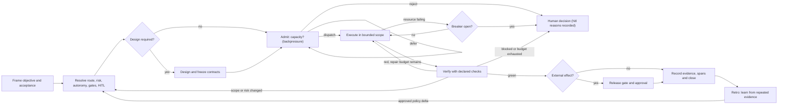

# EngineOS Methodology

**Status:** canonical operating model  
**Scope:** AI-assisted engineering tasks governed by EngineOS

EngineOS exists to improve engineering outcomes without applying the same
ceremony to every change. It resolves policy before action, limits autonomy by
risk, requires evidence before completion, and feeds recurring failures back
into the method.

This document owns the lifecycle and `CONTEXT.md` owns the vocabulary.
`registries/` owns machine-resolvable policy values, `rules/` owns behavioral
constraints, and `templates/adapters/` states what each tool can actually
enforce.

## The interface: one task contract

Callers should not need to understand every rule, hook, skill, or agent. Every
substantive task exposes the same small contract:

| Field | Required content |
|---|---|
| Objective | The observable outcome, not the requested activity |
| Scope | Owned files or systems, exclusions, and frozen contracts |
| Risk | `low`, `medium`, or `high`, plus the fact that set the tier |
| Autonomy | The allowed ceiling (`A0`–`A3`; EngineOS does not grant `A4`) |
| Gates | Required exits and artifacts derived from risk and decision rules |
| Verification | Checks in scope, including final-stage test consent or pending status |
| Evidence | Source-attributed outputs, findings, and approvals |
| State | Current gate, known failures, and one concrete next action |

The contract can live in the plan, change record, or handoff; do not duplicate
it merely to satisfy a template. A low-risk one-line edit may express it in one
line. A high-risk release needs the full contract.

## The control loop

The gates form a ladder, but execution is a feedback loop. A changed scope goes
back through policy resolution. A failed check returns to bounded repair. A
blocked or exhausted task stops for a human; it does not sample until green.

Kernel answers: `admit` → dispatch/defer/reject; `breaker` → per-resource
permission to continue; `hitl` → a human decision with a closed reason id and
record home. Values belong to `registries/policy.json`; the kernel resolves them
but does not enforce host launches. Only `high-risk` has an automatic producer
(`resolve-task` via `decision_rules.any_high`); callers supply other observations.

One supervisor owns contracts, useful host-bounded parallel workers, integration
and final non-test validation. Keep related work on the same branch/PR until the
user directs otherwise. `rules/parallelism.md` and `rules/git.md` own details.

## Policy ownership

One meaning has one owner. Other artifacts point to it or mechanically check a
mirror; they do not restate it.

| Meaning | Owner |
|---|---|
| Machine-resolvable risk, gates, retry, and parallelism values | `registries/policy.json` |
| Intent and file routing | `registries/intents.json`, `registries/routing.json` |
| Conditional artifact requirements | `registries/decision-rules.json` |
| Behavioral constraints and rationale | the relevant `rules/*.md` file |
| Procedure | the relevant `skills/*/SKILL.md` file |
| Executor capability and return contract | `registries/capabilities.json` + `agents/*.md` |
| Tool mapping and enforcement gaps | `templates/adapters/` |
| Task evidence | change record or handoff |

If a registry and its prose mirror disagree, the methodology is inconsistent.
Do not invent precedence between them: stop, resolve the owner, and add an
integrity check that makes the disagreement recur as a red build.

## Enforcement strength

Every mechanism must use one honest label:

- **Blocking** — prevents the transition or external effect.
- **Checked** — fails an integrity check or CI after the fact.
- **Advisory** — emits guidance but cannot prevent non-compliance.
- **Conventional** — depends on an agent or human following the documented rule.

Strength is adapter-specific. Under Claude Code, Stop hooks can block completion.
On tools without Stop hooks, the same requirement is checked in CI or remains a
convention. Portability of the method does not imply portability of enforcement.

## Risk proportionality

- Every substantive task gets a task contract; ceremony scales with risk.
- Risk is the maximum of the declared inputs, never an average.
- Reclassify when scope, destination, data, contract surface, reversibility, or
  spend changes. The initial tier is not permanent.
- Thin or conflicting evidence lowers autonomy even when the nominal risk tier
  stays the same.
- Any external effect uses the release gate. High-risk effects require a human
  approval recorded with the evidence.

`rules/risk-autonomy.md` owns the detailed mapping and `rules/gates.md` owns the
exit criteria.

## Evidence contract

Evidence must name its source and date or execution time. A completion claim
includes:

1. the checks declared in the task contract and their actual output;
2. the files or systems changed;
3. unresolved failures and residual risks;
4. approvals required by the autonomy ceiling; and
5. the next operational action when the change ships.

Tests/evals are authored and run only at the final stage with explicit
current-task user approval. A project requirement, feature flow, agent dispatch
or gate does not grant that consent. Without approval record
`[tests] pending — final-stage user approval required`; never imply a pass.

## Learning and effectiveness

EngineOS measures two different things and must not confuse them:

| Layer | Examples | What it proves |
|---|---|---|
| Internal conformance | integrity checks, routing evals, gate events, bounded retries | The method behaved as specified |
| Engineering effectiveness | escaped defects, convention-review comments, lead time, rollback rate, false gate blocks, bypass rate | The method improved delivery |

Internal conformance is necessary but does not prove better engineering. Before
claiming effectiveness, compare a dated baseline with a pilot window of similar
work. Keep prompt text, secrets, and PII out of telemetry; join task-level process
data to PR or incident outcomes outside the prompt log.

The retro loop promotes a change only from repeated evidence (normally three
independent occurrences), adds detection before prose, and keeps human approval
between a proposal and a policy change.

## Method changes

A methodology change is complete only when all applicable parts move together:

1. the owning registry or rule changes;
2. its human or machine mirror is updated without duplicating ownership;
3. regression criteria exist, with executable tests/evals deferred to approved final validation;
4. compatibility impact is recorded; and
5. the change record carries the evidence.

That is the deletion test for governance: if removing a mechanism would not
change a decision, prevent a violation, or produce useful evidence, simplify or
remove it.
