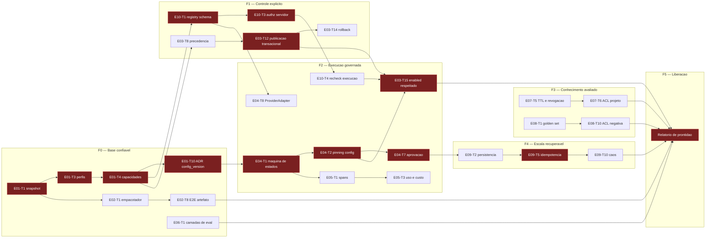

# EngineOS 2.0 — Sequenciamento, ondas e marcos

Companheiro de `01-decomposicao-epicos.md`. Usa os mesmos IDs `E0X-Tn`.

## 1. Princípio de sequenciamento

Três regras decidem a ordem, nesta precedência:

1. **Contrato antes de consumidor.** Nada que consome um contrato começa antes de o
   contrato estar aceito. Isso põe `E01-T10` (config_version), `E04-T8` (ProviderAdapter)
   e `E10-T1` (registry de tools) muito cedo, apesar de seus épicos serem "posteriores".
2. **Fronteira de segurança antes de capacidade.** Autorização, ACL e aprovação
   (`E10-T3`, `E10-T6`, `E07-T6`, `E08-T10`) precedem a capacidade que elas protegem.
   Uma capacidade liberada antes da sua fronteira não é adiantamento: é dívida com juros.
3. **O resto é paralelizável** e segue `rules/parallelism.md`: tarefas independentes com
   escopos de arquivo disjuntos vão para a mesma onda, respeitando
   `policy.json` `parallelism.wave_concurrency_cap`.

## 2. Grafo de dependências (caminho crítico em destaque)

**Caminho crítico:** `E01-T1 → E01-T3 → E01-T4 → E01-T10 → E04-T1 → E04-T2 → E04-T7 →
E03-T15 → prontidão`. Todo atraso nessa cadeia empurra a liberação. As demais cadeias têm
folga e podem absorver interrupção.

Um segundo caminho quase crítico atravessa segurança:
`E01-T4 → E10-T1 → E10-T3 → E10-T4 → E10-T11`. Ele não pode ser comprimido em troca de
velocidade — as tarefas nele são A0 e exigem decisão humana.

## 3. Ondas de execução

Cada onda é um conjunto de tarefas com escopos de arquivo disjuntos, despachável em
paralelo conforme `rules/parallelism.md`. A barreira entre ondas exige handoff no formato
de `templates/handoff.md`.

### F0 — Base confiável

| Onda | Tarefas | Escopos disjuntos | Barreira |
|---|---|---|---|
| F0.1 | E01-T1, E01-T2 | git/working tree, inventário | Snapshot canônico fixado e assinado |
| F0.2 | E01-T3, E06-T1 | `docs/`, `evals/` | Perfis definidos |
| F0.3 | E01-T4, E01-T8, E06-T3 | `docs/CAPABILITIES.md`, adapters, `evals/*.jsonl` | Matriz de capacidades aceita |
| F0.4 | E01-T5, E01-T9, E01-T12, E02-T1, E02-T3 | PRD, ADRs, `scripts/package.sh`, `.gitattributes` | — |
| F0.5 | E01-T10, E01-T11, E02-T2, E02-T4, E06-T2 | ADRs de contrato, allowlist, bootstrap, formato de resultado | **Contratos aceitos** — libera F1 e F2 |
| F0.6 | E01-T6, E01-T7, E01-T13, E02-T5, E02-T6 | versão, compatibilidade, rastreabilidade, manifesto, varredura | — |
| F0.7 | E02-T7, E02-T8, E02-T9, E02-T10, E06-T9 | CI de plataformas, E2E, sincronismo, regressão | **Condição de saída F0** |

Condição de saída F0: o artefato instala e valida nos sistemas suportados, a partir dos
bytes da release, sem ajuste manual não documentado.

### F1 — Controle explícito

| Onda | Tarefas | Barreira |
|---|---|---|
| F1.1 | E10-T1, E10-T5, E03-T1, E03-T2 | Schema de tools aceito |
| F1.2 | E10-T3, E03-T4, E03-T5, E03-T18 | **Autorização decidida no servidor** |
| F1.3 | E03-T3, E03-T6, E03-T7, E10-T2 | Grafo de relações real |
| F1.4 | E03-T8, E03-T9, E03-T11 | Precedência resolvida |
| F1.5 | E03-T10, E03-T12, E03-T13 | Publicação transacional |
| F1.6 | E03-T14, E03-T16, E10-T7 | **Condição de saída F1** |

Condição de saída F1: configuração inválida não publica; conflito de revisão não sobrescreve
trabalho; rollback restaura versão íntegra; console local não aceita origem não autorizada.
`E03-T15` (efeito comprovado de `enabled=false`) fica em F2 porque depende do runner.

`E03-T17` (perfil hospedado) permanece fora de escopo até F5 e o perfil segue declarado
não suportado.

### F2 — Execução governada

| Onda | Tarefas | Barreira |
|---|---|---|
| F2.1 | E04-T1, E04-T8, E05-T2 | Máquina de estados e contrato de provider |
| F2.2 | E04-T2, E04-T9, E05-T1 | Pinning e primeiro adapter |
| F2.3 | E04-T3, E04-T4, E04-T5, E05-T7 | Admission, breaker e prazo ligados |
| F2.4 | E04-T6, E04-T10, E05-T3 | Orçamento e custo reais |
| F2.5 | E04-T7, E10-T4, E10-T6 | **Aprovação e reverificação** |
| F2.6 | E04-T11, E05-T4, E05-T6, E05-T9, E10-T9 | Envelope, exportação, redação |
| F2.7 | E03-T15, E04-T12, E10-T8, E10-T11, E06-T7 | Suítes adversariais |
| F2.8 | E05-T5, E05-T8, E05-T10, E05-T11 | **Condição de saída F2** |

Condição de saída F2: orçamento, aprovação, falha e cancelamento aplicados de fato — cada um
demonstrado por um teste que falha quando o controle é removido.

### F3 — Conhecimento avaliado

| Onda | Tarefas | Barreira |
|---|---|---|
| F3.1 | E07-T1, E07-T2, E08-T1 | Chave de agrupamento e golden set |
| F3.2 | E07-T3, E07-T4, E08-T2, E08-T4 | Promoção e ingestão |
| F3.3 | E07-T5, E07-T6, E08-T3, E08-T10 | **ACL e revogação** |
| F3.4 | E07-T7, E07-T8, E08-T5, E08-T6 | Recuperação medida |
| F3.5 | E08-T7, E08-T8, E08-T9, E06-T5 | **Condição de saída F3** |

Condição de saída F3: proveniência, autorização, atualização e regressão verificadas.

### F4 — Escala recuperável

Só executa se o perfil distribuído entrar na release. Caso contrário, F4 é pulado e o perfil
distribuído é declarado não suportado — não "planejado para breve".

| Onda | Tarefas | Barreira |
|---|---|---|
| F4.1 | E09-T1, E09-T2 | ADR de banco/fila e persistência |
| F4.2 | E09-T3, E09-T4, E09-T6 | Lease, retries e outbox |
| F4.3 | E09-T5, E09-T7, E09-T8 | **Idempotência por efeito** |
| F4.4 | E09-T9, E09-T10, E09-T11 | **Condição de saída F4** |

Condição de saída F4: recuperação, idempotência, carga e isolamento demonstrados em staging.

### F5 — Liberação e operação

| Onda | Tarefas | Barreira |
|---|---|---|
| F5.1 | E06-T8, E10-T10, E05-T8 (revisão) | Baseline vs piloto, rotação ensaiada |
| F5.2 | Validação integrada de release (§5) | Roteiro completo executado |
| F5.3 | Relatório de prontidão | **Liberação** |

## 4. Marcos

| Marco | Conteúdo | Critério de passagem | Consequência de não passar |
|---|---|---|---|
| **A — Release candidata do Core** | F0 + F1 | Artefato reproduzível; console completo; desabilitação com efeito comprovado no console; integrações anunciadas comprovadas | Não distribui. Nenhum consumidor externo instala |
| **B — Runner e conhecimento homologados** | F2 + F3 | Controles aplicados na execução; observabilidade com dados reais; regressão bloqueante; ACL de memória e RAG comprovadas | Runner permanece desabilitado; capacidades de conhecimento não são anunciadas |
| **C — Liberação dos perfis declarados** | F4 quando houver perfil distribuído, seguido de F5 | Todos os gates operacionais do perfil atendidos; relatório de prontidão assinado | Libera apenas o perfil que passou; o outro fica explicitamente não suportado |

Nenhum marco é atingido por conclusão de tarefas. Cada um exige a evidência descrita em
`03-templates-evidencia.md`.

## 5. Validação integrada de release

Executar em homologação, com configuração equivalente ao perfil de produção e dados
autorizados. O roteiro é uma sequência única — parar no meio não conta como parcial.

1. Cadastrar uma skill, um modelo e uma tool no console.
2. Publicar a configuração e conferir o `config_version` resultante.
3. Executar uma tarefa; conferir pós-condições e trace completo.
4. Aplicar alteração concorrente durante a publicação e confirmar que nada foi sobrescrito.
5. Revogar uma permissão e confirmar que a execução retomada a respeita.
6. Interromper uma dependência e confirmar degradação prevista, não falha silenciosa.
7. Recuperar a partir de um checkpoint, preservando aprovação e configuração.
8. Repetir uma operação com efeito externo e confirmar idempotência.
9. Plantar uma regressão de retrieval e confirmar que ela é detectada.
10. Reverter a configuração para a versão anterior.
11. Restaurar backup e confirmar preservação de dados e compatibilidade com a versão anterior suportada.

## 6. Prazo

Não estimado. Este documento não assume número de desenvolvedores nem fixa data.
A estimativa deve ser feita por onda, depois da decomposição de F0.1 em tarefas com
responsável nominal, e revisada ao fim de cada fase com dados reais de vazão.

O que já é possível afirmar sem estimar: **F0 e F1 não são paralelizáveis entre si** no
caminho crítico, porque F1 consome contratos aceitos em F0.5. Comprimir F0 para "ganhar
tempo" desloca o trabalho para F1 com contrato instável, e o retrabalho aparece em F2 —
tarde, caro e disfarçado de bug de runtime.
