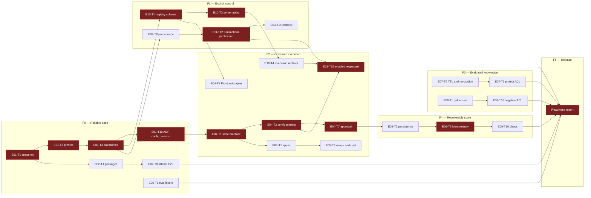

# EngineOS 2.0 — Sequencing, waves and milestones

Companion to `01-decomposicao-epicos.md`. Uses the same `E0X-Tn` IDs.

## 1. Sequencing principle

Three rules decide the order, in this precedence:

1. **Contract before consumer.** Nothing that consumes a contract starts before the
   contract is accepted. That puts `E01-T10` (config_version), `E04-T8` (ProviderAdapter)
   and `E10-T1` (tool registry) very early, despite their epics being "later".
2. **Security boundary before capability.** Authorization, ACL and approval
   (`E10-T3`, `E10-T6`, `E07-T6`, `E08-T10`) precede the capability they protect.
   A capability released before its boundary is not an advance: it is debt with interest.
3. **The rest is parallelizable** and follows `rules/parallelism.md`: independent tasks
   with disjoint file scopes go into the same wave, respecting
   `policy.json` `parallelism.wave_concurrency_cap`.

## 2. Dependency graph (critical path highlighted)

**Critical path:** `E01-T1 → E01-T3 → E01-T4 → E01-T10 → E04-T1 → E04-T2 → E04-T7 →
E03-T15 → readiness`. Every delay in that chain pushes the release out. The other chains
have slack and can absorb an interruption.

A second, near-critical path crosses security:
`E01-T4 → E10-T1 → E10-T3 → E10-T4 → E10-T11`. It cannot be compressed in exchange for
speed — the tasks in it are A0 and require a human decision.

## 3. Execution waves

Each wave is a set of tasks with disjoint file scopes, dispatchable in parallel per
`rules/parallelism.md`. The barrier between waves requires a handoff in the format of
`templates/handoff.md`.

### F0 — Reliable base

| Wave | Tasks | Disjoint scopes | Barrier |
|---|---|---|---|
| F0.1 | E01-T1, E01-T2 | git/working tree, inventory | Canonical snapshot fixed and signed |
| F0.2 | E01-T3, E06-T1 | `docs/`, `evals/` | Profiles defined |
| F0.3 | E01-T4, E01-T8, E06-T3 | `docs/CAPABILITIES.md`, adapters, `evals/*.jsonl` | Capability matrix accepted |
| F0.4 | E01-T5, E01-T9, E01-T12, E02-T1, E02-T3 | PRD, ADRs, `scripts/package.sh`, `.gitattributes` | — |
| F0.5 | E01-T10, E01-T11, E02-T2, E02-T4, E06-T2 | contract ADRs, allowlist, bootstrap, result format | **Contracts accepted** — releases F1 and F2 |
| F0.6 | E01-T6, E01-T7, E01-T13, E02-T5, E02-T6 | version, compatibility, traceability, manifest, scan | — |
| F0.7 | E02-T7, E02-T8, E02-T9, E02-T10, E06-T9 | platform CI, E2E, sync, regression | **F0 exit condition** |

F0 exit condition: the artifact installs and validates on the supported systems, from the
release bytes, with no undocumented manual adjustment.

### F1 — Explicit control

| Wave | Tasks | Barrier |
|---|---|---|
| F1.1 | E10-T1, E10-T5, E03-T1, E03-T2 | Tool schema accepted |
| F1.2 | E10-T3, E03-T4, E03-T5, E03-T18 | **Authorization decided on the server** |
| F1.3 | E03-T3, E03-T6, E03-T7, E10-T2 | Real relations graph |
| F1.4 | E03-T8, E03-T9, E03-T11 | Precedence resolved |
| F1.5 | E03-T10, E03-T12, E03-T13 | Transactional publication |
| F1.6 | E03-T14, E03-T16, E10-T7 | **F1 exit condition** |

F1 exit condition: an invalid configuration does not publish; a revision conflict does not
overwrite work; rollback restores an intact version; the local console does not accept an
unauthorized origin. `E03-T15` (proven effect of `enabled=false`) stays in F2 because it
depends on the runner.

`E03-T17` (hosted profile) remains out of scope until F5 and the profile stays declared
unsupported.

### F2 — Governed execution

| Wave | Tasks | Barrier |
|---|---|---|
| F2.1 | E04-T1, E04-T8, E05-T2 | State machine and provider contract |
| F2.2 | E04-T2, E04-T9, E05-T1 | Pinning and first adapter |
| F2.3 | E04-T3, E04-T4, E04-T5, E05-T7 | Admission, breaker and deadline wired |
| F2.4 | E04-T6, E04-T10, E05-T3 | Real budget and cost |
| F2.5 | E04-T7, E10-T4, E10-T6 | **Approval and re-verification** |
| F2.6 | E04-T11, E05-T4, E05-T6, E05-T9, E10-T9 | Envelope, export, redaction |
| F2.7 | E03-T15, E04-T12, E10-T8, E10-T11, E06-T7 | Adversarial suites |
| F2.8 | E05-T5, E05-T8, E05-T10, E05-T11 | **F2 exit condition** |

F2 exit condition: budget, approval, failure and cancellation actually applied — each one
demonstrated by a test that fails when the control is removed.

### F3 — Evaluated knowledge

| Wave | Tasks | Barrier |
|---|---|---|
| F3.1 | E07-T1, E07-T2, E08-T1 | Grouping key and golden set |
| F3.2 | E07-T3, E07-T4, E08-T2, E08-T4 | Promotion and ingestion |
| F3.3 | E07-T5, E07-T6, E08-T3, E08-T10 | **ACL and revocation** |
| F3.4 | E07-T7, E07-T8, E08-T5, E08-T6 | Retrieval measured |
| F3.5 | E08-T7, E08-T8, E08-T9, E06-T5 | **F3 exit condition** |

F3 exit condition: provenance, authorization, update and regression verified.

### F4 — Recoverable scale

Executes only if the distributed profile goes into the release. Otherwise, F4 is skipped
and the distributed profile is declared unsupported — not "planned for soon".

| Wave | Tasks | Barrier |
|---|---|---|
| F4.1 | E09-T1, E09-T2 | Database/queue ADR and persistence |
| F4.2 | E09-T3, E09-T4, E09-T6 | Lease, retries and outbox |
| F4.3 | E09-T5, E09-T7, E09-T8 | **Idempotency per effect** |
| F4.4 | E09-T9, E09-T10, E09-T11 | **F4 exit condition** |

F4 exit condition: recovery, idempotency, load and isolation demonstrated in staging.

### F5 — Release and operation

| Wave | Tasks | Barrier |
|---|---|---|
| F5.1 | E06-T8, E10-T10, E05-T8 (review) | Baseline vs pilot, rotation drilled |
| F5.2 | Integrated release validation (§5) | Full walkthrough executed |
| F5.3 | Readiness report | **Release** |

## 4. Milestones

| Milestone | Content | Passing criterion | Consequence of not passing |
|---|---|---|---|
| **A — Core release candidate** | F0 + F1 | Reproducible artifact; complete console; disablement with proven effect in the console; announced integrations proven | Does not distribute. No external consumer installs |
| **B — Runner and knowledge approved in staging** | F2 + F3 | Controls applied at execution; observability with real data; blocking regression; memory and RAG ACL proven | The runner stays disabled; knowledge capabilities are not announced |
| **C — Release of the declared profiles** | F4 when there is a distributed profile, followed by F5 | All the profile's operational gates met; readiness report signed | Releases only the profile that passed; the other stays explicitly unsupported |

No milestone is reached by task completion. Each one requires the evidence described in
`03-templates-evidencia.md`.

## 5. Integrated release validation

Execute in staging, with a configuration equivalent to the production profile and
authorized data. The walkthrough is a single sequence — stopping halfway does not count as
partial.

1. Register a skill, a model and a tool in the console.
2. Publish the configuration and check the resulting `config_version`.
3. Execute a task; check postconditions and the full trace.
4. Apply a concurrent change during the publication and confirm that nothing was overwritten.
5. Revoke a permission and confirm that the resumed execution respects it.
6. Interrupt a dependency and confirm the foreseen degradation, not a silent failure.
7. Recover from a checkpoint, preserving approval and configuration.
8. Repeat an operation with an external effect and confirm idempotency.
9. Plant a retrieval regression and confirm that it is detected.
10. Revert the configuration to the previous version.
11. Restore a backup and confirm data preservation and compatibility with the previous supported version.

## 6. Timeline

Not estimated. This document assumes no number of developers and fixes no date.
The estimate has to be made per wave, after the decomposition of F0.1 into tasks with a
named owner, and revised at the end of each phase with real throughput data.

What can already be stated without estimating: **F0 and F1 are not parallelizable with each
other** on the critical path, because F1 consumes contracts accepted in F0.5. Compressing
F0 to "gain time" moves the work into F1 with an unstable contract, and the rework shows up
in F2 — late, expensive and disguised as a runtime bug.
