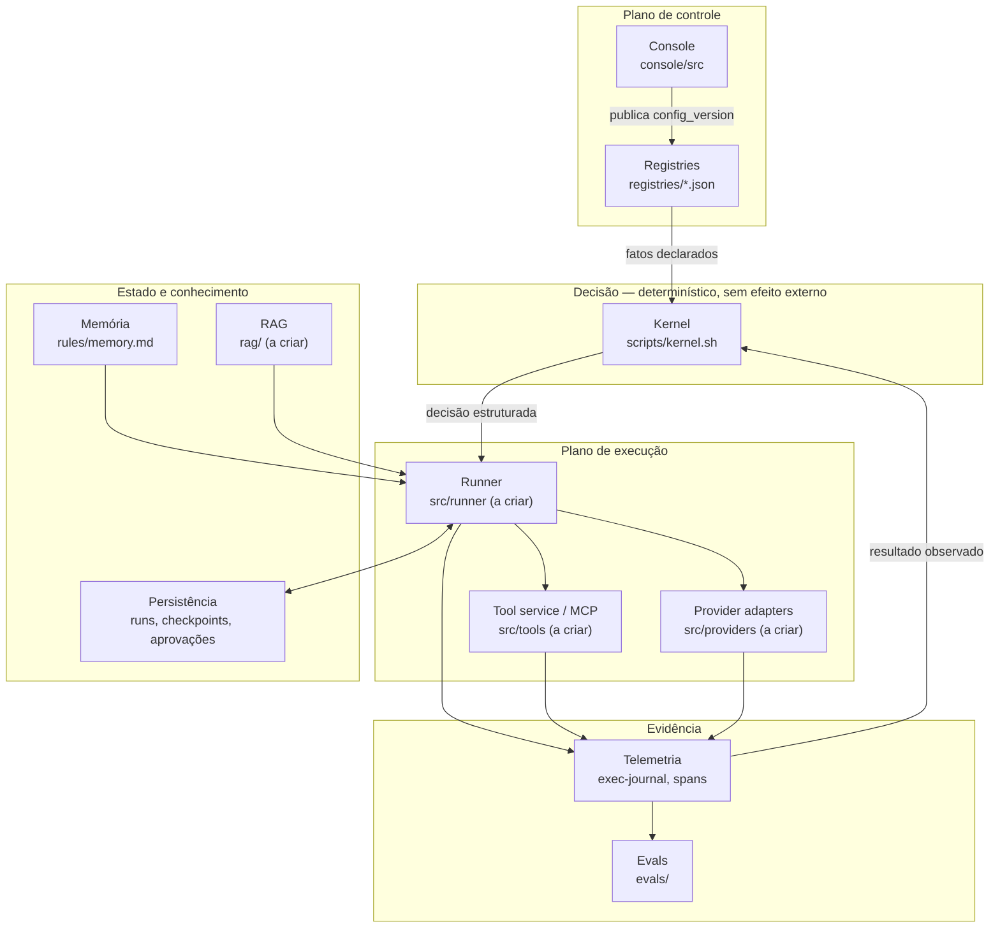
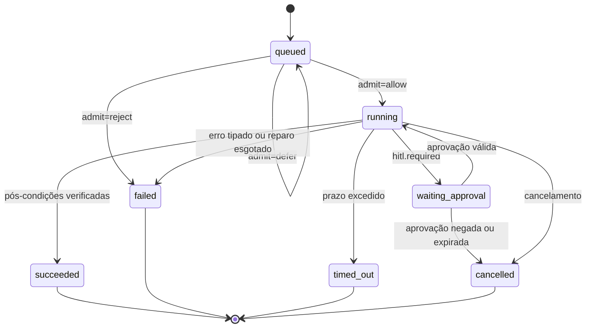

# EngineOS 2.0 — Arquitetura e contratos de componentes

Ancorado no código atual do repositório em `fed9a63`. Cada componente traz: o que já existe,
o que falta, e o **contrato mínimo** que precisa ser aceito antes que consumidores comecem.

## 1. Forma do sistema



**Invariante central:** o kernel decide e não age; o runner age e não decide. Uma decisão
tomada dentro do runner é um defeito de arquitetura, porque deixa de ser testável em
isolamento e deixa de aparecer na simulação do console (`E03-T10`).

**Segunda invariante:** o console escreve configuração, nunca estado de execução. Estado de
execução pertence à persistência do runner. Misturar os dois é o que torna publicação e
rollback perigosos.

---

## 2. Kernel — decisão determinística

**Existe.** `scripts/kernel.sh` com 14 subcomandos: `route-path`, `route-intent`, `model`,
`risk`, `gates`, `repair`, `admit`, `breaker`, `hitl`, `waves`, `decision-rules`, `scale`,
`route-escalate`, `resolve-task`. Alimentado por `registries/policy.json` (blocos `risk`,
`autonomy`, `gates`, `parallelism`, `retry`, `repair`, `breaker`, `hitl`, `telemetry`,
`router`), `registries/decision-rules.json`, `intents.json`, `routing.json`, `models.json`,
`agents.json`, `capabilities.json`.

**Falta.** As decisões não estão ligadas a transições reais de execução (R06). O kernel
responde corretamente e ninguém obedece.

### Contrato

```
entrada:  fatos declarados (caminho, intenção, contagem de arquivos, estado observado)
saída:    decisão estruturada em JSON
efeito:   nenhum. O kernel não escreve, não chama rede, não muta estado.
```

`resolve-task` já devolve o envelope canônico:

```json
{
  "task_contract": {
    "substantive": true,
    "intents": ["backend"],
    "escalates": false,
    "escalation_reasons": [],
    "suppressed": [],
    "agents": ["backend-coordinator"],
    "rules": ["architecture", "backend", "testing", "observability"],
    "policy_rules": ["gates", "models", "parallelism", "risk-autonomy", "verification", "subagents"],
    "skills": ["nestjs-patterns"],
    "commands": [],
    "mcp": [],
    "model_tier": "...",
    "risk_floor": "medium",
    "autonomy_ceiling_at_floor": "A2",
    "scale": {},
    "decision_rules": [],
    "required": [],
    "gates": {},
    "preferences": {}
  },
  "route": {},
  "decision_rules": {},
  "hitl": { "required": false, "reasons": [] }
}
```

**Regra de evolução (`docs/COMPATIBILITY.md`):** adicionar subcomando ou campo é MINOR;
remover ou renomear é MAJOR com janela de depreciação. O interior do kernel — `reg`, os
programas jq, quantos processos custa — não é superfície.

**Contrato a acrescentar em E01-T13:** toda regra em `policy.json` e `decision-rules.json`
declara seu ponto de aplicação. Regra sem ponto de aplicação é reportada como **não
aplicada**, e essa marcação é o que impede anunciar enforcement inexistente.

---

## 3. Console — plano de controle

**Existe.** Next.js 15 + React 19 + Drizzle/SQLite. Rotas `skills`, `publish`, `history`,
`rollback`, `diff`. `console/src/lib/store/schema.ts` já é **genérico por `kind`** — comentário
no próprio arquivo declara que adicionar entidade não deve exigir migração:

```ts
entities            { id, kind, name, status, sourcePaths_json, data_json, updatedAt }
published_snapshot  { id, kind, data_json, publishedAt }
publish_history     { id, commitSha, createdAt, summary, diff_json }
```

**Falta.** As verticais `agent`, `model`, `mcp`, `routing`, `rule`; relações reais; binding
e precedência; publicação transacional com comparação de revisão; rollback não destrutivo;
hardening.

### Contrato de entidade

Toda vertical implementa a mesma interface. Isso é o que mantém o schema estável:

```ts
export interface EntityAdapter<T> {
  kind: string;                                  // 'skill' | 'agent' | 'model' | 'mcp' | 'routing' | 'rule'
  read(): Promise<Draft<T>[]>;                   // do source of truth em disco
  validate(draft: Draft<T>, graph: Graph): ValidationIssue[];
  render(draft: Draft<T>): FileWrite[];          // o que será gravado, sem gravar
  relations(draft: Draft<T>): Relation[];         // arestas para o grafo
}

export interface ValidationIssue {
  severity: 'error' | 'warning';
  code: string;                                  // 'unknown-reference' | 'disabled-dependency' | 'ambiguous-precedence' | ...
  entity: string;
  message: string;
}
```

`severity: 'error'` **impede** a publicação. `warning` não. Não existe terceiro estado, e
nenhuma publicação prossegue com erro "conhecido".

### Contrato de publicação

```
publish(baseRevision, draftSet) →
  | { ok: true,  config_version, commitSha, historyId }
  | { ok: false, reason: 'stale-base',      currentRevision }
  | { ok: false, reason: 'validation',      issues: ValidationIssue[] }
  | { ok: false, reason: 'dirty-worktree',  paths: string[] }
  | { ok: false, reason: 'concurrent',      holder }
  | { ok: false, reason: 'partial',         recoveryToken, completedSteps }
```

Quatro exigências que essa forma impõe:

1. `baseRevision` é obrigatório — publicação sem base comparada não existe na API.
2. `partial` é um resultado de primeira classe, não uma exceção. Falha entre gravar
   arquivos, commitar e atualizar o snapshot deixa `recoveryToken` e a lista de etapas
   concluídas. Sem isso, R08 é inevitável.
3. `concurrent` implica lock: duas publicações não intercalam efeitos (`E03-T13`).
4. `dirty-worktree` protege alteração feita fora do console — o console não é dono
   exclusivo dos arquivos.

### Contrato de rollback

```
rollback(historyId, { onConflict: 'abort' | 'report' }) →
  | { ok: true, config_version }
  | { ok: false, reason: 'operator-changes', paths, diff }
```

`onConflict: 'abort'` é o padrão. Rollback nunca sobrescreve alteração posterior em silêncio.

### `config_version`

Contrato definido em `E01-T10`, consumido por console e runner:

```
config_version = hash( conteúdo canônico de registries/ + rules/ + agents/ + skills/ )
```

Propriedades exigidas: determinístico (mesmo conteúdo, mesmo valor), sensível a qualquer
arquivo que altere decisão, e insensível a fim de linha e modo de arquivo — caso contrário
Windows e Linux produzem versões diferentes para a mesma configuração, e `E02-T3` deixa de
ser cosmético para virar correção de correção.

---

## 4. Runner — plano de execução

**Não existe.** `src/` tem `cli.ts`, `dispatch.ts`, `io.ts`, `node-guard.ts`. O runner
governado é novo.

### Máquina de estados



Estados terminais são absorventes. Transição inválida é **rejeitada**, nunca corrigida para
o estado mais próximo — corrigir silenciosamente é como uma falha vira sucesso.

### Contrato do run

```ts
export interface Run {
  run_id: string;
  task_id: string;
  state: 'queued' | 'running' | 'waiting_approval'
       | 'succeeded' | 'failed' | 'cancelled' | 'timed_out';
  config_version: string;        // fixado no início, não relido durante a execução
  identity: { principal: string; scope: string[] };
  budget: { reserved: Money; consumed: Money; limit: Money };
  deadline: string;              // ISO 8601
  steps: { taken: number; limit: number };
  checkpoint?: CheckpointRef;
  contract: TaskContract;        // saída de kernel resolve-task, congelada
}
```

`config_version` fixado no início é o que faz uma publicação durante um run não alterar o run
em curso (`E04-T2`). Sem isso, o comportamento de uma execução deixa de ser reproduzível.

### Contrato de aprovação

```ts
export interface Approval {
  approval_id: string;
  action: string;
  args_hash: string;             // hash canônico dos argumentos aprovados
  target: string;                // recurso ou destino exato
  config_version: string;
  granted_by: string;
  granted_at: string;
  expires_at?: string;
}

// Válida somente se os quatro campos coincidirem com a chamada em questão.
isValid(approval, call) =
  approval.action === call.action &&
  approval.args_hash === hash(call.args) &&
  approval.target === call.target &&
  approval.config_version === run.config_version &&
  !expired(approval) &&
  !revoked(approval);
```

Mudança em qualquer um dos quatro invalida. E uma confirmação já válida para a mesma ação
**não é pedida de novo** — repetir aprovação treina o operador a aprovar sem ler, o que
destrói o valor do controle.

### Contrato do provider adapter

```ts
export interface ProviderAdapter {
  readonly provider: string;
  readonly capabilities: Capability[];   // 'tools' | 'json-schema' | 'vision' | 'long-context' | ...

  call(req: ModelRequest): Promise<ModelResponse>;
}

export interface ModelRequest {
  model: string;                         // explícito, nunca inferido de tier
  messages: Message[];
  outputSchema?: JsonSchema;
  tools?: ToolSpec[];
  timeoutMs: number;
  idempotencyKey?: string;
}

export interface ModelResponse {
  provider: string;
  model: string;                         // o modelo que de fato respondeu
  output: unknown;                       // validado contra outputSchema quando presente
  usage: {
    inputTokens: number | null;
    outputTokens: number | null;
    cost: Money | null;
    availability: 'reported' | 'estimated' | 'unavailable';
  };
  latencyMs: number;
}

export type ProviderError =
  | { kind: 'timeout' }
  | { kind: 'rate-limited'; retryAfterMs?: number }
  | { kind: 'schema-invalid'; raw: string }
  | { kind: 'unavailable' }
  | { kind: 'auth' }
  | { kind: 'content-filtered' }
  | { kind: 'unknown'; raw: string };
```

O campo `availability` é o que impede R12. `cost: null` com
`availability: 'unavailable'` significa **não medido** e é assim que aparece no dashboard —
nunca como `0`.

Erros são tipados porque o breaker e o loop de reparo precisam distinguir `rate-limited`
(espera) de `schema-invalid` (repara) de `auth` (para e escala). Uma string de erro não
sustenta essa decisão.

### Resolução de modelo

```
resolve(tier, requiredCapabilities) →
  { model, provider, fallbackFrom?, fallbackReason? }
```

A seleção valida **disponibilidade e capacidade**, não nome de tier (`E04-T10`). Um fallback
para um modelo sem a capability exigida é uma falha de resolução, não um fallback.

---

## 5. Tool service / MCP adapter

**Existe.** `templates/mcp.template.json` — um template, não um registry operacional.

**Falta.** Tudo em E10.

### Contrato de registry

```jsonc
{
  "tools": [{
    "id": "postgres.query",
    "server": "postgres-mcp",
    "version": "1.2.0",
    "transport": "stdio",
    "capabilities": ["read"],
    "effect": "read",                       // 'read' | 'write-reversible' | 'irreversible'
    "risk": "medium",
    "argsSchema": { },
    "resultSchema": { },
    "limits": { "argsBytes": 65536, "resultBytes": 1048576, "timeoutMs": 30000 },
    "allowedProjects": ["engineos"],
    "secretRef": "env:PG_MCP_URL",          // referência, nunca valor
    "enabled": true
  }]
}
```

`effect` dirige a exigência de aprovação: `irreversible` sempre exige aprovação válida no
escopo exato; `write-reversible` exige conforme o tier de risco; `read` não exige.

### Contrato de autorização

```ts
authorize(principal, operation, resource, context) →
  | { allow: true }
  | { allow: false; reason: string; audit: AuditRecord }
```

Quatro propriedades não negociáveis:

1. Decidido **no servidor**, a partir de identidade e escopo do run — nunca a partir do
   prompt ou de algo que o modelo escreveu (R17).
2. Reconferido **no momento da execução**, inclusive após `pause`/`resume`. Autorização
   verificada só no dispatch não sobrevive a uma revogação durante a pausa (R19).
3. Negação é **auditada** e comprovadamente **sem escrita** — o teste verifica o efeito
   ausente, não só o retorno negativo.
4. Credencial é usada fora do contexto do modelo. O modelo recebe um handle, nunca o valor.

### Entrada não confiável

Resultado de tool e documento de RAG são **dados**, nunca instruções (R20). O contrato
exige que o conteúdo recuperado atravesse uma fronteira explícita antes de entrar no
contexto, e que existam casos adversariais no conjunto de evals (`E10-T8`, `E08-T3`).

---

## 6. Persistência

**Não existe** para execução. O SQLite atual (`console/.data/console.sqlite`) é do console e
está no working tree — sai do artefato em `E02-T2`.

### Contrato

```
runs         (run_id PK, state, config_version, identity, budget, deadline, updated_at, version)
checkpoints  (checkpoint_id PK, run_id FK, seq, payload, created_at)
approvals    (approval_id PK, run_id FK, action, args_hash, target, config_version, granted_by, granted_at, expires_at, revoked_at)
events       (event_id PK, run_id FK, trace_id, kind, payload, created_at)
effects      (idempotency_key PK, run_id FK, tool_id, target, status, external_ref, created_at)
```

Duas exigências estruturais:

- **Transição condicional.** Toda escrita de estado usa `WHERE state = <esperado> AND
  version = <lido>`. Zero linhas afetadas significa que outro ator mudou o estado — o
  worker desiste, não retenta às cegas. É o que impede um worker que perdeu o lease de
  escrever depois (`E09-T3`).
- **`effects` com `idempotency_key` como chave primária.** É onde a idempotência por efeito
  vive. Antes de repetir uma operação incerta, o worker consulta `external_ref` (`E09-T5`).

A escolha de banco e fila é decidida em `E09-T1`, por requisitos de recuperação, carga,
operação e equipe — não por preferência de stack. Este documento fixa o contrato, não o
produto.

---

## 7. Memória e recuperação

**Existe** como regra e desenho: `rules/memory.md`,
`docs/specs/2026-09-03-agent-memory-architecture-design.md`, `skills/retro/SKILL.md`.

**Não existe como dado:** `registries/policy.json` não tem bloco `memory`; o
`promotion_threshold` só aparece no spec de desenho. O contrato abaixo pressupõe que esse
bloco seja criado antes de E07-T3.

### Contrato

```ts
export interface MemoryRecord {
  key: string;                    // chave estável de agrupamento — não muda por reformulação
  content: string;
  provenance: { source: string; run_id?: string; observed_at: string }[];
  status: 'candidate' | 'promoted' | 'superseded' | 'revoked';
  supersedes?: string;
  validUntil?: string;
  project: string;                // ACL: recuperação nunca cruza projeto
}

retrieve(query, { project, budget }) → { records: MemoryRecord[]; truncated: boolean }
```

Quatro invariantes, cada uma com teste correspondente em E07:

- Registro `revoked` ou expirado **nunca** volta como atual.
- Registro de outro `project` **nunca** aparece, mesmo com consulta construída para
  favorecê-lo.
- `promotion_threshold` conta ocorrências **independentes**; duplicata não infla.
- Nenhum agente altera conhecimento procedural sozinho — promoção passa por revisão humana.

---

## 8. Telemetria e evals

**Existe.** `scripts/exec-journal.sh`, `scripts/telemetry.sh`, `policy.json`
`telemetry.exec_journal` (checado por C27), ADR `2026-09-03-spans-extend-exec-journal.md`,
`evals/` com dois datasets e `RUBRIC.md`, `.github/workflows/live-evals.yml`.

### Contrato de span

```ts
export interface Span {
  trace_id: string;
  span_id: string;
  parent_span_id?: string;
  run_id: string;
  kind: 'runner' | 'model' | 'tool' | 'retrieval';
  name: string;
  startedAt: string;
  durationMs: number;
  outcome: 'success' | 'degraded' | 'policy-blocked' | 'technical-error';
  attributes: Record<string, string | number | boolean | null>;
}
```

`outcome` com quatro valores é o que permite detectar falha **sem depender do texto do
agente** (`E05-T2`). `policy-blocked` é sucesso do sistema e insucesso da tarefa — separá-lo
de `technical-error` é o que evita que um controle funcionando pareça um bug.

Atributos nunca carregam prompt, segredo ou dado pessoal por padrão (`E05-T6`).

### Contrato de resultado de eval

```jsonc
{
  "case_id": "...",
  "layer": "structural | kernel | runner | live",
  "status": "pass | fail | not-measured",
  "reason": "...",
  "versions": {
    "dataset": "...", "scorer": "...", "prompt": "...",
    "model": "...", "config_version": "..."
  },
  "metrics": { "toolSelection": 1, "groundedness": 0.9, "costUsd": null, "latencyMs": 1200 }
}
```

`status: "not-measured"` é obrigatório para caso pulado, custo desconhecido e erro de
infraestrutura (`E06-T9`). Não existe conversão de ausência em aprovação — os 33 casos live
ignorados na corrida citada na análise são exatamente esse estado, e é assim que precisam
aparecer no relatório.

---

## 9. Decisões de stack ainda em aberto

| Decisão | Onde é tomada | Critério | O que este documento já fixa |
|---|---|---|---|
| TypeScript no núcleo | `E01-T9`, estende ADR `2026-09-04-typescript-runtime-over-bash` | Aproveita o runtime existente | O contrato, não a linguagem |
| Worker Python | `E01-T12` | Só se requisito de integração ou operação justificar o custo de manutenção | Consome o mesmo contrato versionado |
| Banco e fila | `E09-T1` | Recuperação, carga, operação, equipe | Schema e transição condicional |
| Vector store | `E08-T4` | Experimento comparativo contra golden set | Versionamento de embedding e invalidação |
| Índice semântico na memória | `E07-T8` | Comparação medida contra busca lexical | Nada é adotado sem a comparação |

Nenhuma dessas decisões obriga migração de stack. Este plano fixa contratos e deixa a
escolha de produto para a tarefa que registra os requisitos.
