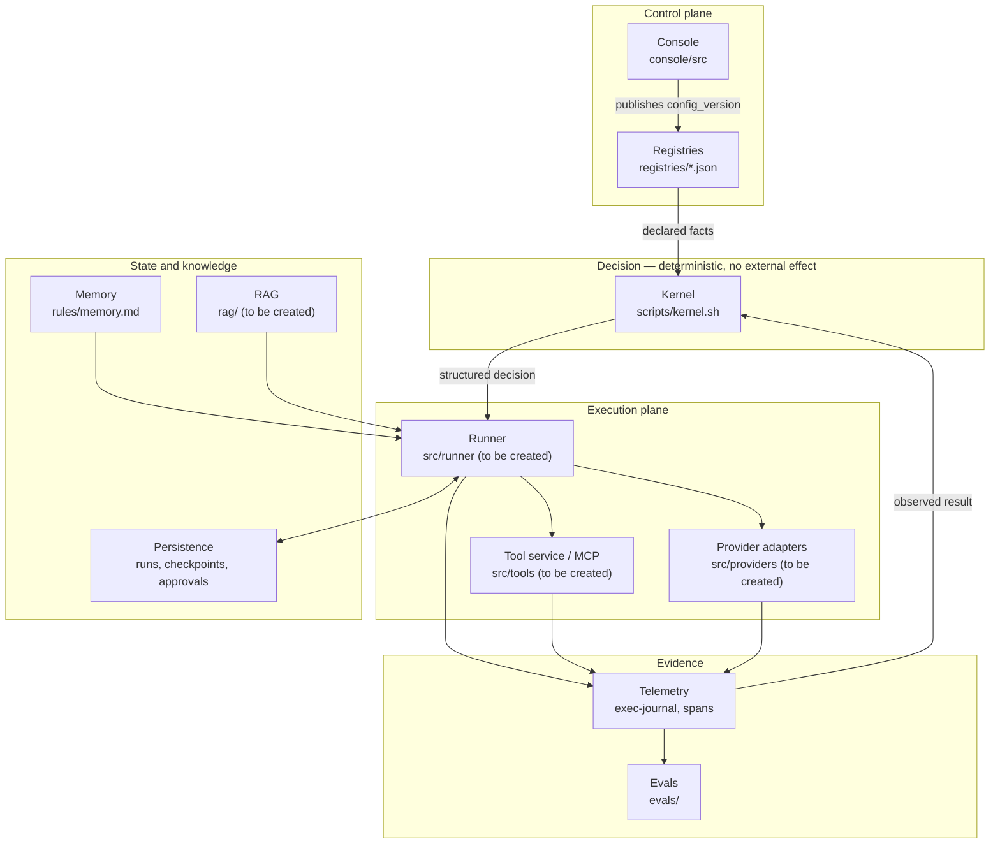
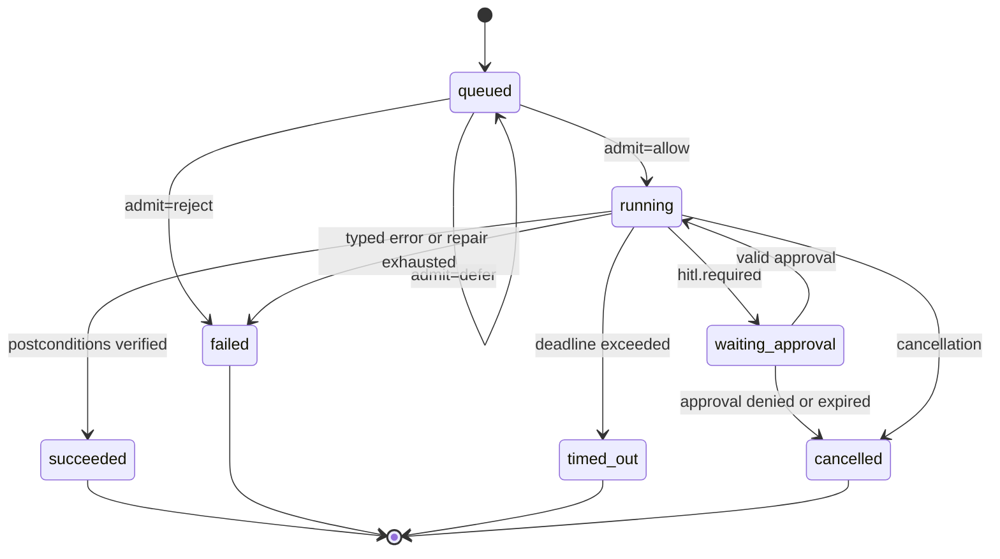

# EngineOS 2.0 — Architecture and component contracts

Anchored in the repository's current code at `fed9a63`. Every component states: what already
exists, what is missing, and the **minimum contract** that has to be accepted before consumers
start.

## 1. Shape of the system



**Central invariant:** the kernel decides and does not act; the runner acts and does not
decide. A decision taken inside the runner is an architecture defect, because it stops being
testable in isolation and stops appearing in the console simulation (`E03-T10`).

**Second invariant:** the console writes configuration, never execution state. Execution
state belongs to the runner's persistence. Mixing the two is what makes publishing and
rollback dangerous.

---

## 2. Kernel — deterministic decision

**Exists.** `scripts/kernel.sh` with 14 subcommands: `route-path`, `route-intent`, `model`,
`risk`, `gates`, `repair`, `admit`, `breaker`, `hitl`, `waves`, `decision-rules`, `scale`,
`route-escalate`, `resolve-task`. Fed by `registries/policy.json` (blocks `risk`,
`autonomy`, `gates`, `parallelism`, `retry`, `repair`, `breaker`, `hitl`, `telemetry`,
`router`), `registries/decision-rules.json`, `intents.json`, `routing.json`, `models.json`,
`agents.json`, `capabilities.json`.

**Missing.** The decisions are not wired to real execution transitions (R06). The kernel
answers correctly and nobody obeys.

### Contract

```
input:   declared facts (path, intent, file count, observed state)
output:  structured decision in JSON
effect:  none. The kernel does not write, does not call the network, does not mutate state.
```

`resolve-task` already returns the canonical envelope:

```json
{
  "task_contract": {
    "substantive": true,
    "intents": ["backend"],
    "escalates": false,
    "escalation_reasons": [],
    "suppressed": [],
    "agents": ["backend-coordinator"],
    "rules": ["architecture", "backend", "testing", "observability"],
    "policy_rules": ["gates", "models", "parallelism", "risk-autonomy", "verification", "subagents"],
    "skills": ["nestjs-patterns"],
    "commands": [],
    "mcp": [],
    "model_tier": "...",
    "risk_floor": "medium",
    "autonomy_ceiling_at_floor": "A2",
    "scale": {},
    "decision_rules": [],
    "required": [],
    "gates": {},
    "preferences": {}
  },
  "route": {},
  "decision_rules": {},
  "hitl": { "required": false, "reasons": [] }
}
```

**Evolution rule (`docs/COMPATIBILITY.md`):** adding a subcommand or a field is MINOR;
removing or renaming one is MAJOR with a deprecation window. The kernel's interior — `reg`,
the jq programs, how many processes it costs — is not surface.

**Contract to add in E01-T13:** every rule in `policy.json` and `decision-rules.json`
declares its enforcement point. A rule with no enforcement point is reported as **not
enforced**, and that marking is what stops nonexistent enforcement from being announced.

---

## 3. Console — control plane

**Exists.** Next.js 15 + React 19 + Drizzle/SQLite. Routes `skills`, `publish`, `history`,
`rollback`, `diff`. `console/src/lib/store/schema.ts` is already **generic by `kind`** — a
comment in the file itself states that adding an entity must not require a migration:

```ts
entities            { id, kind, name, status, sourcePaths_json, data_json, updatedAt }
published_snapshot  { id, kind, data_json, publishedAt }
publish_history     { id, commitSha, createdAt, summary, diff_json }
```

**Missing.** The `agent`, `model`, `mcp`, `routing`, `rule` verticals; real relations;
binding and precedence; transactional publishing with revision comparison; non-destructive
rollback; hardening.

### Entity contract

Every vertical implements the same interface. That is what keeps the schema stable:

```ts
export interface EntityAdapter<T> {
  kind: string;                                  // 'skill' | 'agent' | 'model' | 'mcp' | 'routing' | 'rule'
  read(): Promise<Draft<T>[]>;                   // from the source of truth on disk
  validate(draft: Draft<T>, graph: Graph): ValidationIssue[];
  render(draft: Draft<T>): FileWrite[];          // what will be written, without writing
  relations(draft: Draft<T>): Relation[];         // edges for the graph
}

export interface ValidationIssue {
  severity: 'error' | 'warning';
  code: string;                                  // 'unknown-reference' | 'disabled-dependency' | 'ambiguous-precedence' | ...
  entity: string;
  message: string;
}
```

`severity: 'error'` **blocks** publishing. `warning` does not. There is no third state, and
no publish proceeds with a "known" error.

### Publish contract

```
publish(baseRevision, draftSet) →
  | { ok: true,  config_version, commitSha, historyId }
  | { ok: false, reason: 'stale-base',      currentRevision }
  | { ok: false, reason: 'validation',      issues: ValidationIssue[] }
  | { ok: false, reason: 'dirty-worktree',  paths: string[] }
  | { ok: false, reason: 'concurrent',      holder }
  | { ok: false, reason: 'partial',         recoveryToken, completedSteps }
```

Four requirements this shape imposes:

1. `baseRevision` is mandatory — a publish without a compared base does not exist in the API.
2. `partial` is a first-class result, not an exception. A failure between writing the
   files, committing and updating the snapshot leaves a `recoveryToken` and the list of
   completed steps. Without that, R08 is inevitable.
3. `concurrent` implies a lock: two publishes do not interleave effects (`E03-T13`).
4. `dirty-worktree` protects a change made outside the console — the console is not the
   exclusive owner of the files.

### Rollback contract

```
rollback(historyId, { onConflict: 'abort' | 'report' }) →
  | { ok: true, config_version }
  | { ok: false, reason: 'operator-changes', paths, diff }
```

`onConflict: 'abort'` is the default. Rollback never silently overwrites a later change.

### `config_version`

Contract defined in `E01-T10`, consumed by the console and the runner:

```
config_version = hash( canonical content of registries/ + rules/ + agents/ + skills/ )
```

Required properties: deterministic (same content, same value), sensitive to any file that
changes a decision, and insensitive to end of line (EOL) and file mode — otherwise
Windows and Linux produce different versions for the same configuration, and `E02-T3` stops
being cosmetic and becomes a fix of a fix.

---

## 4. Runner — execution plane

**Does not exist.** `src/` has `cli.ts`, `dispatch.ts`, `io.ts`, `node-guard.ts`. The
governed runner is new.

### State machine



Terminal states are absorbing. An invalid transition is **rejected**, never corrected to
the nearest state — correcting silently is how a failure becomes a success.

### Run contract

```ts
export interface Run {
  run_id: string;
  task_id: string;
  state: 'queued' | 'running' | 'waiting_approval'
       | 'succeeded' | 'failed' | 'cancelled' | 'timed_out';
  config_version: string;        // fixed at the start, not re-read during the run
  identity: { principal: string; scope: string[] };
  budget: { reserved: Money; consumed: Money; limit: Money };
  deadline: string;              // ISO 8601
  steps: { taken: number; limit: number };
  checkpoint?: CheckpointRef;
  contract: TaskContract;        // output of kernel resolve-task, frozen
}
```

`config_version` fixed at the start is what makes a publish during a run not change the
in-flight run (`E04-T2`). Without it, a run's behavior stops being reproducible.

### Approval contract

```ts
export interface Approval {
  approval_id: string;
  action: string;
  args_hash: string;             // canonical hash of the approved arguments
  target: string;                // exact resource or destination
  config_version: string;
  granted_by: string;
  granted_at: string;
  expires_at?: string;
}

// Valid only if the four fields match the call in question.
isValid(approval, call) =
  approval.action === call.action &&
  approval.args_hash === hash(call.args) &&
  approval.target === call.target &&
  approval.config_version === run.config_version &&
  !expired(approval) &&
  !revoked(approval);
```

A change in any of the four invalidates it. And a confirmation that is already valid for the
same action **is not asked again** — repeating an approval trains the operator to approve
without reading, which destroys the value of the control.

### Provider adapter contract

```ts
export interface ProviderAdapter {
  readonly provider: string;
  readonly capabilities: Capability[];   // 'tools' | 'json-schema' | 'vision' | 'long-context' | ...

  call(req: ModelRequest): Promise<ModelResponse>;
}

export interface ModelRequest {
  model: string;                         // explicit, never inferred from a tier
  messages: Message[];
  outputSchema?: JsonSchema;
  tools?: ToolSpec[];
  timeoutMs: number;
  idempotencyKey?: string;
}

export interface ModelResponse {
  provider: string;
  model: string;                         // the model that actually answered
  output: unknown;                       // validated against outputSchema when present
  usage: {
    inputTokens: number | null;
    outputTokens: number | null;
    cost: Money | null;
    availability: 'reported' | 'estimated' | 'unavailable';
  };
  latencyMs: number;
}

export type ProviderError =
  | { kind: 'timeout' }
  | { kind: 'rate-limited'; retryAfterMs?: number }
  | { kind: 'schema-invalid'; raw: string }
  | { kind: 'unavailable' }
  | { kind: 'auth' }
  | { kind: 'content-filtered' }
  | { kind: 'unknown'; raw: string };
```

The `availability` field is what prevents R12. `cost: null` with
`availability: 'unavailable'` means **not measured**, and that is how it appears on the
dashboard — never as `0`.

Errors are typed because the breaker and the repair loop need to distinguish `rate-limited`
(wait) from `schema-invalid` (repair) from `auth` (stop and escalate). An error string does
not support that decision.

### Model resolution

```
resolve(tier, requiredCapabilities) →
  { model, provider, fallbackFrom?, fallbackReason? }
```

Selection validates **availability and capability**, not a tier name (`E04-T10`). A fallback
to a model without the required capability is a resolution failure, not a fallback.

---

## 5. Tool service / MCP adapter

**Exists.** `templates/mcp.template.json` — a template, not an operational registry.

**Missing.** Everything in E10.

### Registry contract

```jsonc
{
  "tools": [{
    "id": "postgres.query",
    "server": "postgres-mcp",
    "version": "1.2.0",
    "transport": "stdio",
    "capabilities": ["read"],
    "effect": "read",                       // 'read' | 'write-reversible' | 'irreversible'
    "risk": "medium",
    "argsSchema": { },
    "resultSchema": { },
    "limits": { "argsBytes": 65536, "resultBytes": 1048576, "timeoutMs": 30000 },
    "allowedProjects": ["engineos"],
    "secretRef": "env:PG_MCP_URL",          // a reference, never a value
    "enabled": true
  }]
}
```

`effect` drives the approval requirement: `irreversible` always requires a valid approval in
the exact scope; `write-reversible` requires one according to the risk tier; `read` requires
none.

### Authorization contract

```ts
authorize(principal, operation, resource, context) →
  | { allow: true }
  | { allow: false; reason: string; audit: AuditRecord }
```

Four non-negotiable properties:

1. Decided **on the server**, from the run's identity and scope — never from the
   prompt or from something the model wrote (R17).
2. Re-checked **at execution time**, including after `pause`/`resume`. Authorization
   verified only at dispatch does not survive a revocation during the pause (R19).
3. A denial is **audited** and provably **without a write** — the test verifies the absent
   effect, not just the negative return.
4. The credential is used outside the model's context. The model receives a handle, never
   the value.

### Untrusted input

A tool result and a RAG document are **data**, never instructions (R20). The contract
requires the retrieved content to cross an explicit boundary before it enters the context,
and adversarial cases to exist in the eval set (`E10-T8`, `E08-T3`).

---

## 6. Persistence

**Does not exist** for execution. The current SQLite file (`console/.data/console.sqlite`)
belongs to the console and sits in the working tree — it leaves the artifact in `E02-T2`.

### Contract

```
runs         (run_id PK, state, config_version, identity, budget, deadline, updated_at, version)
checkpoints  (checkpoint_id PK, run_id FK, seq, payload, created_at)
approvals    (approval_id PK, run_id FK, action, args_hash, target, config_version, granted_by, granted_at, expires_at, revoked_at)
events       (event_id PK, run_id FK, trace_id, kind, payload, created_at)
effects      (idempotency_key PK, run_id FK, tool_id, target, status, external_ref, created_at)
```

Two structural requirements:

- **Conditional transition.** Every state write uses `WHERE state = <expected> AND
  version = <read>`. Zero rows affected means another actor changed the state — the
  worker gives up, it does not retry blindly. It is what stops a worker that lost its lease
  from writing afterwards (`E09-T3`).
- **`effects` with `idempotency_key` as the primary key.** That is where per-effect
  idempotency lives. Before repeating an uncertain operation, the worker looks up
  `external_ref` (`E09-T5`).

The database and queue choice is decided in `E09-T1`, by recovery, load, operation and team
requirements — not by stack preference. This document fixes the contract, not the product.

---

## 7. Memory and retrieval

**Exists** as a rule and a design: `rules/memory.md`,
`docs/specs/2026-09-03-agent-memory-architecture-design.md`, `skills/retro/SKILL.md`.

**Does not exist as data:** `registries/policy.json` has no `memory` block;
`promotion_threshold` only appears in the design spec. The contract below assumes that block
is created before E07-T3.

### Contract

```ts
export interface MemoryRecord {
  key: string;                    // stable grouping key — does not change on rewording
  content: string;
  provenance: { source: string; run_id?: string; observed_at: string }[];
  status: 'candidate' | 'promoted' | 'superseded' | 'revoked';
  supersedes?: string;
  validUntil?: string;
  project: string;                // ACL: retrieval never crosses projects
}

retrieve(query, { project, budget }) → { records: MemoryRecord[]; truncated: boolean }
```

Four invariants, each with a corresponding test in E07:

- A `revoked` or expired record **never** comes back as current.
- A record from another `project` **never** appears, even with a query built to favor
  it.
- `promotion_threshold` counts **independent** occurrences; a duplicate does not inflate it.
- No agent changes procedural knowledge on its own — promotion goes through human review.

---

## 8. Telemetry and evals

**Exists.** `scripts/exec-journal.sh`, `scripts/telemetry.sh`, `policy.json`
`telemetry.exec_journal` (checked by C27), the ADR `2026-09-03-spans-extend-exec-journal.md`,
`evals/` with two datasets and `RUBRIC.md`, `.github/workflows/live-evals.yml`.

### Span contract

```ts
export interface Span {
  trace_id: string;
  span_id: string;
  parent_span_id?: string;
  run_id: string;
  kind: 'runner' | 'model' | 'tool' | 'retrieval';
  name: string;
  startedAt: string;
  durationMs: number;
  outcome: 'success' | 'degraded' | 'policy-blocked' | 'technical-error';
  attributes: Record<string, string | number | boolean | null>;
}
```

`outcome` with four values is what allows failure to be detected **without depending on the
agent's text** (`E05-T2`). `policy-blocked` is a system success and a task failure —
separating it from `technical-error` is what stops a working control from looking like a bug.

Attributes never carry a prompt, a secret or personal data by default (`E05-T6`).

### Eval result contract

```jsonc
{
  "case_id": "...",
  "layer": "structural | kernel | runner | live",
  "status": "pass | fail | not-measured",
  "reason": "...",
  "versions": {
    "dataset": "...", "scorer": "...", "prompt": "...",
    "model": "...", "config_version": "..."
  },
  "metrics": { "toolSelection": 1, "groundedness": 0.9, "costUsd": null, "latencyMs": 1200 }
}
```

`status: "not-measured"` is mandatory for a skipped case, an unknown cost and an
infrastructure error (`E06-T9`). There is no conversion of absence into a pass — the 33 live
cases skipped in the run cited in the analysis are exactly that state, and that is how they
need to appear in the report.

---

## 9. Stack decisions still open

| Decision | Where it is taken | Criterion | What this document already fixes |
|---|---|---|---|
| TypeScript in the core | `E01-T9`, extends the ADR `2026-09-04-typescript-runtime-over-bash` | Reuses the existing runtime | The contract, not the language |
| Python worker | `E01-T12` | Only if an integration or operation requirement justifies the maintenance cost | Consumes the same versioned contract |
| Database and queue | `E09-T1` | Recovery, load, operation, team | Schema and conditional transition |
| Vector store | `E08-T4` | Comparative experiment against the golden set | Embedding versioning and invalidation |
| Semantic index in memory | `E07-T8` | Measured comparison against lexical search | Nothing is adopted without the comparison |

None of these decisions forces a stack migration. This plan fixes contracts and leaves the
product choice to the task that records the requirements.
