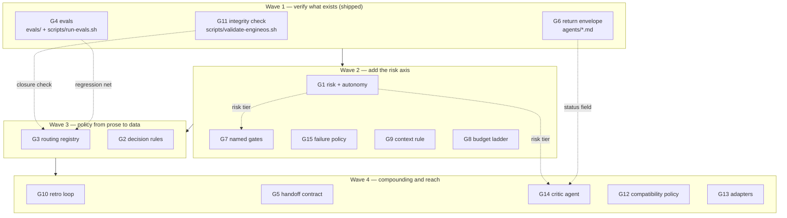
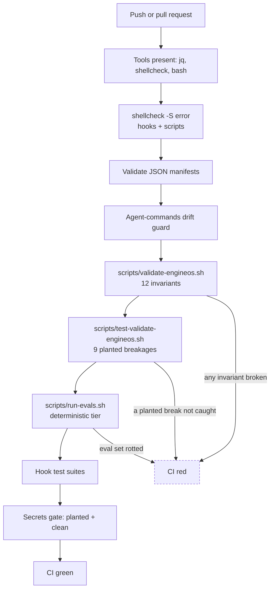
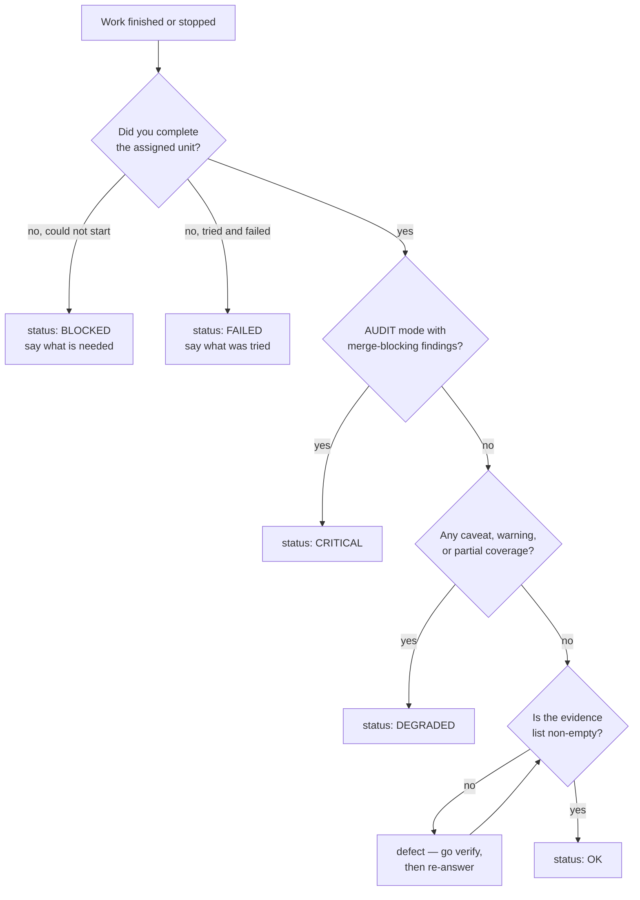
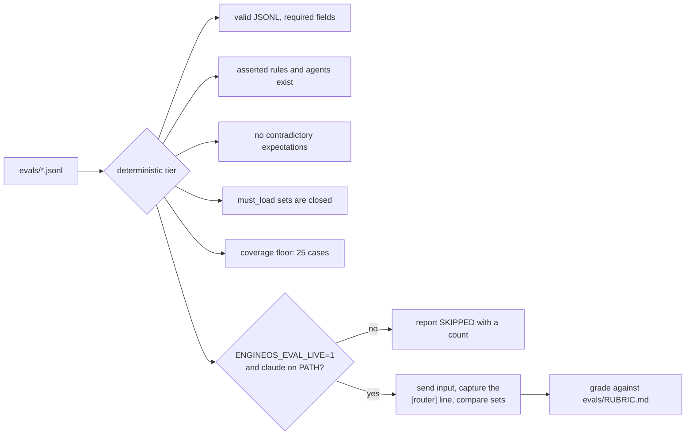

# Wave 1 — Flowcharts

Companion to `docs/specs/2026-08-02-ai-methodology-integration-analysis.md`.
Diagrams for what Wave 1 (G11, G4, G6) actually changed, and where it sits in the
adoption plan.

## 1. Adoption plan and dependencies



Wave 3 is gated on Wave 1 because rewriting the router without a working eval
suite is the one change in this plan that can silently break everything else.

## 2. CI gate chain after Wave 1



`test-validate-engineos.sh` is the check on the checker: it breaks one invariant
at a time in a throwaway copy and asserts the validator catches that one. Without
it, a validator that quietly stopped checking anything would still report green.

## 3. G11 — what the integrity check verifies

```mermaid
flowchart LR
    C[CLAUDE.md] -->|@rules imports| A[always-on rules exist]
    C -->|router table rows| CL[load lists are closed]
    R[rules/*.md] -->|deferral graph| CL
    R --> XR[every rules/X.md reference resolves]
    AG[agents/*.md] --> XR
    SK[skills/*/SKILL.md] --> XR
    M[hooks/routing-map.sh] --> TG[named agents, skills, rules all exist]
    AG --> FM[frontmatter name matches filename]
    AG --> RF[declares the Return format envelope]
    AG --> CM[agent and alias both have a slash command]
    SK --> SN[SKILL.md name matches directory]
    ENV[environment] --> JQ[jq present]
```

The closure check is the one that could not be done by reading. A rule "defers"
to another when its text names that file; the check derives that graph from
`rules/` at runtime, then asserts every router row that loads a deferring rule
also loads its target. Today: `backend.md` defers to `architecture.md` and
`observability.md`; `data.md` defers to `architecture.md`.

## 4. G6 — how an agent picks its status



Pick the worst status that applies; never round up. An `OK` with an empty
`evidence` list is a defect, not a pass — the same rule
`superpowers:verification-before-completion` already applies to the main loop,
now stated where sub-agents will read it.

## 5. G4 — eval tiers



The deterministic tier exists because golden sets die quietly: the suite keeps
passing while the thing it describes moves underneath it. Checks D2 and D4 catch
exactly that. The live tier is never reported as passed when it did not run.
