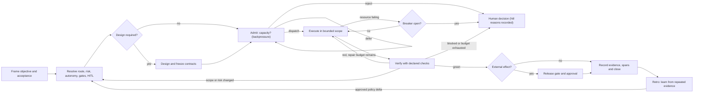

# EngineOS as the Default AI-Development Methodology — Implementation Plan

> **For agentic workers:** REQUIRED SUB-SKILL: Use superpowers:subagent-driven-development (recommended) or superpowers:executing-plans to implement this plan task-by-task. Steps use checkbox (`- [ ]`) syntax for tracking.

**Goal:** Make adopting EngineOS in a child project a single documented action, and close the seven runtime-governance gaps an external review identified (backpressure, circuit breaker, HITL entity, agent observability spans, RAG evaluation metrics, hybrid retrieval + re-ranking, agent memory architecture) without rebuilding the core.

**Architecture:** Every new control follows the existing kernel pattern: a block in `registries/policy.json` (data), a `scripts/kernel.sh` subcommand (deterministic resolver), a prose mirror in `rules/` (behaviour), a `validate-engineos.sh` check with a behavioural canary (drift guard), and cases in `scripts/test-kernel.sh`. Nothing new gets decided by the LLM that the kernel can answer. Adoption gets a project-scoped bootstrap that flips the existing opt-in gate instead of asking users to know about it.

**Tech Stack:** bash + jq (kernel, hooks, installer), JSON registries, Markdown rules/skills, Claude Code hooks (`hooks/hooks.json`), GitHub Actions (`.github/workflows/ci.yml`).

**Spec:** Part A of this document (verified findings, contracts, decisions) is the spec. Task 1 turns the contract decisions into `docs/adr/` records with rejected alternatives, which satisfies the Design gate at risk=high (`rules/gates.md`).

## Global Constraints

- Risk tier **high** (contract surface: `policy.json` shape, `kernel.sh` subcommands and rule paths are versioned public surface per `docs/COMPATIBILITY.md` + non-negotiable #11; blast radius: every child project imports the constitution). Autonomy ceiling **A3**: apply in the working tree, human approval before merge to `main`.
- Rollback path per PR: `git revert` of the squash commit. Child projects pin nothing today; the plugin version bump (1.5.0 → 1.6.0) is the upgrade marker.
- PR size ≤ 400 lines changed (`rules/git.md`). Each Task below is one PR; stacked in the order given inside a wave.
- Every new string value that can reach `.git/engineos-telemetry/` must match `^[A-Za-z0-9@_./:-]+$` (no whitespace class) — the P7 Decision 4 invariant that keeps prompt text structurally impossible.
- No new number may be a second copy of an existing one. Backpressure capacity IS `parallelism.wave_concurrency_cap`; prose quotes the registry, never the other way round.
- Additive only in this cycle: no rename, no removal, no field made mandatory that was optional. `exec-journal.sh validate` must keep accepting every line it accepted before.
- Tests are ON for this task (kernel/hook behaviour changes; the repo's own CI runs them). Run only at the final gate (Task 10), never per edit.
- Shellcheck level: `shellcheck -S error hooks/*.sh install.sh scripts/*.sh` (CI step).
- Language: English identifiers, comments, messages. No emojis in code.

---

# Part A — Spec: verified findings and frozen contracts

## A1. What the review claimed vs. what the tree shows (2026-09-03)

| # | Claim | Verdict | Evidence |
|---|---|---|---|
| 1 | Backpressure absent as first-class policy | **Partially true** | `registries/policy.json:133` `wave_concurrency_cap: 6` is the only control; `max_inflight`, `max_queue`, `overload` = 0 hits repo-wide. A static cap exists; admission control, a queue bound and an overload action do not. |
| 2 | Circuit breaker absent | **True** | `circuit`, `breaker`, `half-open`, `cooldown` = 0 hits in `registries/`, `scripts/`, `rules/`. `policy.retry` and `policy.repair` are per-unit / per-check retry ladders, not per-resource breakers. Already listed as an unadopted control in `docs/specs/2026-08-02-ai-methodology-integration-analysis.md:331`. |
| 3 | HITL not a first-class entity | **Partially true** | `HITL` = 0 hits. Semantics exist deterministically: `policy.autonomy` A3 "a human gate precedes any external effect", `gates.by_risk.high.release = required-plus-human-approval`. Missing: a kernel answer, a reason taxonomy, a record home. |
| 4 | No agent observability | **Largely false as stated** | `scripts/exec-journal.sh` already defines `run_id, capability_id, agent, model_tier, status, tokens_in, tokens_out, duration_ms`. `scripts/telemetry.sh` already enforces no-prompt-text structurally (`value_pattern`). Missing: `trace_id`/span correlation, `cost`/`cache_hit`/`retry_attempt`, span kinds, and **a writer** (exec-journal is "a schema contract, not a running service"). Also found: `policy.json telemetry.events[].written_by` names 2 hooks but 4 write (`hooks/route-advisor.sh:43`, `hooks/gate-advisor.sh:45` unlisted); C22c checks one direction only. |
| 5 | RAG eval metrics absent | **True** | `Recall@K`, `Precision@K`, `MRR`, `nDCG`, `groundedness` = 0 hits in `rules/` + `skills/`. Principle present twice (`rules/llm-apps.md:34`, `skills/llm-engineering/SKILL.md:38`). `registries/decision-rules.json` `rule-volatile-knowledge` **requires** a `retrieval-evaluation` artifact no rule defines. |
| 6 | Hybrid search + re-ranking absent | **True** | `hybrid`, `BM25`, `rerank` = 0 hits. |
| 7 | Agent memory architecture absent | **True** | `rules/memory.md` is a knowledge-placement table with a manual "3 repetitions → promote" heuristic; `docs/specs/2026-08-02-ai-methodology-integration-analysis.md:274`: "no mechanism to detect the third repetition". Review itself frames this as a later module. |
| 8 | Child-project adoption under-specified | **True** | `install.sh` is machine-scoped (symlinks into `~/.claude`, absolute `@import` in global `CLAUDE.md`). `hooks/ensure-project-layout.sh:70-73` scaffolds only where `.engineos/` already exists or `ENGINEOS_SCAFFOLD=1`. `templates/project-claude.md` is a manual copy. No per-project bootstrap command; `docs/ADOPTION.md` §2–3 describe three manual steps. |

Incidental defects found while verifying, fixed in this plan:

- `scripts/kernel.sh:180,192-193` `cmd_risk` **fails open**: a `--signals` payload without `inputs` or `floors` returns `{"risk":"low"}` exit 0. Fixed in Task 2.
- `docs/COMPATIBILITY.md` points removal-version records at `docs/release-notes/`, which does not exist. Created in Task 9.
- `docs/adr/` named as ADR home by `rules/memory.md` and `templates/project-claude.md`; does not exist. Created in Task 1.

## A2. Frozen contracts (consumed by Tasks 2–5; do not renegotiate mid-flight)

### A2.1 `policy.json` additions

```json
"parallelism": {
  "backpressure": {
    "note": "Admission control for the orchestrator's dispatch loop. Capacity is wave_concurrency_cap above (never a second copy). Answered by scripts/kernel.sh admit; mirrored in rules/parallelism.md 'Backpressure'. defer = hold the unit for the next wave; reject = stop planning, report BLOCKED, re-plan with a human (a hitl reason).",
    "max_queued_units": 12,
    "overload_action": "defer",
    "actions": ["dispatch", "defer", "reject"]
  }
},
"breaker": {
  "note": "Per-resource circuit breaker (provider, MCP server, tool, agent) — the counterpart to retry, which is per-unit. retry asks 'try this unit again?'; breaker asks 'why are we still calling this resource?'. Answered by scripts/kernel.sh breaker; the orchestrator keeps the per-resource state and failure count in the exec journal (span_kind=tool|model, status=FAILED) and passes them in. Mirrored in rules/parallelism.md 'Circuit breaker'.",
  "scopes": ["provider", "mcp", "tool", "agent"],
  "failure_threshold": 3,
  "cooldown_waves": 1,
  "half_open_probes": 1,
  "states": ["closed", "open", "half-open"]
},
"hitl": {
  "note": "Human-in-the-loop as an entity the kernel can answer about. Reasons are the only vocabulary a gate may cite; the record home is where the decision is written so it is auditable. Answered by scripts/kernel.sh hitl and folded into resolve-task. Mirrored in rules/risk-autonomy.md 'Human-in-the-loop' and rules/gates.md release checklist.",
  "reasons": [
    "high-risk",
    "evidence-insufficient",
    "external-effect",
    "policy-conflict",
    "never-retry-situation",
    "destructive-action",
    "budget-exhausted",
    "breaker-open"
  ],
  "situations": ["destructive", "budget-exhausted", "reject", "breaker-open"],
  "record_home": ".engineos/changes/<record>.md#human-decisions"
},
"telemetry": {
  "exec_journal": {
    "note": "Span-level run accounting (scripts/exec-journal.sh), distinct from the kernel-decision events above. Written by the agent-dispatch/return hooks (span_kind=agent), prompt-advisor (router) and stop-verify (verification); tool and model spans are the headless runner's to write. Same home dir, same value_pattern, same retention.",
    "home": ".git/engineos-telemetry/<session_id>.exec.jsonl",
    "span_kinds": ["router", "coordinator", "agent", "tool", "model", "verification"],
    "written_by": ["hooks/announce-agent-dispatch.sh", "hooks/announce-agent-return.sh", "hooks/prompt-advisor.sh", "hooks/stop-verify.sh"]
  }
}
```

Also in `telemetry.events[]`: `written_by` becomes an **array** (fixes the C22c one-directional gap), and a new event:

```json
{
  "id": "hitl",
  "written_by": ["hooks/prompt-advisor.sh"],
  "keys": ["required", "reasons"],
  "sample": {"required": true, "reasons": ["high-risk", "external-effect"]}
}
```

### A2.2 `kernel.sh` subcommand signatures

| Subcommand | Input | Output |
|---|---|---|
| `admit --inflight N --queued M` | non-negative integers, both required | `{action: dispatch\|defer\|reject, capacity: int, reason: string}` |
| `breaker --state closed --failures N` | | `{state, allow: bool, reason}` |
| `breaker --state open --cooldown-elapsed true\|false` | | same |
| `breaker --state half-open --probe-result ok\|failed` | | same |
| `hitl --risk T --autonomy A0..A4 [--evidence thin\|adequate] [--external-effect true\|false] [--conflict true\|false] [--situation S]` | S ∈ `retry.never_retry` ∪ `hitl.situations` | `{required: bool, reasons: [...], autonomy_after: A0..A4, record_home}` |
| `resolve-task` (existing) | unchanged | gains `hitl: {required, reasons}` computed from `risk_floor` |

All malformed input → `{"error": "..."}` on stdout, exit 1 (existing `err` convention).

### A2.3 `exec-journal.sh` schema v2 (additive, all optional)

| Field | Type | Constraint |
|---|---|---|
| `trace_id` | string | `value_pattern`; hooks use the Claude session id |
| `span_id` | string | `value_pattern`; hooks use `tool_use_id` |
| `parent_span_id` | string or null | `value_pattern` |
| `span_kind` | enum | `router\|coordinator\|agent\|tool\|model\|verification` |
| `tool` | string or null | `value_pattern` |
| `provider` | string or null | `value_pattern` |
| `model` | string or null | `value_pattern` |
| `cost_micros` | non-negative integer or null | micro-USD; integer so no float drift; null = unknown |
| `retry_attempt` | non-negative integer or null | |
| `cache_hit` | boolean or null | |
| `route` | string or null | intent id, `value_pattern` |
| `risk` | enum or null | `low\|medium\|high` |

`note` keeps its current free-text contract (changing it is a deprecation, out of scope) — flagged for the security review in Task 10.

### A2.4 Adoption bootstrap

`scripts/init-project.sh [--dir PATH] [--dry-run]` — idempotent; exits 1 with instructions if the machine install is missing; refuses to run inside the engineos repo; creates `.engineos/` + `docs/` via the shared scaffold; copies `templates/project-claude.md` to `CLAUDE.md` only when absent; prints the three remaining optional steps (MCP, CI, gates check). Exposed as `/engineos:init` (`commands/init.md`).

## A3. Decisions (each becomes an ADR in Task 1, with the rejected alternative recorded)

ADRs: `docs/adr/2026-09-03-*.md` (branch `docs/adr-runtime-governance`).

| Decision | Chosen | Rejected | Why |
|---|---|---|---|
| Where backpressure lives | `parallelism.backpressure` sub-block reusing `wave_concurrency_cap` | New top-level `backpressure` with its own `max_inflight` | Two copies of the same number drift; C16 already guards the cap. |
| Breaker vs. retry | Separate `breaker` block + subcommand; orchestrator calls `breaker` before `retry` | Extend `retry.by_situation` with `resource-open` | Different key (resource vs. unit), different state (counter + cooldown vs. attempt). Merging would make `retry` stateful. |
| HITL shape | `hitl` block with closed reason list; `hitl` subcommand; result folded into `resolve-task` | Prose-only taxonomy in `rules/risk-autonomy.md` | Prose cannot be queried by the prompt-advisor hook or emitted as telemetry; the review's whole point is observability. |
| Spans | Extend `exec-journal.sh` with optional fields; hooks become the first writer | New `scripts/spans.sh` + separate JSONL | exec-journal already has 8 of the fields and a validator; two journals with overlapping fields is the drift the P7 spec warned about. |
| Trace id | `trace_id = session_id`, `span_id = tool_use_id` | Generate UUIDs in hooks | Hooks receive both ids for free; generated ids cannot be joined to the kernel-decision events keyed by session. |
| Cost field | `cost_micros` integer | `cost_usd` float | JSONL floats round-trip badly through jq; integer micro-units are the standard fix. |
| RAG metric home | Standard in `rules/llm-apps.md`; scorer mechanics + formulas in `skills/eval-harness` | Everything in `rules/llm-apps.md` | Rules say what; skills say how (`skills/eval-harness/SKILL.md:21` records that division already). |
| Adoption entry point | `scripts/init-project.sh` + `/engineos:init`; scaffold logic extracted to `hooks/scaffold-layout.sh` and shared with the SessionStart hook | `ENGINEOS_SCAFFOLD=1` in every shell profile | Env var is machine-wide and invisible in the repo; `init` leaves `.engineos/` in git, which is the opt-in signal every hook already reads. |
| Agent memory | Design spec only this cycle | Implement tiers now | Review says "later module"; no runtime exists to give TTL/decay a clock. |

## A4. Gate requirements matched by the prompt advisor (`registries/decision-rules.json`)

| Rule | Requirement | Status |
|---|---|---|
| `rule-public-contract` | compatibility-plan | Task 9 |
| | contract-tests | `scripts/test-kernel.sh`, `scripts/test-exec-journal.sh` cases in Tasks 2–5 |
| | adr | Task 1 |
| `rule-fanout` | frozen-contracts, disjoint-scopes, single-message-dispatch | Part A2; Part B waves |
| `rule-volatile-knowledge` | retrieval-evaluation, freshness-policy | Task 6 |
| `rule-sensitive-data` | security-review | Task 10 (`security-reviewer`) |
| | human-approval | A3: before merge to `main` |
| | threat-model | **Waived**: keyword match on "PII/credentials" in the review text; this work handles no real data. The only data path is telemetry, already covered by the value_pattern invariant re-checked in Task 10. |
| `rule-high-risk-critic` | critic pass | Task 10 (`critic`) |

---

# Part B — Waves and ownership

Units that touch `registries/policy.json`, `scripts/kernel.sh`, `scripts/validate-engineos.sh` or `scripts/test-kernel.sh` cannot run in parallel (same files). They stack serially in Wave 2. Everything else is disjoint and fans out.

```
[fanout] waves=4
  wave1=(T1 adr+spec: product-spec/fable, T7 adoption: devops-coordinator/opus, T6 rag-prose: llm-coordinator/opus, T8 memory-design: llm-coordinator/opus [disjoint file])
  wave2=(T2 → T3 → T4 → T5 serial stack: backend-coordinator/opus, one PR each)
  wave3=(T9 governance: docs-writer/opus)
  wave4=(T10 critic/opus + security-reviewer/opus, then final gate)
```

Barrier rule: wave 2 starts only after T1's ADRs are merged or approved in review (design gate). Wave 3 starts after wave 2's last PR. Final gate runs once, at wave 4.

| Task | Owner agent | Files (exclusive) |
|---|---|---|
| T1 | `product-spec` (mariana), model fable | `docs/adr/*` (new dir) |
| T2 | `backend-coordinator` (borisenko) | `scripts/kernel.sh`, `registries/policy.json`, `scripts/test-kernel.sh`, `scripts/validate-engineos.sh`, `scripts/test-validate-engineos.sh`, `rules/parallelism.md` |
| T3 | same, next PR | same set |
| T4 | same, next PR | same set + `rules/risk-autonomy.md`, `rules/gates.md`, `hooks/prompt-advisor.sh`, `.engineos/changes/_template.md` |
| T5 | same, next PR | `scripts/exec-journal.sh`, `scripts/test-exec-journal.sh`, `hooks/announce-agent-dispatch.sh`, `hooks/announce-agent-return.sh`, `hooks/stop-verify.sh`, `rules/observability.md`, `registries/policy.json`, `scripts/validate-engineos.sh` |
| T6 | `llm-coordinator` (hermsdorff) | `rules/llm-apps.md`, `skills/llm-engineering/SKILL.md`, `skills/eval-harness/SKILL.md`, `skills/eval-harness/references/retrieval-metrics.md` (new) |
| T7 | `devops-coordinator` (hinokuma) | `scripts/init-project.sh` (new), `hooks/scaffold-layout.sh` (new), `hooks/ensure-project-layout.sh`, `commands/init.md` (new), `templates/project-claude.md`, `docs/ADOPTION.md`, `install.sh`, `hooks/test-layout.sh` |
| T8 | `llm-coordinator` | `docs/specs/2026-09-03-agent-memory-architecture-design.md` (new) |
| T9 | `docs-writer` (tomasz) | `docs/COMPATIBILITY.md`, `docs/release-notes/1.6.0.md` (new), `.claude-plugin/plugin.json`, `docs/METHODOLOGY.md`, `.engineos/changes/2026-09-03-runtime-governance-modules.md` |
| T10 | `critic` (vera), `security-reviewer` (leo-ely) | read-only |

---

# Part C — Tasks

### Task 1: Design gate — ADRs for the frozen contracts

**Files:**
- Create: `docs/adr/README.md`
- Create: `docs/adr/2026-09-03-backpressure-reuses-wave-cap.md`
- Create: `docs/adr/2026-09-03-circuit-breaker-separate-from-retry.md`
- Create: `docs/adr/2026-09-03-hitl-as-kernel-entity.md`
- Create: `docs/adr/2026-09-03-spans-extend-exec-journal.md`
- Create: `docs/adr/2026-09-03-init-project-over-env-flag.md`

**Interfaces:**
- Consumes: Part A3 decision table.
- Produces: five ADRs that Tasks 2–7 cite in their commit bodies.

- [ ] **Step 1: Create the ADR directory with a README**

```markdown
# Architecture Decision Records

One file per decision, `YYYY-MM-DD-<slug>.md`, written with the `adr` skill.
Status is one of: proposed, accepted, superseded-by <file>.
A decision without a rejected alternative is a preference, not a decision (`rules/gates.md`).
```

- [ ] **Step 2: Write each ADR using the `adr` skill's template**

Every ADR has: Context (the finding from Part A1 with its line refs), Decision (the "Chosen" column), Alternatives considered (the "Rejected" column, with why), Consequences (what Tasks 2–7 must do), Status `accepted`. For the backpressure ADR the Consequences section states verbatim: "`parallelism.backpressure` carries no `max_inflight`; capacity is `wave_concurrency_cap`. `validate-engineos.sh` C24a fails if a `max_inflight*` key appears."

- [ ] **Step 3: Cross-link from the plan**

Add one line under Part A3 of this plan: `ADRs: docs/adr/2026-09-03-*.md`.

- [ ] **Step 4: Commit**

```bash
git add docs/adr docs/specs/2026-09-03-engineos-default-methodology-plan.md
git commit -m "docs(adr): record the runtime-governance contract decisions"
```

---

### Task 2: Backpressure — `kernel.sh admit` + fail-open fix in `cmd_risk`

**Files:**
- Modify: `registries/policy.json:119-145` (add `parallelism.backpressure`)
- Modify: `scripts/kernel.sh:167-203` (`cmd_risk` fail-closed), add `cmd_admit`, dispatcher `:604-621`
- Modify: `scripts/test-kernel.sh`
- Modify: `scripts/validate-engineos.sh` (new C24), `scripts/test-validate-engineos.sh`
- Modify: `rules/parallelism.md` (new `## Backpressure` section after `## Hard rules`)

**Interfaces:**
- Consumes: A2.1 `parallelism.backpressure`, A2.2 `admit`.
- Produces: `kernel.sh admit` output shape used by `rules/parallelism.md` prose and by Task 4's `hitl --situation reject`.

- [ ] **Step 1: Write the failing kernel tests**

Append to `scripts/test-kernel.sh` before the summary block:

```bash
# ----------------------------------------------------------------------- admit
echo "-- admit --"
cap=$(jq -r '.parallelism.wave_concurrency_cap' "$REG/policy.json")
maxq=$(jq -r '.parallelism.backpressure.max_queued_units' "$REG/policy.json")

run admit --inflight 0 --queued 0
assert_ok "admit with idle capacity exits 0"
assert_eq "admit idle -> dispatch" "$(jqval .action)" "dispatch"
assert_eq "admit idle capacity == cap" "$(jqval .capacity)" "$cap"

run admit --inflight "$cap" --queued 0
assert_eq "admit at cap -> overload_action" "$(jqval .action)" "$(jq -r '.parallelism.backpressure.overload_action' "$REG/policy.json")"
assert_eq "admit at cap capacity 0" "$(jqval .capacity)" "0"

run admit --inflight "$cap" --queued "$maxq"
assert_eq "admit at cap and queue full -> reject" "$(jqval .action)" "reject"

run admit --inflight abc --queued 0
assert_err "admit rejects a non-numeric --inflight"
run admit --inflight 1
assert_err "admit requires --queued"

# ------------------------------------------------------- risk fail-closed fix
echo "-- risk fail-closed --"
run risk --signals '{}'
assert_err "risk with neither inputs nor floors is an error, not low"
run risk --signals '{"inputs":{}}'
assert_err "risk with empty inputs and no floors is an error"
run risk --signals '{"floors":["destructive-ddl-dml"]}'
assert_ok "risk with a floor and no inputs is still answerable"
assert_eq "floor alone -> high" "$(jqval .risk)" "high"
```

(Floor id from `registries/policy.json` `risk.high_floors`.)

- [ ] **Step 2: Run to verify failure**

Run: `bash scripts/test-kernel.sh 2>&1 | grep -E '^FAIL|admit|fail-closed'`
Expected: FAIL lines for every admit case (`usage:` error) and for the two fail-closed cases (they currently exit 0 with `low`).

- [ ] **Step 3: Add the registry block**

In `registries/policy.json`, inside `"parallelism"`, after `"disjoint_file_scopes": true,` insert the `backpressure` object from A2.1 verbatim.

- [ ] **Step 4: Fix `cmd_risk` fail-open**

Replace `scripts/kernel.sh:180-181`:

```jq
    | ((.inputs // {}) | to_entries) as $in
    | ((.floors // [])) as $fl
```

with:

```jq
    | ((.inputs // {}) | to_entries) as $in
    | ((.floors // [])) as $fl
    | if ($in | length) == 0 and ($fl | length) == 0
        then {error: "risk --signals needs a non-empty inputs{} or floors[] — an empty payload is not low risk, it is no evidence"}
      else
```

and close the new `else` by changing the final line `end')` of the jq program to `end end')`. Delete the now-unreachable `else "low" end` branch at `:193` and keep `elif ($in | length) > 0 then "low"` as the terminal branch: `else "low" end` → remove, so the chain reads `... elif ([$in[].value] | index("medium")) then "medium" else "low" end`.

- [ ] **Step 5: Add `cmd_admit`**

Insert after `cmd_repair` (before `cmd_capability`):

```bash
# --------------------------------------------------------------------- admit
# Backpressure: may one more unit be dispatched right now? Capacity is
# parallelism.wave_concurrency_cap (never a second copy of the number); the
# queue bound and the overload action live in parallelism.backpressure.
# rules/parallelism.md "Backpressure" is the prose mirror; C24 guards both.
cmd_admit() {
  local inflight="" queued=""
  while [ $# -gt 0 ]; do
    case "$1" in
      --inflight) inflight="${2:-}"; shift 2 ;;
      --queued)   queued="${2:-}"; shift 2 ;;
      *) err "admit: unknown argument $1" ;;
    esac
  done
  case "$inflight" in ''|*[!0-9]*) err "admit requires a numeric --inflight" ;; esac
  case "$queued"   in ''|*[!0-9]*) err "admit requires a numeric --queued" ;; esac
  need_reg policy.json
  jq -n --argjson i "$inflight" --argjson q "$queued" --slurpfile pol "$REG/policy.json" '
    $pol[0].parallelism as $par
    | $par.wave_concurrency_cap as $cap
    | $par.backpressure.max_queued_units as $maxq
    | ($cap - $i) as $capacity
    | if $capacity > 0 then
        {action: "dispatch", capacity: $capacity,
         reason: "inflight \($i) below cap \($cap)"}
      elif $q < $maxq then
        {action: $par.backpressure.overload_action, capacity: 0,
         reason: "cap \($cap) reached; \($q) of \($maxq) queued — hold the unit for the next wave"}
      else
        {action: "reject", capacity: 0,
         reason: "cap \($cap) reached and queue full (\($q)/\($maxq)) — stop planning, report BLOCKED, re-plan with a human (hitl: budget-exhausted)"}
      end'
}
```

Add `admit)          cmd_admit "$@" ;;` to the dispatcher and `admit` to the usage string.

- [ ] **Step 6: Run kernel tests**

Run: `bash scripts/test-kernel.sh 2>&1 | tail -3`
Expected: `0 failed` (or the existing pass/fail summary with fail=0).

- [ ] **Step 7: Add validate check C24 with canary**

In `scripts/validate-engineos.sh`, after the C23 group and before C13, add:

```bash
  # ------------- C24: backpressure — data, canary, prose mirror
  # Spec: docs/specs/2026-09-03-engineos-default-methodology-plan.md Task 2
  if want C24; then
  if [ -f "$PJ" ] && [ -x "$KSH" ]; then
    b_bad=""
    maxq=$(jq -r '.parallelism.backpressure.max_queued_units' "$PJ" 2>/dev/null)
    case "$maxq" in ''|*[!0-9]*) b_bad="$b_bad max_queued_units-not-a-nonneg-integer"; maxq="" ;; esac
    oa=$(jq -r '.parallelism.backpressure.overload_action // ""' "$PJ")
    jq -e --arg a "$oa" '.parallelism.backpressure.actions | index($a)' "$PJ" >/dev/null 2>&1 \
      || b_bad="$b_bad overload_action-not-in-actions"
    jq -e '.parallelism.backpressure | keys[] | select(test("max_inflight"))' "$PJ" >/dev/null 2>&1 \
      && b_bad="$b_bad has-a-max_inflight-copy-of-wave_concurrency_cap"
    [ -z "$b_bad" ] && ok "policy.json.parallelism.backpressure is well-formed" \
                     || bad "backpressure block problems:$b_bad"

    # C24b: canary — the kernel rejects exactly when the registry says the queue is full
    cap=$(jq -r '.parallelism.wave_concurrency_cap' "$PJ")
    got=$(bash "$KSH" admit --inflight "$cap" --queued "${maxq:-0}" 2>/dev/null | jq -r '.action // empty')
    [ "$got" = "reject" ] && ok "kernel.sh admit rejects at cap with a full queue" \
                          || bad "admit canary: expected reject at cap/full-queue, got '$got'"

    # C24c: prose mirror — rules/parallelism.md quotes the queue bound and names the subcommand
    p_bad=""
    grep -q 'kernel.sh admit' rules/parallelism.md 2>/dev/null || p_bad="$p_bad parallelism.md-does-not-name-kernel.sh-admit"
    grep -qE "max_queued_units[^0-9]*${maxq}\b" rules/parallelism.md 2>/dev/null || p_bad="$p_bad parallelism.md-queue-bound-disagrees-with-registry(${maxq})"
    [ -z "$p_bad" ] && ok "rules/parallelism.md mirrors policy.json.parallelism.backpressure" \
                     || bad "backpressure prose-mirror problems:$p_bad"
  else
    bad "policy.json or kernel.sh missing — backpressure checks skipped"
  fi
  fi
```

Add a negative case to `scripts/test-validate-engineos.sh` following its existing copy-mutate-run pattern: set `.parallelism.backpressure.max_queued_units` to `"many"` in the temp copy, run `--only C24`, expect `FAIL`.

- [ ] **Step 8: Write the prose mirror**

Append to `rules/parallelism.md` after `## Hard rules`:

```markdown
## Backpressure

The wave cap says how many agents may run. Backpressure says what happens when
work arrives faster than the cap drains it. Before every dispatch the
orchestrator asks the kernel:

`scripts/kernel.sh admit --inflight <running agents> --queued <units waiting>`

| Answer | Meaning |
|---|---|
| `dispatch` | capacity remains under the wave cap — go |
| `defer` | cap reached, queue below `max_queued_units` (12) — hold the unit for the next wave |
| `reject` | cap reached and queue full — stop planning, report `BLOCKED`, re-plan with a human |

`reject` is a HITL reason (`budget-exhausted`), not a retry. Capacity is the
same number as the wave cap above; the queue bound lives in
`registries/policy.json` `parallelism.backpressure`.
```

- [ ] **Step 9: Commit**

```bash
git add registries/policy.json scripts/kernel.sh scripts/test-kernel.sh scripts/validate-engineos.sh scripts/test-validate-engineos.sh rules/parallelism.md
git commit -m "feat(kernel): add admit backpressure resolver, fail risk closed on empty signals" -m "ADR: docs/adr/2026-09-03-backpressure-reuses-wave-cap.md"
```

---

### Task 3: Circuit breaker — `kernel.sh breaker`

**Files:**
- Modify: `registries/policy.json` (new top-level `breaker` after `repair`)
- Modify: `scripts/kernel.sh` (add `cmd_breaker`, dispatcher)
- Modify: `scripts/test-kernel.sh`
- Modify: `scripts/validate-engineos.sh` (C25), `scripts/test-validate-engineos.sh`
- Modify: `rules/parallelism.md` (new `## Circuit breaker` after `## Failure policy`)

**Interfaces:**
- Consumes: A2.1 `breaker`, A2.2 `breaker` signature.
- Produces: `{state, allow, reason}`; Task 5's `span_kind=tool|model` FAILED lines are the failure counter's source.

- [ ] **Step 1: Write the failing tests**

```bash
# --------------------------------------------------------------------- breaker
echo "-- breaker --"
thr=$(jq -r '.breaker.failure_threshold' "$REG/policy.json")

run breaker --state closed --failures 0
assert_eq "closed with 0 failures stays closed" "$(jqval .state)" "closed"
assert_eq "closed allows" "$(jqval .allow)" "true"
run breaker --state closed --failures "$thr"
assert_eq "closed at threshold opens" "$(jqval .state)" "open"
assert_eq "open blocks" "$(jqval .allow)" "false"
run breaker --state open --cooldown-elapsed false
assert_eq "open before cooldown stays open" "$(jqval .state)" "open"
run breaker --state open --cooldown-elapsed true
assert_eq "open after cooldown goes half-open" "$(jqval .state)" "half-open"
assert_eq "half-open allows a probe" "$(jqval .allow)" "true"
run breaker --state half-open --probe-result ok
assert_eq "successful probe closes" "$(jqval .state)" "closed"
run breaker --state half-open --probe-result failed
assert_eq "failed probe reopens" "$(jqval .state)" "open"
run breaker --state closed
assert_err "closed requires --failures"
run breaker --state open
assert_err "open requires --cooldown-elapsed"
run breaker --state bogus --failures 1
assert_err "unknown state is an error"
```

- [ ] **Step 2: Run to verify failure**

Run: `bash scripts/test-kernel.sh 2>&1 | grep -c '^FAIL.*breaker\|^FAIL.*probe\|^FAIL.*closed\|^FAIL.*open'`
Expected: 11.

- [ ] **Step 3: Add the registry block**

Insert the `breaker` object from A2.1 as a top-level key after `"repair": {...}` in `registries/policy.json`.

- [ ] **Step 4: Add `cmd_breaker`**

Insert after `cmd_admit`:

```bash
# ------------------------------------------------------------------- breaker
# Per-resource circuit breaker. retry (above) asks "try this UNIT again?";
# breaker asks "why are we still calling this RESOURCE?". The orchestrator
# owns the state and the consecutive-failure count (from the exec journal)
# and passes them in — the kernel is the transition table, nothing more.
cmd_breaker() {
  local state="" failures="" cooldown="" probe=""
  while [ $# -gt 0 ]; do
    case "$1" in
      --state)            state="${2:-}"; shift 2 ;;
      --failures)         failures="${2:-}"; shift 2 ;;
      --cooldown-elapsed) cooldown="${2:-}"; shift 2 ;;
      --probe-result)     probe="${2:-}"; shift 2 ;;
      *) err "breaker: unknown argument $1" ;;
    esac
  done
  case "$state" in closed|open|half-open) ;; *) err "breaker requires --state closed|open|half-open" ;; esac
  need_reg policy.json
  local P="$REG/policy.json"
  case "$state" in
    closed)
      case "$failures" in ''|*[!0-9]*) err "breaker --state closed requires a numeric --failures" ;; esac
      jq -n --argjson f "$failures" --slurpfile pol "$P" '
        $pol[0].breaker as $b
        | if $f >= $b.failure_threshold
          then {state: "open", allow: false,
                reason: "\($f) consecutive failures reached threshold \($b.failure_threshold) — stop calling this resource for \($b.cooldown_waves) wave(s); route around or report DEGRADED"}
          else {state: "closed", allow: true,
                reason: "\($f) of \($b.failure_threshold) failures — resource healthy"} end' ;;
    open)
      case "$cooldown" in true|false) ;; *) err "breaker --state open requires --cooldown-elapsed true|false" ;; esac
      if [ "$cooldown" = true ]; then
        jq -n --slurpfile pol "$P" '{state: "half-open", allow: true,
          reason: "cooldown elapsed — allow \($pol[0].breaker.half_open_probes) probe call(s); no fan-out through this resource until it closes"}'
      else
        jq -n '{state: "open", allow: false, reason: "cooldown not elapsed — do not call; route around or report DEGRADED"}'
      fi ;;
    half-open)
      case "$probe" in ok|failed) ;; *) err "breaker --state half-open requires --probe-result ok|failed" ;; esac
      if [ "$probe" = ok ]; then
        jq -n '{state: "closed", allow: true, reason: "probe succeeded — resource recovered; reset the failure count to 0"}'
      else
        jq -n '{state: "open", allow: false, reason: "probe failed — reopen for another cooldown"}'
      fi ;;
  esac
}
```

Register `breaker)        cmd_breaker "$@" ;;` in the dispatcher and usage.

- [ ] **Step 5: Run kernel tests**

Run: `bash scripts/test-kernel.sh 2>&1 | tail -3`
Expected: fail=0.

- [ ] **Step 6: Add validate check C25**

Same three-part shape as C24: (a) block well-formed — `failure_threshold` ≥ 1 integer, `states` exactly `closed,half-open,open` sorted, `scopes` non-empty, `cooldown_waves` ≥ 1; (b) canary — `bash "$KSH" breaker --state closed --failures "$thr"` returns `open`, and `--state half-open --probe-result ok` returns `closed`; (c) prose — `rules/parallelism.md` contains `kernel.sh breaker` and the literal threshold number next to `failure_threshold`. Add a negative case to `scripts/test-validate-engineos.sh` setting `.breaker.states` to `["closed","open"]`.

- [ ] **Step 7: Prose mirror**

Append to `rules/parallelism.md` after `## Failure policy`:

```markdown
## Circuit breaker

The failure policy above is per unit. The breaker is per resource — a provider,
an MCP server, a tool, an agent type — and answers a different question: not
"retry?" but "why are we still calling this?". Consult it BEFORE `retry`.

`scripts/kernel.sh breaker --state closed --failures <consecutive failures on this resource>`

| State | Rule |
|---|---|
| `closed` | calls allowed; `failure_threshold` (3) consecutive failures opens it |
| `open` | calls blocked for `cooldown_waves` (1); route around or report `DEGRADED` |
| `half-open` | after cooldown, `half_open_probes` (1) call is allowed; success closes, failure reopens |

The consecutive-failure count comes from the exec journal
(`rules/observability.md` "Agent traces"): `span_kind` `tool` or `model`,
`status: FAILED`, same `tool`/`provider`. An open breaker on a resource a unit
needs makes that unit `BLOCKED`, which is a HITL reason (`breaker-open`) when
no alternative resource exists.
```

- [ ] **Step 8: Commit**

```bash
git add registries/policy.json scripts/kernel.sh scripts/test-kernel.sh scripts/validate-engineos.sh scripts/test-validate-engineos.sh rules/parallelism.md
git commit -m "feat(kernel): add per-resource circuit breaker resolver" -m "ADR: docs/adr/2026-09-03-circuit-breaker-separate-from-retry.md"
```

---

### Task 4: HITL as a kernel entity — `kernel.sh hitl`, folded into `resolve-task`

**Files:**
- Modify: `registries/policy.json` (new top-level `hitl`; new `telemetry.events[]` entry `hitl`; `written_by` → arrays)
- Modify: `scripts/kernel.sh` (add `cmd_hitl`; `cmd_resolve_task` adds `hitl`)
- Modify: `scripts/test-kernel.sh`
- Modify: `hooks/prompt-advisor.sh` (emit `hitl` line + telemetry event when `required`)
- Modify: `scripts/validate-engineos.sh` (C26; C22c reads `written_by[]`), `scripts/test-validate-engineos.sh`
- Modify: `rules/risk-autonomy.md` (new `## Human-in-the-loop`), `rules/gates.md` (release checklist line), `.engineos/changes/_template.md` (new `## Human decisions`)

**Interfaces:**
- Consumes: A2.1 `hitl`, `retry.never_retry`; Task 2's `reject`; Task 3's `open`.
- Produces: `{required, reasons[], autonomy_after, record_home}`; `resolve-task.hitl`; telemetry event `hitl`.

- [ ] **Step 1: Write the failing tests**

```bash
# ------------------------------------------------------------------------ hitl
echo "-- hitl --"
run hitl --risk low --autonomy A2
assert_ok "hitl low/A2 exits 0"
assert_eq "hitl low/A2 not required" "$(jqval .required)" "false"
assert_eq "hitl low/A2 no reasons" "$(jqvalc .reasons)" "[]"
run hitl --risk high --autonomy A3
assert_eq "hitl high required" "$(jqval .required)" "true"
assert_eq "hitl high reason" "$(jqvalc .reasons)" '["high-risk"]'
run hitl --risk medium --autonomy A3 --external-effect true
assert_eq "hitl external effect at A3 required" "$(jqvalc .reasons)" '["external-effect"]'
run hitl --risk medium --autonomy A2 --evidence thin
assert_eq "thin evidence drops autonomy to A1" "$(jqval .autonomy_after)" "A1"
assert_eq "thin evidence reason" "$(jqvalc .reasons)" '["evidence-insufficient"]'
run hitl --risk low --autonomy A2 --situation security-risk
assert_eq "never-retry situation is a hitl reason" "$(jqvalc .reasons)" '["never-retry-situation"]'
run hitl --risk low --autonomy A2 --situation reject
assert_eq "backpressure reject maps to budget-exhausted" "$(jqvalc .reasons)" '["budget-exhausted"]'
run hitl --risk low --autonomy A2 --situation breaker-open
assert_eq "open breaker is a hitl reason" "$(jqvalc .reasons)" '["breaker-open"]'
run hitl --risk high --autonomy A3 --conflict true --external-effect true
assert_eq "reasons accumulate in fixed order" "$(jqvalc .reasons)" '["high-risk","external-effect","policy-conflict"]'
run hitl --risk low --autonomy A2 --situation nonsense
assert_err "unknown situation is an error"
run hitl --autonomy A2
assert_err "hitl requires --risk"

run resolve-task --prompt "drop the users table in production"
assert_eq "resolve-task carries hitl" "$(jqval .hitl.required)" "true"
```

- [ ] **Step 2: Run to verify failure**

Run: `bash scripts/test-kernel.sh 2>&1 | grep -c '^FAIL.*hitl'`
Expected: ≥ 12.

- [ ] **Step 3: Registry**

Add the `hitl` block (A2.1) after `breaker`. In `telemetry.events[]`, change every `"written_by": "x"` to `"written_by": ["x"]`, set the `route` event's array to `["hooks/prompt-advisor.sh", "hooks/route-advisor.sh"]` and `decision-rules` to `["hooks/prompt-advisor.sh", "hooks/gate-advisor.sh"]` (the real writers), and append the `hitl` event object from A2.1.

- [ ] **Step 4: Add `cmd_hitl`**

```bash
# ---------------------------------------------------------------------- hitl
# Human-in-the-loop as a queryable entity: given the tier, ceiling, evidence
# quality and situation, does a human have to decide, and for which named
# reasons? Reasons are the closed list in policy.hitl.reasons — a gate may
# cite nothing else. rules/risk-autonomy.md "Human-in-the-loop" mirrors it.
cmd_hitl() {
  local risk="" autonomy="" evidence="adequate" external="false" conflict="false" situation=""
  while [ $# -gt 0 ]; do
    case "$1" in
      --risk)            risk="${2:-}"; shift 2 ;;
      --autonomy)        autonomy="${2:-}"; shift 2 ;;
      --evidence)        evidence="${2:-}"; shift 2 ;;
      --external-effect) external="${2:-}"; shift 2 ;;
      --conflict)        conflict="${2:-}"; shift 2 ;;
      --situation)       situation="${2:-}"; shift 2 ;;
      *) err "hitl: unknown argument $1" ;;
    esac
  done
  case "$risk"     in low|medium|high) ;; *) err "hitl requires --risk low|medium|high" ;; esac
  case "$autonomy" in A0|A1|A2|A3|A4) ;;  *) err "hitl requires --autonomy A0..A4" ;; esac
  case "$evidence" in thin|adequate) ;;   *) err "hitl --evidence must be thin|adequate" ;; esac
  case "$external" in true|false) ;;      *) err "hitl --external-effect must be true|false" ;; esac
  case "$conflict" in true|false) ;;      *) err "hitl --conflict must be true|false" ;; esac
  need_reg policy.json
  local P="$REG/policy.json"
  if [ -n "$situation" ]; then
    jq -e --arg s "$situation" '(.retry.never_retry + .hitl.situations) | index($s)' "$P" >/dev/null 2>&1 \
      || err "unknown situation: $situation (one of retry.never_retry or hitl.situations)"
  fi
  jq -n --arg r "$risk" --arg a "$autonomy" --arg e "$evidence" --arg s "$situation" \
        --argjson x "$external" --argjson c "$conflict" --slurpfile pol "$P" '
    $pol[0] as $p
    | ([ (if $r == "high" then "high-risk" else empty end),
         (if $e == "thin" then "evidence-insufficient" else empty end),
         (if $x and ($a == "A3" or $a == "A4") then "external-effect" else empty end),
         (if $c then "policy-conflict" else empty end),
         (if $s != "" and ($p.retry.never_retry | index($s)) then "never-retry-situation" else empty end),
         (if $s == "destructive" then "destructive-action" else empty end),
         (if $s == "budget-exhausted" or $s == "reject" then "budget-exhausted" else empty end),
         (if $s == "breaker-open" then "breaker-open" else empty end) ]) as $reasons
    | {required: (($reasons | length) > 0),
       reasons: $reasons,
       autonomy_after: (if $e == "thin" then "A1" else $a end),
       record_home: $p.hitl.record_home}'
}
```

Register `hitl)           cmd_hitl "$@" ;;` in the dispatcher and usage.

- [ ] **Step 5: Fold into `resolve-task`**

In `cmd_resolve_task`, after the risk floor and decision rules are computed, add a call `hitl_json=$(cmd_hitl --risk "$risk_floor" --autonomy "$ceiling" $( [ "$any_high" = true ] && printf -- '--conflict true' ))` (use the local variable names the function already has for the floor, the ceiling from `.autonomy.ceiling_by_risk[$tier]`, and `decision_rules.any_high`) and merge `hitl: {required, reasons}` into the output object at `scripts/kernel.sh:~600`.

- [ ] **Step 6: Emit from the prompt advisor**

In `hooks/prompt-advisor.sh`, where the `resolve-task` JSON is already parsed, add:

```bash
hitl_req=$(printf '%s' "$TASK" | jq -r '.hitl.required // false')
if [ "$hitl_req" = "true" ]; then
  hitl_reasons=$(printf '%s' "$TASK" | jq -r '.hitl.reasons | join(", ")')
  printf '[engineos] human-in-the-loop required — reasons: %s. Record the decision under "## Human decisions" in the change record before any external effect (rules/risk-autonomy.md).\n' "$hitl_reasons"
  "$REPO_DIR/scripts/telemetry.sh" append hitl "$(printf '%s' "$TASK" | jq -c '{required: .hitl.required, reasons: .hitl.reasons}')" 2>/dev/null || true
fi
```

Match the existing telemetry call style at `hooks/prompt-advisor.sh:47,54` exactly (argument order, session id handling).

- [ ] **Step 7: Validate checks**

C26: (a) `hitl.reasons` ≥ 8 unique strings, `hitl.situations` non-empty, `record_home` present; (b) canary `bash "$KSH" hitl --risk high --autonomy A3 | jq -r .required` == `true` and `--risk low --autonomy A2` == `false`; (c) prose — `rules/risk-autonomy.md` names `kernel.sh hitl` and lists every reason id (loop the registry, grep each); `rules/gates.md` release checklist mentions `Human decisions`; `.engineos/changes/_template.md` has `## Human decisions`. Update C22c so it iterates `written_by[]` and additionally asserts the **reverse**: every hook that calls `telemetry.sh append <event>` is listed for that event (`grep -l 'telemetry.sh" append <id>' hooks/*.sh`). Update C22a to accept arrays. If C21 asserts the change-record template's heading list, add `## Human decisions` there in the same PR. Negative cases: remove one reason from the temp copy → `--only C26` FAILs; add a fake writer hook file → `--only C22` FAILs.

- [ ] **Step 8: Prose mirrors**

`rules/risk-autonomy.md`, new section after `## Mapping — the ceiling, not the target`:

```markdown
## Human-in-the-loop

The ceiling says how far you may go alone. HITL says when a human must decide,
and names why, so the decision is auditable rather than implied by a tier.

`scripts/kernel.sh hitl --risk <tier> --autonomy <ceiling> [--evidence thin] [--external-effect true] [--conflict true] [--situation <s>]`

| Reason | Fires when |
|---|---|
| `high-risk` | tier is high |
| `evidence-insufficient` | evidence is thin — autonomy drops to A1 |
| `external-effect` | the action leaves the working tree at A3 or above (merge, deploy, publish, send) |
| `policy-conflict` | decision rules disagree, or a matched rule carries risk=high on a lower-tier task |
| `never-retry-situation` | the situation is on `retry.never_retry` |
| `destructive-action` | destructive DDL/DML, secret rotation, data deletion |
| `budget-exhausted` | the repair or retry bound is spent, or backpressure answered `reject` |
| `breaker-open` | a needed resource's breaker is open with no alternative |

`resolve-task` carries `hitl.required` and `hitl.reasons` so the prompt advisor
can announce them before the first write. The decision itself is recorded in
the change record under `## Human decisions`: who, when, which reasons, what
was approved or refused. A tier that requires a human and has no such record
has not passed its gate.
```

`rules/gates.md` release checklist: add `- [ ] For any \`hitl.required\`: the human decision is recorded under \`## Human decisions\` in the change record, with the reason ids.`

`.engineos/changes/_template.md`: add section `## Human decisions` with the line `<!-- date | who | reasons (from registries/policy.json hitl.reasons) | approved/refused | note -->`.

- [ ] **Step 9: Run tests, commit**

Run: `bash scripts/test-kernel.sh 2>&1 | tail -3` → fail=0.

```bash
git add registries/policy.json scripts/kernel.sh scripts/test-kernel.sh hooks/prompt-advisor.sh scripts/validate-engineos.sh scripts/test-validate-engineos.sh rules/risk-autonomy.md rules/gates.md .engineos/changes/_template.md
git commit -m "feat(kernel): make human-in-the-loop a queryable entity with a reason taxonomy" -m "ADR: docs/adr/2026-09-03-hitl-as-kernel-entity.md"
```

---

### Task 5: Agent observability — exec-journal spans + first writer

**Files:**
- Modify: `scripts/exec-journal.sh` (v2 optional fields)
- Modify: `scripts/test-exec-journal.sh`
- Modify: `hooks/announce-agent-dispatch.sh`, `hooks/announce-agent-return.sh` (agent spans)
- Modify: `hooks/stop-verify.sh` (verification span), `hooks/prompt-advisor.sh` (router span)
- Modify: `registries/policy.json` (`telemetry.exec_journal` block from A2.1)
- Modify: `scripts/validate-engineos.sh` (C27), `scripts/test-validate-engineos.sh`
- Modify: `rules/observability.md` (new `## Agent traces`)
- Modify: `hooks/ensure-project-layout.sh:55-59` (reap `*.exec.jsonl` too — the glob `'*.jsonl'` already matches; add a comment saying so)

**Interfaces:**
- Consumes: A2.3 schema; A2.1 `telemetry.exec_journal`.
- Produces: `.git/engineos-telemetry/<session>.exec.jsonl` lines that Task 3's breaker count reads; `skills/retro` may read them later (out of scope).

- [ ] **Step 1: Write the failing tests**

Append to `scripts/test-exec-journal.sh` (mirror its existing helper names):

```bash
echo "-- v2 span fields --"
J=$(mktemp)
# v1 line still valid (backward compatibility is the contract)
bash "$EJ" append "$J" --run-id r1 --capability-id route --model-tier build --status OK --tokens-in 1 --tokens-out 1 --duration-ms 5
bash "$EJ" validate "$J" >/dev/null && pass "v1 line still validates" || fail "v1 line rejected"

bash "$EJ" append "$J" --run-id r1 --capability-id route --model-tier build --status FAILED \
  --tokens-in 0 --tokens-out 0 --duration-ms 900 \
  --trace-id sess-1 --span-id tu-1 --span-kind tool --tool mcp.postgres --provider anthropic \
  --model claude-opus-5 --cost-micros 1200 --retry-attempt 1 --cache-hit false --route dba --risk medium
bash "$EJ" validate "$J" >/dev/null && pass "v2 line validates" || fail "v2 line rejected"
tail -1 "$J" | jq -e '.span_kind=="tool" and .cost_micros==1200 and .cache_hit==false and .trace_id=="sess-1"' >/dev/null \
  && pass "v2 fields round-trip" || fail "v2 fields lost"

bash "$EJ" append "$J" --run-id r1 --capability-id route --model-tier build --status OK --tokens-in 0 --tokens-out 0 --duration-ms 1 --span-kind bogus 2>/dev/null \
  && fail "unknown span_kind accepted" || pass "unknown span_kind rejected"
bash "$EJ" append "$J" --run-id r1 --capability-id route --model-tier build --status OK --tokens-in 0 --tokens-out 0 --duration-ms 1 --trace-id "has space" 2>/dev/null \
  && fail "whitespace in trace_id accepted" || pass "whitespace in trace_id rejected (no prompt-text channel)"
bash "$EJ" append "$J" --run-id r1 --capability-id route --model-tier build --status OK --tokens-in 0 --tokens-out 0 --duration-ms 1 --cost-micros 1.5 2>/dev/null \
  && fail "float cost accepted" || pass "float cost rejected"
rm -f "$J"
```

- [ ] **Step 2: Run to verify failure**

Run: `bash scripts/test-exec-journal.sh 2>&1 | grep -c FAIL`
Expected: ≥ 4 (`unknown arg: --trace-id` path).

- [ ] **Step 3: Extend `exec-journal.sh append`**

Add to the header comment the twelve v2 fields from A2.3 marked `(optional, v2)`. Add constants:

```bash
VALID_SPAN_KINDS="router coordinator agent tool model verification"
VALID_RISKS="low medium high"
# Same no-whitespace class as registries/policy.json telemetry.value_pattern:
# no free-text field may be added to a span without a deprecation (docs/COMPATIBILITY.md).
SLUG_RE='^[A-Za-z0-9@_./:-]+$'
is_slug() { printf '%s' "$1" | grep -Eq "$SLUG_RE"; }
```

Extend the flag loop with `--trace-id --span-id --parent-span-id --span-kind --tool --provider --model --cost-micros --retry-attempt --cache-hit --route --risk`, each setting `<name>_val` and `<name>_set=1`. Validate: `span_kind` via `in_list`, `risk` via `in_list`, `cache_hit` ∈ `true|false`, `cost_micros`/`retry_attempt` via `is_nonneg_int`, every other string via `is_slug`. Extend the `jq -nc` call with `--arg`/`--argjson` pairs and emit each field as `(if $x_set == 1 then $x_val else null end)`; omit keys whose `_set` is 0 entirely (use `| with_entries(select(.value != null or (.key | IN("agent","note"))))` so v1 lines look exactly as before).

- [ ] **Step 4: Extend `validate`**

In the jq predicate add, after the existing checks:

```jq
and ((.span_kind // "router") | IN("router","coordinator","agent","tool","model","verification"))
and ((.risk // "low") | IN("low","medium","high"))
and ((.cost_micros // 0) | is_nonneg_int)
and ((.retry_attempt // 0) | is_nonneg_int)
and ((.cache_hit // false) | type == "boolean")
and ([.trace_id, .span_id, .parent_span_id, .tool, .provider, .model, .route][] | select(. != null) | test("^[A-Za-z0-9@_./:-]+$"))
```

- [ ] **Step 5: Run exec-journal tests**

Run: `bash scripts/test-exec-journal.sh 2>&1 | tail -2` → 0 FAIL.

- [ ] **Step 6: Write the first writer — agent spans from the dispatch/return hooks**

In `hooks/announce-agent-dispatch.sh`, after the banner is emitted, add (guarded exactly like `telemetry.sh`'s callers: `.engineos/` exists in the project, `ENGINEOS_TELEMETRY` not `0`, `jq` present):

```bash
# Span start marker: epoch ms keyed by the tool_use_id so the return hook can
# compute duration. Falls back to a hash of the brief when the harness omits
# tool_use_id — a span with a synthetic id is still joinable by trace_id.
SPAN_ID=$(printf '%s' "$INPUT" | jq -r '.tool_use_id // empty')
[ -n "$SPAN_ID" ] || SPAN_ID=$(printf '%s' "$INPUT" | jq -r '.tool_input | (.subagent_type // "") + ":" + (.description // "")' | shasum | cut -c1-12)
mkdir -p "$GITDIR/engineos-telemetry/spans"
date +%s000 > "$GITDIR/engineos-telemetry/spans/$SPAN_ID"
```

In `hooks/announce-agent-return.sh`:

```bash
SPAN_ID=$(printf '%s' "$INPUT" | jq -r '.tool_use_id // empty')
[ -n "$SPAN_ID" ] || SPAN_ID=$(printf '%s' "$INPUT" | jq -r '.tool_input | (.subagent_type // "") + ":" + (.description // "")' | shasum | cut -c1-12)
START_FILE="$GITDIR/engineos-telemetry/spans/$SPAN_ID"
if [ -f "$START_FILE" ]; then
  START=$(cat "$START_FILE"); NOW=$(date +%s000); rm -f "$START_FILE"
  DUR=$(( NOW - START )); [ "$DUR" -ge 0 ] || DUR=0
  AGENT=$(printf '%s' "$INPUT" | jq -r '.tool_input.subagent_type // "unknown"' | tr -c 'A-Za-z0-9@_./:-\n' '-')
  # status: FAILED only when the harness reports an error; the envelope's own
  # OK|BLOCKED|FAILED|DEGRADED inside the response text is the agent's claim,
  # not the harness's — read it only if it is the first token of the response.
  STATUS=$(printf '%s' "$INPUT" | jq -r '.tool_response | tostring | capture("^(?<s>OK|BLOCKED|FAILED|DEGRADED)\\b").s // "OK"')
  "$REPO_DIR/scripts/exec-journal.sh" append "$GITDIR/engineos-telemetry/$SESSION_ID.exec.jsonl" \
    --run-id "$SESSION_ID" --capability-id dispatch --agent "$AGENT" --model-tier build \
    --status "$STATUS" --tokens-in 0 --tokens-out 0 --duration-ms "$DUR" \
    --trace-id "$SESSION_ID" --span-id "$SPAN_ID" --span-kind agent 2>/dev/null || true
fi
```

`tokens_in/out` stay 0 and `cost_micros` absent: the hook does not see the subagent's usage. State this in the `rules/observability.md` section so nobody reads 0 as "free". `model_tier`: read `registries/agents.json` for the agent's `model` frontmatter when present, else `build`.

`hooks/stop-verify.sh`: at the point it already appends the `verify` telemetry event (`:193`), also append an exec-journal line with `--span-kind verification --status $( [ "$failed" = true ] && echo FAILED || echo OK ) --duration-ms <measured>` and `--capability-id verify`. `hooks/prompt-advisor.sh`: append a `--span-kind router` line with the wall time of the `resolve-task` call and `--route <first intent>`, `--risk <risk_floor>`.

- [ ] **Step 7: Registry + validate**

Add `telemetry.exec_journal` (A2.1) to `registries/policy.json`. C27: (a) block well-formed — `span_kinds` equals exec-journal's `VALID_SPAN_KINDS` (grep the constant out of the script and compare sorted); `home` ends in `.exec.jsonl`; (b) canary — append a v2 line to a temp file via `exec-journal.sh` with every field set and `validate` it; append one with a whitespace `trace_id` and assert non-zero exit; (c) wiring — every path in `exec_journal.written_by` contains `exec-journal.sh" append` (or `exec-journal.sh append`) and, reverse, every hook that calls it is listed; (d) prose — `rules/observability.md` contains `Agent traces`, `trace_id`, `span_kind`, `cost_micros`. Negative test: rename a `span_kinds` entry in the temp copy → `--only C27` FAILs.

- [ ] **Step 8: Prose mirror**

Append to `rules/observability.md`:

```markdown
## Agent traces

Structured logging above is for the systems we build. This section is for the
agents that build them. One session is one trace; every dispatched agent, the
router decision and the verification gate are spans in it.

- Home: `.git/engineos-telemetry/<session_id>.exec.jsonl`, schema
  `scripts/exec-journal.sh` (v2 fields optional, v1 lines stay valid).
- Correlation: `trace_id` = session id, `span_id` = the harness tool-use id,
  `parent_span_id` for nested spans. `span_kind` is one of
  `router | coordinator | agent | tool | model | verification`.
- Per span: `agent`, `model_tier`, `status` (the return-envelope vocabulary),
  `tokens_in`, `tokens_out`, `duration_ms`, `cost_micros` (integer micro-USD,
  absent when unknown), `retry_attempt`, `cache_hit`, `route`, `risk`,
  `tool`, `provider`, `model`.
- Never content: every string field is a slug (`^[A-Za-z0-9@_./:-]+$`). A
  prompt, a file body or a PII value cannot be written — the validator rejects
  it, the same invariant as the kernel-decision events.
- Who writes what: the dispatch/return hooks write `agent` spans (duration and
  status only — `tokens_*` are 0 there because the hook cannot see the
  subagent's usage; do not read 0 as free); the prompt advisor writes `router`;
  the Stop gate writes `verification`. `tool` and `model` spans, and real token
  and cost figures, come from a headless runner that owns the model call.
- Consumers: the breaker's consecutive-failure count (`rules/parallelism.md`),
  `scripts/usage-report.sh`, the retro.
```

- [ ] **Step 9: Run hook tests, commit**

Run: `bash hooks/test-verify.sh && bash hooks/test-prompt-advisor.sh && bash scripts/test-exec-journal.sh` → all pass (add a case to `hooks/test-verify.sh` asserting a `.exec.jsonl` line with `span_kind=verification` exists after a Stop run in a temp project with `.engineos/`).

```bash
git add scripts/exec-journal.sh scripts/test-exec-journal.sh hooks/announce-agent-dispatch.sh hooks/announce-agent-return.sh hooks/stop-verify.sh hooks/prompt-advisor.sh hooks/ensure-project-layout.sh hooks/test-verify.sh registries/policy.json scripts/validate-engineos.sh scripts/test-validate-engineos.sh rules/observability.md
git commit -m "feat(telemetry): add span fields to the exec journal and write agent spans from hooks" -m "ADR: docs/adr/2026-09-03-spans-extend-exec-journal.md"
```

---

### Task 6: RAG evaluation metrics, hybrid retrieval, re-ranking, freshness

**Files:**
- Modify: `rules/llm-apps.md:31-36` (`## RAG` section)
- Modify: `skills/llm-engineering/SKILL.md:31-38` (`## RAG checklist`)
- Modify: `skills/eval-harness/SKILL.md:32-38` (scorers), `:48-56` (quality bar)
- Create: `skills/eval-harness/references/retrieval-metrics.md`
- Modify: `scripts/validate-engineos.sh` (C28: prose presence), `scripts/test-validate-engineos.sh`

**Interfaces:**
- Consumes: `registries/decision-rules.json` `rule-volatile-knowledge.then.require = ["retrieval-evaluation","freshness-policy"]`.
- Produces: the named artifacts those two requirements resolve to: `evals/<feature>/retrieval/BASELINE.md` and a `## Freshness` block in the feature's README or spec.

- [ ] **Step 1: Replace the `## RAG` section of `rules/llm-apps.md`**

```markdown
## RAG
- DO chunk by semantic units (sections, paragraphs) with metadata, not fixed char counts blindly.
- DO measure retrieval quality separately from generation quality — most RAG failures are retrieval failures. Retrieval is measured with **Recall@K**, **Precision@K** and **MRR** against the golden set; generation with **groundedness** (every claim traceable to a retrieved chunk) and **faithfulness** (no claim contradicts the chunks). A feature that reports only an end-to-end pass rate cannot say which half is broken.
- DO keep the retrieval baseline in `evals/<feature>/retrieval/BASELINE.md` (metric, K, value, date, index version) — this is the `retrieval-evaluation` artifact `registries/decision-rules.json` requires when knowledge is volatile. A prompt or index change that lowers Recall@K does not ship.
- DO retrieve hybrid by default — dense (vector) AND lexical (BM25/full-text) — then re-rank the merged candidate set before the top-N reaches the model. Dense-only misses exact identifiers, codes and rare terms; lexical-only misses paraphrase. Skip the re-ranker only when Precision@K on the golden set is already above the feature's threshold without it — and record that measurement.
- DO declare a freshness policy per corpus: what triggers re-indexing, the maximum acceptable staleness, and how a stale answer is labelled — the `freshness-policy` artifact of the same decision rule.
- DO include source references in outputs so answers are verifiable.
- DON'T stuff context: retrieval top-k is a tuned parameter, more ≠ better; tune K on Recall@K vs. Precision@K, not on vibes.
```

- [ ] **Step 2: Extend `skills/llm-engineering/SKILL.md` `## RAG checklist`**

```markdown
## RAG checklist

Chunking, metrics, hybrid retrieval, re-ranking, freshness and source citation are ruled by
`rules/llm-apps.md` (RAG + Reliability sections). Team additions:

- Store the chunking version alongside the embedding, so re-chunking invalidates the right cache entries.
- Pipeline shape: `query -> [dense search, lexical search] -> merge (RRF) -> re-rank -> top-N -> generator`.
  Dense and lexical run in parallel; Reciprocal Rank Fusion merges without score calibration; the
  re-ranker (cross-encoder or LLM pointwise) sees ~3-5x N candidates and returns N.
- Diagnose in this order, never the reverse: Recall@K low -> fix chunking/index/hybrid weights;
  Recall fine but Precision@K low -> add or tune the re-ranker; retrieval fine but groundedness
  low -> fix the generation prompt. Touching the prompt while Recall@K is low hides the real fault.
- Formulas, K choice and the scorer implementation: `skills/eval-harness/references/retrieval-metrics.md`.
```

- [ ] **Step 3: Extend `skills/eval-harness/SKILL.md`**

In the scorer list add:

```markdown
   - `retrieval` — `recall_at_k`, `precision_at_k`, `mrr` over `expected.relevant_chunk_ids` vs. the retriever's ranked ids; see `references/retrieval-metrics.md`
   - `judge` criteria for RAG generation: `groundedness` (every claim maps to a retrieved chunk) and `faithfulness` (no claim contradicts one) — yes/no per claim, never a scale
```

In the runner step add: "For RAG features the runner calls the retriever and the generator separately and reports two tables — retrieval metrics per K, then generation pass rate — plus writes `evals/<feature>/retrieval/BASELINE.md`." In Quality bar add: "A RAG eval that has no `retrieval` scorer is incomplete: it cannot tell a retrieval failure from a generation failure."

- [ ] **Step 4: Create `skills/eval-harness/references/retrieval-metrics.md`**

```markdown
# Retrieval metrics

Inputs per golden case: `relevant` = set of chunk ids that answer the question
(1-3 typically), `ranked` = the retriever's ordered ids (length >= K).

| Metric | Formula | Reads as |
|---|---|---|
| Recall@K | \|relevant ∩ ranked[:K]\| / \|relevant\| | did the right chunks make it into the window at all |
| Precision@K | \|relevant ∩ ranked[:K]\| / K | how much of the window is noise |
| MRR | mean over cases of 1 / rank of the first relevant id (0 if none in ranked) | does the best chunk sit near the top |

Report at the K the generator actually receives (after re-ranking) AND at the
candidate-set size before re-ranking; the gap is the re-ranker's contribution.

```ts
export function recallAtK(relevant: Set<string>, ranked: string[], k: number): number {
  const hits = ranked.slice(0, k).filter((id) => relevant.has(id)).length;
  return relevant.size === 0 ? 0 : hits / relevant.size;
}
export function precisionAtK(relevant: Set<string>, ranked: string[], k: number): number {
  const hits = ranked.slice(0, k).filter((id) => relevant.has(id)).length;
  return k === 0 ? 0 : hits / k;
}
export function reciprocalRank(relevant: Set<string>, ranked: string[]): number {
  const idx = ranked.findIndex((id) => relevant.has(id));
  return idx === -1 ? 0 : 1 / (idx + 1);
}
export function meanReciprocalRank(cases: Array<{ relevant: Set<string>; ranked: string[] }>): number {
  return cases.length === 0 ? 0 : cases.reduce((s, c) => s + reciprocalRank(c.relevant, c.ranked), 0) / cases.length;
}
```

Thresholds to start from (raise, never lower silently): Recall@K >= 0.9 at the
generator's K, MRR >= 0.7. Record them in `evals/<feature>/retrieval/BASELINE.md`
with date, index version and chunking version.

Groundedness / faithfulness are judge criteria (yes/no per claim), scored by a
model outside the feature's family — the `judge` scorer rules in SKILL.md apply.
```

- [ ] **Step 5: Validate C28**

Assert `rules/llm-apps.md` contains `Recall@K`, `Precision@K`, `MRR`, `groundedness`, `hybrid`, `re-rank`, `freshness policy`; `skills/eval-harness/references/retrieval-metrics.md` exists; `skills/eval-harness/SKILL.md` names the `retrieval` scorer. Negative: temp copy with `MRR` removed from `rules/llm-apps.md` → FAIL.

- [ ] **Step 6: Commit**

```bash
git add rules/llm-apps.md skills/llm-engineering/SKILL.md skills/eval-harness/SKILL.md skills/eval-harness/references/retrieval-metrics.md scripts/validate-engineos.sh scripts/test-validate-engineos.sh
git commit -m "docs(llm): name the retrieval metrics, prescribe hybrid search and re-ranking, define freshness policy"
```

---

### Task 7: Child-project adoption — `scripts/init-project.sh` + `/engineos:init`

**Files:**
- Create: `hooks/scaffold-layout.sh` (shared function)
- Modify: `hooks/ensure-project-layout.sh:75-105` (call the shared function)
- Create: `scripts/init-project.sh`
- Create: `commands/init.md`
- Modify: `templates/project-claude.md`
- Modify: `docs/ADOPTION.md:71-110` (§2–3 collapse into one step)
- Modify: `install.sh` (final hint line)
- Modify: `hooks/test-layout.sh` (init cases)
- Modify: `scripts/validate-engineos.sh` (C29 wiring), `scripts/test-validate-engineos.sh`

**Interfaces:**
- Consumes: `hooks/layout-manifest.sh` `LAYOUT_MANIFEST`, `templates/project-claude.md`, `install.sh` `IMPORT_RE`.
- Produces: `engineos_scaffold_layout <root> <repo_dir>` (prints created dirs, one per line); `scripts/init-project.sh` exit codes 0 ok / 1 machine-install missing / 2 not a git repo / 3 refused (engineos repo).

- [ ] **Step 1: Write the failing hook test**

Append to `hooks/test-layout.sh` (reuse its temp-git-repo helper):

```bash
echo "-- init-project --"
T=$(mktemp -d); (cd "$T" && git init -q)
HOME_FAKE=$(mktemp -d); mkdir -p "$HOME_FAKE/.claude"; printf '@%s/CLAUDE.md\n' "$ROOT" > "$HOME_FAKE/.claude/CLAUDE.md"
HOME="$HOME_FAKE" bash "$ROOT/scripts/init-project.sh" --dir "$T" >/dev/null; rc=$?
[ "$rc" -eq 0 ] && pass "init exits 0 on a fresh git repo" || fail "init rc=$rc"
[ -d "$T/.engineos/changes" ] && pass "init created .engineos/changes" || fail "no .engineos/changes"
[ -f "$T/CLAUDE.md" ] && pass "init copied CLAUDE.md" || fail "no CLAUDE.md"
HOME="$HOME_FAKE" bash "$ROOT/scripts/init-project.sh" --dir "$T" >/dev/null && pass "init is idempotent" || fail "second init failed"
printf '# mine\n' > "$T/CLAUDE.md"; HOME="$HOME_FAKE" bash "$ROOT/scripts/init-project.sh" --dir "$T" >/dev/null
[ "$(cat "$T/CLAUDE.md")" = "# mine" ] && pass "init never overwrites an existing CLAUDE.md" || fail "CLAUDE.md clobbered"
EMPTY_HOME=$(mktemp -d); mkdir -p "$EMPTY_HOME/.claude"; : > "$EMPTY_HOME/.claude/CLAUDE.md"
HOME="$EMPTY_HOME" bash "$ROOT/scripts/init-project.sh" --dir "$T" >/dev/null 2>&1; [ $? -eq 1 ] && pass "init exits 1 without the machine install" || fail "missing-install not detected"
HOME="$HOME_FAKE" bash "$ROOT/scripts/init-project.sh" --dir "$ROOT" >/dev/null 2>&1; [ $? -eq 3 ] && pass "init refuses the engineos repo" || fail "ran inside engineos"
# the SessionStart hook now scaffolds without the hint, because .engineos/ exists
out=$(printf '{"cwd":"%s"}' "$T" | bash "$ROOT/hooks/ensure-project-layout.sh")
case "$out" in *"not scaffolded"*) fail "hook still shows opt-in hint after init" ;; *) pass "hook opt-in gate satisfied by init" ;; esac
rm -rf "$T" "$HOME_FAKE" "$EMPTY_HOME"
```

- [ ] **Step 2: Run to verify failure**

Run: `bash hooks/test-layout.sh 2>&1 | grep -c FAIL` → ≥ 6 (script missing).

- [ ] **Step 3: Extract the scaffold into `hooks/scaffold-layout.sh`**

```bash
#!/usr/bin/env bash
# Shared scaffold for the EngineOS standard project layout. Sourced only.
# Used by hooks/ensure-project-layout.sh (SessionStart, opt-in) and
# scripts/init-project.sh (explicit adoption). One implementation, so the
# hook and the bootstrap can never disagree about what "the layout" is.
#
# engineos_scaffold_layout <project_root> <engineos_repo_dir>
#   Creates every missing dir in LAYOUT_MANIFEST and seeds missing files.
#   Prints each created dir on its own line. Returns 0 always (never breaks a
#   session start); callers decide what to do with the list.
engineos_scaffold_layout() {
  local root="$1" repo_dir="$2"
  # shellcheck source=/dev/null
  source "$repo_dir/hooks/layout-manifest.sh" 2>/dev/null || return 0
  local entry dir seeds target pair src dest abs
  for entry in "${LAYOUT_MANIFEST[@]}"; do
    dir="${entry%%|*}"; seeds="${entry#*|}"
    target="$root/$dir"
    if [ ! -d "$target" ]; then
      mkdir -p "$target" 2>/dev/null || continue
      printf '%s\n' "$dir"
    fi
    IFS=',' read -ra pairs <<< "$seeds"
    for pair in "${pairs[@]}"; do
      src="${pair%%:*}"; dest="${pair#*:}"
      case "$src" in
        @*) abs="$repo_dir/${src#@}" ;;
        *)  abs="$repo_dir/templates/project-layout/$src" ;;
      esac
      [ -f "$abs" ] && [ ! -f "$target/$dest" ] && cp "$abs" "$target/$dest" 2>/dev/null || true
    done
  done
  return 0
}
```

In `hooks/ensure-project-layout.sh` replace lines 75–105 with:

```bash
# shellcheck source=hooks/scaffold-layout.sh
. "$REPO_DIR/hooks/scaffold-layout.sh"
created=$(engineos_scaffold_layout "$ROOT" "$REPO_DIR" | paste -sd, -)
[ -n "$created" ] && printf '[engineos] scaffolded standard layout: %s (review seeded READMEs)\n' "${created//,/, }"
exit 0
```

- [ ] **Step 4: Write `scripts/init-project.sh`**

```bash
#!/usr/bin/env bash
# EngineOS — adopt EngineOS in ONE project, in one command.
#
# install.sh is machine-scoped (links skills/agents/hooks into ~/.claude and
# imports the constitution). This script is project-scoped: it creates the
# .engineos/ + docs/ layout (which is also the opt-in signal every EngineOS
# hook reads), drops a deltas-only CLAUDE.md if the project has none, and
# prints the optional follow-ups. Idempotent; never overwrites user files.
#
# Usage: scripts/init-project.sh [--dir PATH] [--dry-run]
# Exit:  0 ok | 1 machine install missing | 2 not a git work tree | 3 refused (engineos repo itself)
set -euo pipefail

REPO_DIR="$(cd "$(dirname "$0")/.." && pwd)"
TARGET="$PWD"; DRY=0
while [ $# -gt 0 ]; do
  case "$1" in
    --dir) [ $# -ge 2 ] || { echo "--dir needs a path" >&2; exit 64; }; TARGET="$2"; shift 2 ;;
    --dry-run) DRY=1; shift ;;
    *) echo "usage: $0 [--dir PATH] [--dry-run]" >&2; exit 64 ;;
  esac
done

# 1. Machine install present? Same regex install.sh uses for its own import line.
IMPORT_RE='^@[^[:space:]]+[/\\]CLAUDE\.md[[:space:]]*$'
if ! grep -Eq "$IMPORT_RE" "$HOME/.claude/CLAUDE.md" 2>/dev/null; then
  echo "[engineos] machine install not found in ~/.claude/CLAUDE.md — run once: $REPO_DIR/install.sh" >&2
  exit 1
fi

# 2. A git work tree?
ROOT=$(cd "$TARGET" 2>/dev/null && git rev-parse --show-toplevel 2>/dev/null) || { echo "[engineos] $TARGET is not inside a git work tree" >&2; exit 2; }

# 3. Not the engineos repo itself (its .engineos/ is the canonical store).
if [ -f "$ROOT/hooks/layout-manifest.sh" ] && [ -f "$ROOT/install.sh" ]; then
  echo "[engineos] refusing to init inside the EngineOS repo" >&2; exit 3
fi

echo "[engineos] adopting EngineOS in $ROOT"
[ "$DRY" -eq 1 ] && echo "(dry run — nothing written)"

# 4. Layout — the same function the SessionStart hook uses.
# shellcheck source=hooks/scaffold-layout.sh
. "$REPO_DIR/hooks/scaffold-layout.sh"
if [ "$DRY" -eq 0 ]; then
  created=$(engineos_scaffold_layout "$ROOT" "$REPO_DIR" | paste -sd, -)
  [ -n "$created" ] && echo "  created: ${created//,/, }" || echo "  layout: already complete"
else
  echo "  would ensure: $(sed -n 's/^  "\([^|]*\)|.*/\1/p' "$REPO_DIR/hooks/layout-manifest.sh" | paste -sd, -)"
fi

# 5. Project CLAUDE.md — deltas only, never overwrite.
if [ -f "$ROOT/CLAUDE.md" ]; then
  echo "  CLAUDE.md: exists, left untouched (declare your stack there — see templates/project-claude.md)"
elif [ "$DRY" -eq 0 ]; then
  cp "$REPO_DIR/templates/project-claude.md" "$ROOT/CLAUDE.md"
  echo "  CLAUDE.md: created from templates/project-claude.md — fill in the Stack and Commands sections"
else
  echo "  would create CLAUDE.md from templates/project-claude.md"
fi

cat <<EOF

Done. EngineOS is now the default methodology for this project:
  - routing, risk, gates and the change-record Stop gate are active on the next Claude Code session
  - commit .engineos/ and CLAUDE.md so teammates get the same behaviour

Optional next steps (docs/ADOPTION.md sections 4-6):
  - MCP servers for the read-only specialists: $REPO_DIR/templates/mcp.template.json
  - CI agents:                                  $REPO_DIR/docs/ADOPTION.md#5
  - confirm the gates are live:                 open a session, edit a file, expect a [router] line
EOF
```

`chmod +x scripts/init-project.sh`.

- [ ] **Step 5: Slash command `commands/init.md`**

Follow `commands/route.md`'s frontmatter shape. Body:

```markdown
Adopt EngineOS in the current project. Resolve the EngineOS repo from the
import line in `~/.claude/CLAUDE.md` (the line matching `^@.*CLAUDE.md$`,
directory part), then run:

```bash
"$ENGINEOS_DIR/scripts/init-project.sh" --dir "$(git rev-parse --show-toplevel)"
```

Show its output verbatim. Exit 1 means the machine install is missing — tell
the user to run `install.sh` first. Exit 3 means this IS the EngineOS repo —
nothing to adopt. Do not edit `CLAUDE.md` yourself; the script leaves an
existing one untouched on purpose.
```

- [ ] **Step 6: `templates/project-claude.md`, `docs/ADOPTION.md`, `install.sh`**

`templates/project-claude.md`: add after `## Stack (router hints)` a line for the LLM row: `- LLM: <yes/no — agents, RAG, prompts live in ...> — rules/llm-apps.md + llm-engineering; RAG features keep evals/<feature>/retrieval/BASELINE.md`. Add a final section:

```markdown
## EngineOS
Adopted with `scripts/init-project.sh` (EngineOS 1.6.0). Tests are opt-in per `rules/verification.md`;
list any area where this project requires them: <none | e.g. "apps/api/src/billing/**">.
```

`docs/ADOPTION.md`: replace §2 and §3 with one `## 2. Adopt EngineOS in the project (one command)` section: the `init-project.sh` invocation (or `/engineos:init` inside a session), what it creates, the note that committing `.engineos/` is what makes the SessionStart scaffold and the Stop gate engage for every teammate, and the old manual path (`mkdir .engineos`, `ENGINEOS_SCAFFOLD=1`) kept as a "manual equivalent" sub-heading. Renumber nothing else; §4–9 stay.

`install.sh`: after its final success message add `echo "Next, per project: cd <project> && $REPO_DIR/scripts/init-project.sh   (or /engineos:init inside a session)"`.

- [ ] **Step 7: Validate C29 (wiring)**

Assert: `scripts/init-project.sh` exists and is executable; `commands/init.md` exists and mentions `init-project.sh`; `hooks/ensure-project-layout.sh` sources `scaffold-layout.sh` and no longer contains `for entry in "${LAYOUT_MANIFEST[@]}"` (no private copy); `docs/ADOPTION.md` mentions `init-project.sh`; `install.sh` mentions `init-project.sh`. Negative: temp copy with the `source` line removed from the hook → FAIL.

- [ ] **Step 8: Run tests, commit**

Run: `bash hooks/test-layout.sh 2>&1 | tail -2` → 0 FAIL. `shellcheck -S error hooks/scaffold-layout.sh scripts/init-project.sh hooks/ensure-project-layout.sh` → clean.

```bash
git add hooks/scaffold-layout.sh hooks/ensure-project-layout.sh scripts/init-project.sh commands/init.md templates/project-claude.md docs/ADOPTION.md install.sh hooks/test-layout.sh scripts/validate-engineos.sh scripts/test-validate-engineos.sh
git commit -m "feat(adoption): add init-project bootstrap and /engineos:init" -m "ADR: docs/adr/2026-09-03-init-project-over-env-flag.md"
```

---

### Task 8: Agent memory architecture — design spec (no implementation)

**Files:**
- Create: `docs/specs/2026-09-03-agent-memory-architecture-design.md`

**Interfaces:**
- Consumes: `rules/memory.md` placement table, `rules/context.md` layers, `.engineos/archived/`, `.engineos/skill-observations/log.md`, `skills/retro`, `skills/task-observer`, Task 5's exec journal.
- Produces: a spec a future plan implements; no kernel or rule change now.

- [ ] **Step 1: Write the spec with these sections and these decisions**

1. **Problem** — quote `docs/specs/2026-08-02-ai-methodology-integration-analysis.md:274` ("no mechanism to detect the third repetition") and `rules/memory.md:24` (the manual rule).
2. **Tiers mapped onto existing homes** (a table, no new stores):
   - short-term = the turn's context per `rules/context.md` layers 3–4; TTL = session.
   - episodic = `.engineos/archived/**` change records + `.engineos/skill-observations/log.md` + `.git/engineos-telemetry/*.jsonl`; TTL = archive forever, telemetry 90 days (already policy).
   - semantic = project `CLAUDE.md`, `docs/adr/`, `docs/specs/`; TTL = until superseded (ADR status).
   - procedural = EngineOS `rules/` + `skills/`; TTL = deprecation window (`docs/COMPATIBILITY.md`).
3. **Write policy** — who may write each tier (table: session / record-change skill / adr skill / PR to engineos), and the rule that nothing writes upward without evidence.
4. **Retrieval policy** — what a turn loads from each tier (already `rules/context.md`; this section only adds "episodic is loaded by the retro and by `hitl` when `--evidence thin`, never wholesale").
5. **Promotion mechanism** — the missing detector: `scripts/kernel.sh promote-candidates --since <date>` reads `skill-observations/log.md` OPEN entries and archived records, groups by a `tag:` field, and returns entries with count ≥ 3 (the number lives in a new `policy.memory.promotion_threshold`, default 3). `skills/retro` step 1 calls it instead of eyeballing. Show the JSON output shape: `{candidates: [{tag, count, first_seen, last_seen, sources: [...]}]}`.
6. **Forgetting** — demotion triggers: an ADR superseded → semantic entry retired; a rule deprecated → procedural entry stubbed for one minor release then removed; telemetry reaped at `retention_days`. No confidence scores in v1 (state why: no signal to compute them from until spans carry outcomes for several months).
7. **Rejected alternatives** — a vector store of past sessions (no runtime, and `rules/security.md` forbids carrying PII into anything summarised or stored); confidence-weighted recall (no data yet).
8. **Out of scope / next plan** — the `promote-candidates` subcommand, the `policy.memory` block, the `tag:` convention in the observation log template.

- [ ] **Step 2: Commit**

```bash
git add docs/specs/2026-09-03-agent-memory-architecture-design.md
git commit -m "docs(specs): design the agent memory tiers over existing homes"
```

---

### Task 9: Governance surface — compatibility, release notes, methodology diagram, change record

**Files:**
- Modify: `docs/COMPATIBILITY.md`
- Create: `docs/release-notes/README.md`, `docs/release-notes/1.6.0.md`
- Modify: `.claude-plugin/plugin.json:5` (`1.5.0` → `1.6.0`)
- Modify: `docs/METHODOLOGY.md:36-60` (control-loop mermaid)
- Modify: `.engineos/changes/2026-09-03-runtime-governance-modules.md` (created by the first edit's hook; finalize here)

**Interfaces:**
- Consumes: every new subcommand, block, event, file and command from Tasks 2–7.
- Produces: the versioned-surface record `docs/COMPATIBILITY.md` demands; the release-notes dir it already points at.

- [ ] **Step 1: `docs/COMPATIBILITY.md`** — add a `## 1.6.0 additions` table: `kernel.sh admit|breaker|hitl` (new subcommands, additive), `policy.json` new keys `parallelism.backpressure`, `breaker`, `hitl`, `telemetry.exec_journal`, `telemetry.events[].written_by` **shape change string → array** (MINOR: consumers reading it as a string must update; the field is inside the registry shape row of the surface table — call it out), new telemetry event `hitl`, `exec-journal.sh` v2 optional fields, `commands/init.md`, `hooks/scaffold-layout.sh` (new hook helper, sourced not registered), new rule sections. State: nothing removed, nothing renamed, no deprecation opened.

- [ ] **Step 2: Release notes** — `docs/release-notes/README.md` (one paragraph: purpose, one file per version, the removal-version register lives here per COMPATIBILITY.md). `docs/release-notes/1.6.0.md` in the `release-notes` skill's structure: Added (the list above, one line each with the ADR link), Changed (`written_by` array; `cmd_risk` now fails closed on empty signals — call this a fix with the old behaviour named), Fixed, Upgrade notes (child projects: run `scripts/init-project.sh` once to get the one-command adoption; nothing else required).

- [ ] **Step 3: `plugin.json` version bump** to `1.6.0`.

- [ ] **Step 4: `docs/METHODOLOGY.md` control loop** — replace the mermaid with:



Add one paragraph under it naming the three new kernel answers and that every human stop now carries a reason id.

- [ ] **Step 5: Change record** — finalize `.engineos/changes/2026-09-03-runtime-governance-modules.md`: link this plan and the five ADRs as its spec; checklist per the template; "what was made" = one line per Task 2–9 with files; `## Human decisions` = the merge approval entry (date, who, `high-risk, external-effect`, approved) once given. Leave it in `changes/` until Task 10 is green; the `record-change` skill archives it.

- [ ] **Step 6: Commit**

```bash
git add docs/COMPATIBILITY.md docs/release-notes .claude-plugin/plugin.json docs/METHODOLOGY.md .engineos/changes/2026-09-03-runtime-governance-modules.md
git commit -m "docs(release): record the 1.6.0 surface, release notes and control-loop update"
```

---

### Task 10: Independent review + the final gate

**Files:** none written by the reviewers. Fix-ups from findings go back to the owning task's PR.

- [ ] **Step 1: Dispatch both reviewers in ONE message**, read-only, model opus:
  - `critic` (vera): "Refute that this is done. Targets: does `admit` exert backpressure or describe it (is anything in the repo obliged to call it before dispatch — check `rules/parallelism.md`, `commands/implement.md`, `agents/*coordinator*.md`)? Can the breaker be observed changing state from journal data alone? Is the HITL taxonomy enumerable by the kernel, and does `resolve-task` really carry it on the prompt-advisor path? Do the agent spans join to the `route` events by `trace_id == session_id`? Did any validate check get weakened to pass?"
  - `security-reviewer` (leo-ely): "Apply `rules/security.md` pre-merge checklist to the diff since `main`. Specific exposures: (1) exec-journal v2 — confirm no new field admits whitespace; assess the pre-existing free-text `note` field as a prompt/PII channel and recommend deprecate-or-keep; (2) `announce-agent-return.sh` reads `tool_response` — confirm only the first token is captured and nothing else from the response reaches disk; (3) `init-project.sh` — sourcing `scaffold-layout.sh` from `REPO_DIR` derived from `$0`, `HOME` trust, and no write outside `ROOT`; (4) `install.sh` secrets gate still fail-closed after the added hint line."
- [ ] **Step 2: Triage findings** — each finding becomes a fix commit in the owning task's PR or an explicit, written waiver in the change record. No silent skips.
- [ ] **Step 3: Final gate — run ONCE, output shown**

```bash
shellcheck -S error hooks/*.sh install.sh scripts/*.sh
bash scripts/validate-engineos.sh
bash scripts/test-validate-engineos.sh
bash scripts/test-kernel.sh
bash scripts/test-exec-journal.sh
bash scripts/test-telemetry.sh
bash hooks/test-layout.sh
bash hooks/test-verify.sh
bash hooks/test-prompt-advisor.sh
bash scripts/run-evals.sh
```

Expected: every suite reports 0 failures; `validate-engineos.sh` reports ≥ 89 + 6 new checks passing (C24–C29); `run-evals.sh` deterministic tier passes and live tier reports `SKIPPED` unless `ENGINEOS_EVAL_LIVE=1`. Red → fix loop bounded by `policy.repair` (2 attempts per check, 1 escalation), then stop and report red.

- [ ] **Step 4: Human approval (A3)** — record the decision under `## Human decisions` in the change record with reasons `high-risk, external-effect`. Only then open the PRs against `main`, stacked in wave order, each ≤ 400 lines, each description carrying the gate output for its checks.
- [ ] **Step 5: `record-change`** — archive the record after merge; run the `release-notes` skill if `docs/release-notes/1.6.0.md` needs the final commit list.

---

# Part D — Self-review against the spec

**Spec coverage.** Review item → task: backpressure → T2; circuit breaker → T3; HITL → T4; observability spans → T5; RAG metrics → T6; hybrid + rerank → T6; memory → T8 (design, as the review scoped it); adoption → T7. Incidental defects: `cmd_risk` fail-open → T2; `written_by` gap → T4; missing `docs/release-notes/` → T9; missing `docs/adr/` → T1. Gate requirements → Part A4, all met or waived with a reason.

**Placeholder scan.** No TBD/TODO. Task 8 is a design deliverable by decision (A3, last row); its sections and their content are enumerated, not deferred. Task 4 Step 5 references `cmd_resolve_task`'s existing locals by role rather than name because their names are at `scripts/kernel.sh:531-600` and the executor must read them; the merge target (`hitl: {required, reasons}`) is exact.

**Type consistency.** `admit` → `{action, capacity, reason}` used identically in T2 tests, C24 canary, prose. `breaker` → `{state, allow, reason}` across T3 and C25. `hitl` → `{required, reasons, autonomy_after, record_home}` across T4, prompt-advisor, C26, `resolve-task.hitl` (subset `{required, reasons}` — stated). Exec-journal v2 field names identical in A2.3, T5 flags (`--cost-micros` → `cost_micros`), validator predicate, `rules/observability.md`. Reason ids identical in A2.1, `cmd_hitl` jq, T4 tests, `rules/risk-autonomy.md` table. `engineos_scaffold_layout <root> <repo_dir>` identical in T7 Steps 3, 4 and the hook.

**Known open points for the human (not blockers to start waves 1–2):**
1. Backpressure and the breaker are kernel answers the orchestrator must ask for; no scheduler enforces the ask. The critic pass (T10) checks that `rules/parallelism.md` and `commands/implement.md` make the ask mandatory in prose. If a hook-level enforcement is wanted (a PreToolUse on `Agent|Task` that calls `admit`), that is a follow-up plan — it needs a running-agent count the hook does not have today.
2. Agent-span token and cost figures stay 0/absent until a headless runner writes `tool`/`model` spans. The schema is ready; the writer is the runner's.
3. Memory tiers ship as design only. Say so if implementation is wanted in this cycle; T8 then becomes its own wave with `policy.memory` + `promote-candidates`.
