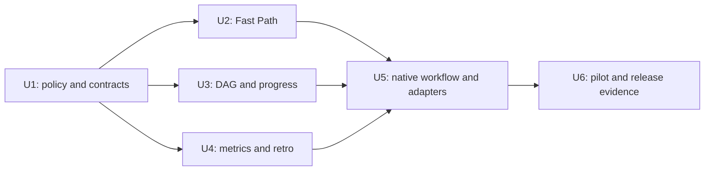

# EngineOS workflow optimization — architecture assessment and delivery plan

Date: 2026-10-07  
Status: working-tree implementation delivered; unreleased; empirical comparison pending  
Implementation scope: public workflow/contracts changes, high risk, A2; no external effects.  
Original assessment: low risk, A1. The baseline assessment below describes the pre-implementation architecture.

Implementation update, 2026-10-07: the developer authorized working-tree
implementation and final targeted tests. Native runtime/procedure changes are
delivered with [validation evidence](../perf/2026-10-07-workflow-validation.md).
The original proposal below remains the design reference; real-workload
comparison, wider Python compatibility failures and release approval remain open.

## Objective and recommendation

Deliver the smallest useful set of independent work units, execute their dependency frontier at maximum safe capacity, and expose verified results as they become available.

Keep the existing TypeScript kernel and registry architecture. Make its execution decisions operational through a deterministic scheduler and host adapter. Do not introduce a new agent framework, provider service, mandatory coordinator layer, or a second orchestration system.

Reuse the [September Fast Core design](2026-09-22-engineos-2-fast-core-design.md), but revise its contracts against October policy before implementation. Its execution lanes and scheduler are proposals, not current runtime capabilities. Measurement work from its first wave exists; later wave plans must not be treated as completed features. This plan narrows the program to workflow delivery; runtime bundle splitting and model rebinding remain outside scope.

## Current architecture and evidence

The implemented flow is prose → JSON registries → deterministic kernel → host instructions/hooks → journals and integrity checks. The kernel has no model calls. Agent dispatch remains a host/model action; a policy answer does not itself launch a worker.

| Checklist area | Current evidence | Gap and action |
|---|---|---|
| 1. Task budget | [parallelism rules](../../rules/parallelism.md) forbid manufacturing redundant units; [new-feature](../../commands/new-feature.md) creates one file per ticket. | No small/medium/large task budget or mandatory consolidation pass. Add budget recommendations and a justification for excess units. |
| 2. Fast Path | [scale.ts](../../src/kernel/scale.ts:18) returns three booleans; [task contract](../../src/kernel/resolve.ts:76) has no execution lane. [subagents rules](../../rules/subagents.md:8) require dispatch even for one unit. | Implement a risk-aware lane from declared scope facts. Change policy and mirrors together; a small prompt alone cannot authorize direct execution. |
| 3. Spec → DAG | [waves.ts](../../src/kernel/waves.ts) parses `depends_on`, checks unknown ids/cycles, and builds Kahn layers. | The dependency model exists. Static layers do not maintain live state or release workers after integration. Reuse graph validation and add an event-driven scheduler. |
| 4. Parallelism | [policy](../../registries/policy.json:119) has cap 6, queue limit 12, depth 1 and dependency-ready guidance. [admit.ts](../../src/kernel/admit.ts) calculates admission from policy cap. | Host capacity is not an input to `admit`; ownership and refill are executor discipline. Add operational capacity and write-scope enforcement at the launcher boundary. |
| 5. Useful results / TTFR | [agent hooks](../../src/hooks/announce-agent-return.ts) record returns; [benchmark scenarios](../../src/bench/scenarios.ts:30) time hook invocations. | A return message or fast hook is not a verified result. Add artifact/evidence events and end-to-end TTFR. |
| 6. Incremental review | [parallelism rules](../../rules/parallelism.md) already distinguish `returned` from `integrated` and allow continuous integration. [verification rules](../../rules/verification.md:3) restrict tests to final integrated work. | Start read-only scoped review immediately on return. Component checks/testing require an explicit ordering-policy revision; preserve consent and final integration validation. |
| 7. Deterministic execution | [kernel](../../src/kernel/resolve.ts), [Stop gate](../../src/hooks/stop-verify.ts), registry loaders and route caches already perform deterministic work. | Connect checks and scheduler decisions to runners without a model turn per operation. Add revision-bound evidence/context reuse; do not cache stale success. |
| 8. Lightweight supervisor | [parallelism](../../rules/parallelism.md:11) and [subagents](../../rules/subagents.md) already require one supervisor and flat workers. | Operationalize this instead of adding layers. Replan on scope/contract/risk changes or unresolved failures, not every successful return. |
| 9. Matt Pocock concepts | Vendored [implement-spec](../../.agents/skills/implement-spec/SKILL.md) explicitly describes a ticket graph and ready frontier. [retro](../../skills/retro/SKILL.md) is already EngineOS-owned. [new-feature](../../commands/new-feature.md) still reads external skills in-session. | Build an EngineOS-owned implement-spec procedure using existing kernel/scheduler; adapt PR lifecycle to local permissions. Preserve provenance; external skills become optional references. |
| 10. Performance retro | [journal schema](../../src/journal/schema.ts:25) has duration, tokens, cost and retries; [usage report](../../src/report/usage.ts) counts usage; [retro](../../skills/retro/SKILL.md) mines recurring evidence. | Missing task/dependency timing, TTFR and scheduler utilization reporting. Hooks do not observe actual model usage; maintain unknown values and report coverage. |

Sources were inspected on 2026-10-07 in the current working tree. No timing, token or cost improvement has been measured in this assessment. Existing benchmark reports are evidence about hooks, not full delivery performance.

## Policy conflicts to resolve first

1. **Every edit delegates today.** October [supervisor-routing spec](2026-10-06-supervisor-routing-capacity.md) intentionally made even an indivisible edit use a routed worker. Fast Path changes that decision. Preserve a lightweight deterministic routing step; let its resolved contract select the executor.
2. **Any new feature or >2 files requires design today.** [policy gates](../../registries/policy.json:114), [gates](../../rules/gates.md) and the accepted [feature-artifact ADR](../adr/2026-10-06-from-scratch-artifacts-matt-pocock-and-tlc-spec-lean.md) own this requirement. Initial Fast Path applies below this threshold. A later compact-spec exception for small new features needs a deliberate replacement decision; changing a router label cannot silently remove required artifacts.
3. **Tests require current-task consent and final-stage ordering today.** This checklist is input to a plan, not approval to run tests now. Recommend preserving explicit consent while allowing approved component checks after that component is integrated at a stable revision. If this revision is declined, scoped review can still be incremental, but executable tests remain final-only and TTFR claims must reflect that limitation.
4. **September scheduler contracts are stale.** Its `completed` release event and abbreviated state model must be reconciled with October's `returned` versus `integrated` distinction. Dependents must consume an accepted contract revision, not merely a worker's successful return.
5. **Routine routing must not disable Fast Path.** September's direct-lane predicate rejects any non-empty required-agent list. Distinguish ordinary domain ownership from genuinely mandatory security/critic/user-requested delegation, or almost every routed edit will still delegate.
6. **Compatibility is a deliverable.** Rules, commands, adapter instructions and return envelopes are published surface under [COMPATIBILITY](../COMPATIBILITY.md). Keep legacy entry points; inventory changed behavior and set deprecation windows before removing anything. `AGENTS.md` changes belong in the repository review path, never an unreviewed installed-copy edit.

These are proposed policy revisions. This document does not activate them or override current project rules.

## Execution contract and task budget

Separate three decisions: **complexity** describes the work, **risk** determines gates, and **execution mode** determines who performs it. A one-line authentication change can be small and high risk. A broad mechanical edit can be large and low risk.

Classify complexity after bounded read-only scoping using uncertainty, contract changes, domains, deliverables and genuine dependencies. File count is evidence, not the number of tasks. Prompt keywords may flag uncertainty but cannot prove scope or risk.

| Complexity | Recommended task budget | Typical execution |
|---|---|---|
| Small | 1–3; usually 1 atomic unit | Direct executor if eligible; otherwise one specialist or required independent review. |
| Medium | 3–6 as a ceiling guide, fewer when sufficient | Compact design and dependency-ready workers where useful. |
| Large | 5–10 as a reference, not a target | Frozen shared contracts, DAG, bounded workers, incremental integration. |

No lower bound forces splitting: a medium task can still be one coherent delivery. Budgets apply to delivery units, not internal steps or deterministic check invocations. A review deserves its own scheduled unit only when independence/risk warrants it; checks can attach to the unit they prove.

Before accepting a plan ask: **“Dá para entregar o mesmo resultado com menos tasks?”** Merge adjacent work unless the split has an independent outcome, dependency, owner/write scope, or useful review boundary. File/endpoint/test counts alone never justify a split. For 15 units, record why each needs independent scheduling and which consolidation alternatives were rejected. Exceeding a recommendation requires justification, not automatic truncation of necessary work.

Extend the existing task contract additively with proposed fields: `complexity`, `execution.mode`, `execution.reasons`, `units`, task-budget rationale, effective capacity, and evidence/consent references. Each unit declares `id`, `dependsOn`, exclusive write scope, contract revision, owner and acceptance claims. Freeze the precise schema in U1; this is not an already implemented interface.

Initial direct eligibility: low classified risk, reversible, known scope, one domain, one indivisible unit, at most two files, no spec-triggering feature, no security-sensitive surface, and no mandatory independent agent/gate. Unknown facts select read-only scoping, never direct execution. No ticket directory, coordinator dispatch or routine independent reviewer is needed for an eligible edit. A compact contract, applicable deterministic checks and one change record remain.

If execution discovers changed scope, new dependencies or higher risk: pause affected writes, retain delivered evidence, resolve the contract again and promote the lane. Replan only the affected remainder. Do not repeatedly regenerate PRD/spec/tickets already valid for unchanged work.

## Scheduler, ownership and progressive integration

Use one deterministic scheduler module behind a small interface: validate a graph, apply an event and return legal next actions. The host adapter launches/intercepts actual workers. EngineOS need not own provider credentials or model calls to calculate readiness.

States: `planned → ready → running → returned → integrated`, plus `blocked`, `failed` and an explicit cancellation outcome. Implementation completion is not integration acceptance. Read-only review can start at `returned`; dependent implementation starts after prerequisite `integrated` and required contracts/checks are accepted.

For A and B independent, with C depending only on A: start A and B; integrate A; start C even if B is still running. A review of B may run concurrently with C when it has a stable snapshot and capacity. No whole-wave barrier applies to unrelated work.

Proposed initial worker cap: **3**, expandable to 5 after measurement. Reuse `parallelism.wave_concurrency_cap` as the single policy setting; do not introduce a competing `maxConcurrency` setting. Effective worker capacity is `min(policy cap, host worker slots, remaining resource/budget capacity)`. Reserve the supervisor only if the host's reported slots include it; do not subtract it twice. This session supports three workers plus the supervisor.

Ready admission requires: accepted dependencies/contracts, no overlapping write ownership, available worker capacity, and existing breaker/retry/budget permission. Include wildcard, ancestor-directory and generated-output collisions, not just equal filenames. One owner holds shared wiring, lockfiles and generated bundle integration. Use isolated worktrees only when needed and authorized by the Git policy; disjoint edits do not require a branch per worker.

The scheduler responds to worker returns and accepted integration events, refills ready capacity and records why slots are idle. Failures block descendants, not unrelated units. Preserve current bounded retry/escalation rules. Resume uses persisted event/state revisions and reconciles actual host handles; never launch duplicates because a process restarted.

Stream events through the host's supported progress surface: unit running, artifact returned, review verdict, checks completed, unit integrated, dependent released, blocked/failed. Summaries cite real revision-bound evidence: `Backend integrated — 18/18 tests passed at <revision>` is valid only if those approved tests actually ran. Proposed examples never become evidence.

## Deterministic checks and context reuse

Run lint, typecheck, tests and allowed Git operations through existing tools with structured arguments and bounded timeouts. The LLM selects scope or interprets failures; it need not reason through each successful deterministic step. Git automation preserves `ENGINEOS_GIT_WRITES` and host approval rules; optimization never grants write permission.

Bind verification to source revision, contract revision, tool command/configuration and dependency/lockfile fingerprint. A changed dependency invalidates affected downstream evidence. Read-only review uses an immutable diff/snapshot; writers cannot change the reviewed evidence unnoticed. Run final cross-component integration checks after fan-in, even if every component passed locally.

The current `lint` and `typecheck` scripts both run the same TypeScript compiler ([package.json](../../package.json)). A runner may execute an identical target once and attribute its evidence to both declared checks, without claiming an additional lint capability that does not exist.

Cache parsed registries, routing/discovery and focused research by version/content hash. Workers receive a short objective plus pointers to exact contracts, rules and source revisions; retrieve relevant content on demand. Required safety instructions remain loaded. Invalidate on policy, contract, working-tree, dependency or permission changes as applicable. Do not cache approvals for future tasks, model verdicts as timeless truth, or secrets in shared context.

## Six delivery units and dependency graph

This is a large workflow program with **six units**, each representing a reviewable outcome. Check authoring, generated output, compatibility notes and the unit's own record are internal steps, not additional tickets. This is a narrower scope than the entire September Fast Core program.

| Unit | Deliverable and owner | Depends on | Exclusive scope and exit evidence |
|---|---|---|---|
| **U1 — Policy and frozen contracts** | Supervisor/design owner: task budgets, lane eligibility, verification timing proposal, scheduler/event interfaces and compatibility strategy. | None | `registries/*`, relevant `rules/*`, proposed ADRs/specs. Freeze exported contracts before fan-out; coordinate adapters/constitution integration through U5. Publish an approval/status matrix and resolve all current-policy conflicts. |
| **U2 — Operational Fast Path** | Kernel worker: complexity facts and direct/delegate/parallel decisions, with scoped context reuse. | U1 | `src/kernel/*`, applicable registry loaders, route-cache helper modules. Unknown facts fail safely; ordinary routing permits eligible direct edits; scope expansion promotes the lane. No shared CLI/adapter writes. |
| **U3 — DAG scheduler and incremental results** | Scheduler worker: state transitions, host launch interface, capacity/ownership admission, progressive review/integration events and resume. | U1 | `src/scheduler/*`. A→C releases while unrelated B runs; collisions serialize; failed prerequisites block descendants; no duplicate launch on resume. Emit U1's frozen events to U4's sink. No shared CLI/adapter writes. |
| **U4 — Performance evidence and retro** | Telemetry worker: lifecycle event sink, metrics report and performance input for existing retro. | U1 | `src/journal/*`, `src/report/*`, `src/bench/*`, `skills/retro/*`, performance docs. Distinguish unknown usage, dependency wait, queue wait and execution; report evidence coverage and task-level TTFR. No shared CLI/adapter writes. |
| **U5 — EngineOS-owned workflow and host integration** | Integration owner: native implement-spec procedure, PR lifecycle procedure and supported host adapters. | U2, U3, U4 | `commands/*`, new native workflow skills, adapter templates, constitution/router mirrors, `src/cli.ts`, hook integration and `dist/*`. Connect existing tools once; remove core runtime reliance on external skills through a documented transition. Demonstrate actual adapter dispatch capability or label it conventional. |
| **U6 — Pilot, compatibility and release evidence** | Supervisor plus risk-required independent reviewers: representative comparisons, migration guide and bounded rollout decision. | U5 | Pilot/release evidence and migration/release docs; shared integration belongs to U5 if a fix is needed. Document rollback and residual gaps. A release occurs only after its separate approval; this unit may conclude with a ready-to-review result. |

U2/U3/U4 start together after U1; they share interfaces, not write scopes. Review each as soon as it returns. U5 can prepare read-only host inventory before dependencies finish, but adapter integration requires their accepted revisions. The supervisor owns shared wiring and final evidence; do not add a permanent merger agent or another coordinator layer.

First useful implementation result: an eligible small edit routed through the new kernel lane with scoped verification evidence. Scheduler progress and full host wiring follow without requiring completion of unrelated Fast Core runtime/model optimizations.

## Native implement-spec, PR and upstream boundaries

Adapt Matt Pocock's ready-frontier concept, sparse context pointers and background execution from the installed [implement-spec](../../.agents/skills/implement-spec/SKILL.md). Its mandatory new branch/draft PR, worktree per worker and merger subagent conflict with EngineOS's current branch preservation, permission and flat-worker rules; do not copy those behaviors wholesale.

Create the EngineOS-owned implement-spec skill/command as a procedure over U2/U3/U4, not a second scheduler. It consumes an existing approved spec and DAG; it does not regenerate design artifacts by default. Add an EngineOS-owned PR procedure that prepares a concrete diff, description and evidence, then performs only authorized forge actions. Reuse the current branch/PR unless instructed otherwise. The present pinned skill set has implement-spec; a pinned `pr` skill was not found.

Extend existing EngineOS retro instead of creating another feedback mechanism. Upstream skills remain version-pinned optional references with provenance/license attribution where adaptation requires it. Retain compatibility aliases during migration; core execution must work when external skill directories are unavailable.

Primary upstream references inspected on 2026-10-07:

- [Matt Pocock to-tickets](https://raw.githubusercontent.com/mattpocock/skills/main/skills/engineering/to-tickets/SKILL.md): vertical deliverables, blocking relationships and merge/split review reinforce the consolidation approach. Numeric task budgets are this proposal's policy, not an upstream claim.
- [Matt Pocock pr](https://raw.githubusercontent.com/mattpocock/skills/main/skills/engineering/pr/SKILL.md): a PR-description skill, with visual/before-after evidence, reversibility and blast radius. Adapt its presentation into EngineOS's PR template; branch/forge lifecycle stays under EngineOS policy.
- [Matt Pocock implement](https://raw.githubusercontent.com/mattpocock/skills/main/skills/engineering/implement/SKILL.md): ongoing typechecks/scoped tests provide a reference for incremental evidence, but its test/commit instructions do not override local consent or Git rules.

The installed implement-spec is content-hash pinned in `skills-lock.json`; an immutable upstream commit is not recorded. Direct retrieval of its old in-progress source path returned 404 during research. Its installed content supports the local comparison, but current upstream equivalence is unverified. Pin a resolvable revision and check provenance/license before adapting or redistributing it. Do not make core execution depend on an unstable in-progress path.

## Metrics and evaluation plan

Capture per-run/unit identifiers, attempt, owner/domain, contract/source revision, queued/ready/start/return/integration timestamps, failure reason and first useful-result evidence reference. Attribute measured model calls/usage to the provider/host that actually observes them. Record capability and coverage when a host cannot provide a metric; do not estimate absent usage as zero.

| Metric | Definition |
|---|---|
| Dependency wait | Sum of intervals when a unit cannot become ready because prerequisites/contracts are unaccepted; keep retries separate. |
| Queue/resource wait | Ready but not admitted due to capacity, ownership, breaker or budget; report reason. |
| Task duration | Attempt start to return; separately report review/integration duration. |
| TTFR | Run acceptance timestamp to first user-visible independently useful artifact with the declared verification evidence. Status messages and unverified code returns do not qualify. |
| Total time | Run acceptance to final integrated/verified result; pending consent and failure outcomes are explicit. |
| Parallelism | Time integral of active workers divided by run execution time; also report occupied/available worker time and critical path. |
| LLM calls/tokens/cost | Real observed usage plus observed-run coverage; sum only known fields. Distinguish tool invocations, turns and provider requests. |
| Retries/failures | Attempts per unit/check, cause, model escalation and final outcome, including cancelled/blocked runs. |
| Coordinator overhead | Time/context/calls spent in orchestration roles; direct runs have no coordinator dispatch. |

Pilot matched small, medium and large changes, including a small sensitive change, diamond DAG, scope expansion, shared-file contention and unavailable launcher. Establish a current-policy baseline first. Compare equivalent acceptance outcomes, host, model bindings and cache conditions; include cold/warm runs, sample counts and p50/p95. Do not compare a hook benchmark against delivery TTFR.

Provisional adoption targets, to ratify after baseline: small work dispatches zero routine subagents; small/medium TTFR p50 improves at least 30%; ready independent work incurs no artificial whole-wave wait; total-time p95 does not regress over 10% on matched workload; task count stays within justified budgets; safety/acceptance cases do not regress. Measure actual token/cost differences only where provider usage coverage supports comparison. These are targets, not claimed savings.

Retro ranks observed bottlenecks by critical-path delay, TTFR impact and real cost. Require three independent occurrences before proposing a permanent rule change, consistent with current retro. Sparse samples remain observations. Human approval governs policy promotion; retro does not automatically rewrite the framework.

## Acceptance and stopping conditions

- [ ] Every checklist area has a named implemented control or an explicit host/policy limitation.
- [ ] Small classification cannot bypass high-risk, security, design, consent or release gates.
- [ ] Task plans undergo consolidation; excess units carry delivery/dependency justification.
- [ ] Ready dependencies are dispatched without waiting for unrelated work, within effective host capacity and exclusive ownership.
- [ ] Reviews/check evidence reference exact revisions; contract drift invalidates affected descendants.
- [ ] Deterministic execution and reporting do not require routine model interpretation of successful operations.
- [ ] Supported adapters demonstrate launches; unsupported hosts state conventional/manual enforcement.
- [ ] Native core workflow operates without external skill installations; existing names receive compatibility handling.
- [ ] Metrics distinguish unobserved usage and real delivery results; pilots compare equivalent acceptance outcomes.
- [ ] Current-task approved tests/evals and required independent reviews produce release evidence; missing evidence remains pending.

Stop after these outcomes. Do not add dashboards, a cloud service, new provider bindings, universal worktrees, per-file tickets, or a new NestJS/Mastra application to deliver this CLI framework change. Revisit runtime bundle/model/context optimizations only when the new measurements identify them as material bottlenecks.

Rollback: preserve the legacy lane/entry points during the pilot, disable new execution selection, and return to current supervised dispatch. Version scheduler state/events; do not feed incompatible snapshots to a legacy executor. Journal evolution is additive where possible. Public behavior changes and any superseded ADRs require review before activation.

Next implementation action: U1, reconciling the September Fast Core contracts with October rules and this checklist. The plan does not authorize Git/forge writes, tests, production effects, or a new application agent topology.
