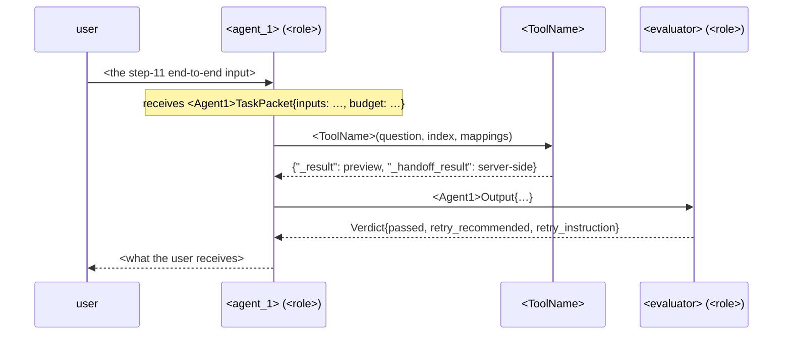

# The agent-topology form — interview script

Used by `llm-coordinator` (`hermsdorff`, INTERVIEW mode) through
`patterns/3-Agent-topology-interview.md`. Read before step 1; consult the current
step on demand. Walk all twelve decisions in order, one per message, using
`templates/agent-topology.md` from the EngineOS root.

Mastra/Node.js/TypeScript inside NestJS providers is selected policy; ask only
unresolved project details, never framework reselection. Single-agent chatbots
skip this multi-agent gate. Historical Python paths are design provenance, not
active APIs/tooling; resolve JS APIs against installed dependencies/official docs.
Tests/evals here are plans until integration and explicit final-stage approval.

Citation prefixes: `demo/` = `labv-opensearch-agent-demo/backend`;
`assist/` = `labv-assist/app`. Cite available file:line evidence or explicitly
say “no reference implementation”.

At every step: ask, show options/trade-offs and **one** grounded recommendation,
then wait. Record the answer before continuing. Preserve free text verbatim,
shape it into the required table and show it for confirmation in the same turn.
“Whatever you think” requires explicit agreement to the recommendation. Revisited
answers replace their section; re-ask dependent later decisions.

## Step 1 — Topology

**Ask:** "What is the shape of the work? Pick a pattern from the catalog — one id, or
a named combination — and I will record why."

First establish linear pipeline vs model-chosen tool loop, and one vs multiple
model decision makers. Read the two or three applicable catalog files before recommending.

| id | Pick it when | Trade-off |
|---|---|---|
| `grounded-pipeline` | One generation whose output must be checked against its own input data | Fixed Mastra workflow; a deterministic check does the auditing (`assist/domain/grounding.py:74-88`); one corrective retry only (`assist/domain/use_cases/describe.py:290-313`) |
| `typed-pipeline` | Fixed stages, each with a zod in/out, testable one at a time | Rigid by design; a new stage is a code change, never a prompt change |
| `rule-first-router` | Most inputs can be classified deterministically; the model handles the residue | Cheapest and most predictable; the rules must be maintained as the data drifts |
| `react-tool-loop` | One agent picks among tools until it can answer; an evaluator judges; bounded retry | The demo's shape (`demo/graph/workflow.py:239-265`); needs the harness of step 7 or it runs away |
| `evaluator-optimizer` | A generator and a critic with a standard verdict schema | Doubles the model calls; the retry guard must exist in the node **and** the routing function (`demo/graph/workflow.py:48-65`) |
| `supervisor-workers` | Several specialists with disjoint tools; one router dispatches typed task packets and assembles outputs | Adds a hop per task; forces the decision whether the supervisor sees worker reasoning or only outputs |
| `fanout-aggregate` | Independent sub-tasks that can run at once; a reducer merges or votes | Cost is N× per run; must decide what one failed branch does to the whole |
| `plan-execute-replan` | The task needs a plan that survives partial failure | Three prompts to maintain; the plan schema is the contract |
| `user-approval-interrupt` | The **product** must ask its **user** before an action with external effect | A product feature, not this gate; composes with any of the above |
| `handoff-swarm` | Agents transfer control explicitly and no single view of the run is needed | The file says when it is the wrong choice; rarely first pick |

Recommendation: linear/one → grounded-pipeline for data-checked prose, otherwise
typed-pipeline; prepend rule-first-router when deterministic classification covers
most inputs. One decision-maker/tool-loop → react-tool-loop, optionally
evaluator-optimizer. Several distinct specialists → supervisor-workers;
independent tasks/cost allowance → fanout-aggregate. External effects requiring
product-user consent add user-approval-interrupt. Recommend handoff-swarm only
with an explicit reason against a supervisor; otherwise quote its exclusions.
Mastra workflow steps/agents implement the shape in NestJS; deterministic helpers
remain plain TypeScript.

**Writes:** front-matter `pattern_ids`, spec §1 — the id(s), the two facts above,
the why, and the rejected alternative with its reason.

**Do not proceed until** the developer has named the pattern id(s) in their own
words and the rejected alternative is recorded.

---

## Step 2 — Agent roster

**Ask:** "For each agent in the topology: what is its purpose in one sentence, which
model role does it run under, and what must it never see?"

| Column | Options | Trade-off |
|---|---|---|
| Model role | `router`, `dsl`, `evaluator`, `narrator`, `compute`, or a new role name | One role per node lets a profile override the model per tenant (`demo/graph/workflow.py:84-90`, `demo/config/data_profile.py:43-47`); a role shared by two agents cannot be tuned apart later |
| Never sees | the raw user message · other agents' reasoning · full tool payloads · credentials · other tenants' data | Each exclusion is a line in step 5's packet and a test in step 11 |

Derive roster from the chosen pattern. Supervisor sees outputs only; worker
reasoning stays private. Evaluator sees question/answer, not full tool payloads
(demo memory summary/final messages: `demo/graph/nodes.py:412-448`). Keep one
agent per needed role; add no future-only roles. Each exclusion becomes a packet
constraint and planned step-11 check.

**Writes:** spec §2 roster table — `agent | purpose | model role | never sees |
tools (filled at step 3)`.

**Do not proceed until** every agent has all three answers and the developer has
confirmed the roster is complete — not "we might add one".

---

## Step 3 — Tools (the longest step, by design)

**Ask, per tool:** "Let's define `<ToolName>`. Eight decisions, one at a time."
Claude asks the eight sub-decisions for **one tool**, records them, then moves to
the next tool. The inventory (3.1) is asked first for all tools, so the developer
sees the whole list before going deep on the first.

Read `references/context-enriched-tools.md` first.

### 3.1 Inventory

**Ask:** "Name, purpose, input schema, output envelope, and which agents may call it."

Use PascalCaseTool names (`demo/graph/workflow.py:93-120`). Every zod input
field description carries usage/default guidance, not just a type
(`demo/tools/schemas.py:29-33,45-52`); missing descriptions are findings.
Authorize a named subset of the roster. Retrieval returns preview/full-payload
parts; pure list/mapping lookup returns _result only. Full payload is removed
before model-visible state (`demo/tools/search.py:246-249`,
`demo/graph/nodes.py:330-355`). Record/reuse this envelope:

```json
{
  "_dsl": { "...": "what the tool executed — for tracing, never for the model to copy" },
  "_result": "what the model sees: a preview, capped by the limit in 3.5",
  "_handoff_result": "full payload, server-side only, consumed through the sentinel in 3.6",
  "_pagination": "optional note when the visible result is a page of a larger set"
}
```

### 3.2 Dependencies

**Ask:** "Which tool must run before this one, and where is that rule stated?"

State dependencies in **both** tool description and its jointly feature-flagged
prompt block (`demo/graph/workflow.py:117,171-174,176-201`). Retrieval depends
on schema/mapping; plot/extract/compute consume retrieval via the 3.6 sentinel,
never model-copied data.

### 3.3 Context the tool needs before acting

**Ask:** "Which of the three context layers does this tool need, who owns each,
how often the machine layer refreshes, and where is the context injected?"

| Layer | Ownership/refresh | Injection |
|---|---|---|
| Semantic | Developer-versioned entity naming/lookup/join model (`demo/config/data_profile.py:29`) | Tool sub-agent |
| Curated | Developer default + tenant-owner overlay, PR refresh; agg_fields union, fields keyed override, notes concatenate (`demo/services/index_context_registry.py:124-135,186-199`) | Tool sub-agent (`demo/tools/search.py:146-164`) |
| Machine | Scheduler-discovered sampled fields/enums/counts; gitignored; weekly/startup or chosen cadence, minimum-entity/field-loss guards; facts win mechanically and contradictions reported (`demo/services/index_facts.py:6-8,38-39,282,316,335`) | Tool sub-agent |

Recommend all three for retrieval, none for pure lookups, semantic only for
compute. Detailed context never enters router; if using its compact schema summary
(`demo/graph/workflow.py:207-217`), explicitly record its exception/size.
Tenant-bind live facts aggregations at construction; unscoped aggregation leaks
other tenants (`demo/services/index_context_registry.py:167-171`).

### 3.4 Internal reasoning

**Ask:** "Does the tool embed its own model call? Under which role, and with what
self-repair budget?"

Query-language generation uses an internal role-specific agent
(`demo/tools/search.py:155-164`, `demo/graph/workflow.py:88,111-113`);
fetch/reshape-only tools need none. Recommend bounded N=3 repair attempts:
previous attempt + error, then typed failure rather than graph exception
(`demo/tools/search.py:19,168-194,251`). Independently apply D10 strict zod
parsing: one schema-feedback retry then typed failure, never regex/defaults
(the historical `demo/agents/dsl_agent.py` anti-pattern).

### 3.5 Errors and limits

**Ask:** "What are the typed error codes, what hint accompanies an empty result, and
what is the response-size cap?"

Define ERROR_<REASON> protocol prefixes, e.g. ERROR_SYNTAX and
ERROR_RESPONSE_TOO_LARGE (`demo/tools/search.py:185,204`), plus empty-result
hints. Over-cap output must explain replanning (slim _source, split filters,
stable pagination); retain the full server-side handoff instead of silent
truncation (`demo/tools/search.py:196-234`). Recommend separate settings for
model-visible character cap SEARCH_TOOL_MAX_RESPONSE_CHARS and handoff bound
_HANDOFF_MAX_CHARS (`:23,196`); share ERROR_PREFIX through one protocol module.

### 3.6 Memory of prior calls

**Ask:** "What is the memo key, what is the handoff sentinel, and what stops a small
lookup from overwriting derived data in the same turn?"

Recommend index::question turn memoization (`demo/graph/nodes.py:118-121`),
LAST_SEARCH default on data_json and server substitution
(`demo/tools/schemas.py:45-52`, `demo/graph/nodes.py:74-79`). When several
tools write the handoff slot, retain result kind/turn: small raw lookup cannot
overwrite same-turn derived data (`demo/graph/nodes.py:343-355`).

### 3.7 Scoping

**Ask:** "How is the tenant baked in at construction, which fail-closed guards run
on what the model generates, and which model-supplied ids are overridden
server-side?"

Every tenant-data tool requires all three: tenant-restricted credentials bound
at construction; fail-closed output guards injecting tenant filter, stripping
forbidden clauses and validating index names/prefix; server override of any
model-supplied session identity despite “leave empty” schema guidance.
Sources: `demo/graph/workflow.py:76,109-113`,
`demo/services/agent_service.py:57-85` (cache per profile/tenant),
`demo/tools/search.py:175`, `demo/tools/schemas.py:115-118`,
`demo/graph/nodes.py:156-159`. No construction tenant → no registration.

### 3.8 Evals

**Ask:** "What are the golden question → query pairs, and is the curated-vs-facts
contradiction check a test?"

Plan at least five golden question→query pairs per retrieval tool, using the
project JavaScript runner and fake providers (D13). When curated+facts apply,
plan detect_contradictions coverage (`demo/services/index_facts.py:335`).
`eval-harness` authors/runs only after integration and final approval.

**Writes:** spec §3 — the tool contract table (`tool | purpose | input schema |
envelope | callers | depends on | sub-agent role | self-repair N | error codes |
size cap | memo key | sentinel | tenant binding | guards`) and the context table
(`tool | semantic | curated (default + overlay, merge rules) | facts (refresh,
guards) | injected into`). The step-2 roster's `tools` column is filled now.

**Do not proceed until** every tool in the inventory has all eight sub-decisions
recorded and every roster row lists its tools.

---

## Step 4 — Communication protocol

**Ask:** "How do the agents talk — typed workflow state, typed message envelopes, or a
network protocol between services — and is each hop synchronous?"

| Option | Pick it when | Trade-off |
|---|---|---|
| Typed workflow state | Agents run within a Mastra workflow hosted by one NestJS service | Validate step inputs/outputs and state schema; only the explicitly scoped packet enters each agent. Historical shared-state provenance: `demo/graph/state.py:8-28` |
| Typed message envelopes | Agents in one process but each must see only its packet | A zod envelope per hop; the supervisor assembles; costs a model per hop |
| Network protocol (A2A) | Agents in different services or owned by different teams | Versioned contracts, auth per hop, retries and idempotency become the developer's problem |

Classify each hop sync(waited-on) or async(fan-out/long worker + join).
Recommend typed workflow state for react-tool-loop/evaluator-optimizer; scoped
envelopes inside state for supervisor-workers/fanout-aggregate/plan-execute-replan.
A2A needs an explicitly named second service; then its envelope is the wire schema.
Every shared string lives in one protocol constants module.

**Writes:** spec §4 — the protocol, one row per hop (`from | to | carrier | sync/async
| envelope type`), and the protocol constants module every string two nodes agree
on will live in (see `mastra-patterns`).

**Do not proceed until** every edge that will appear in step 12's flowchart has a
row here.

---

## Step 5 — Context scoping

**Ask:** "For each agent, write its task packet: the inputs it gets, the constraints
it must respect, its budget, and the output contract it must return. The agent gets
its task, not the whole picture."

Define one frozen strict zod packet and strict output schema per roster agent:

```typescript
import { z } from 'zod';

const Budget = z.object({
  maxTokens: z.number().int().positive(),
  maxToolCalls: z.number().int().positive(),
  timeoutMs: z.number().positive(),
}).strict().readonly();
const TaskPacket = z.object({
  runId: z.string(), tenantId: z.string(), task: z.string(),
  inputs: AgentInputsSchema,
  constraints: AgentConstraintsSchema,
  budget: Budget, outputContract: z.literal('AgentOutput'),
}).strict().readonly();
type AgentTaskPacket = z.infer<typeof TaskPacket>;
// Define a strict AgentOutput schema for the fields the next agent consumes.
```

The agent receives only its validated packet, never full conversation/shared state.
Derive inputs from allowed tool outputs, constraints from “never sees”, and budgets
from step 7; leave numeric <n> placeholders until that step, then confirm them.
Strict parsing enforces exclusions. Validate outputs at each boundary; one
schema-feedback retry on failure (D10).

**Writes:** spec §5 — one code block per agent, in roster order.

**Do not proceed until** every roster agent has a packet and an output model, and
the developer has confirmed each `never sees` line is absent from its packet.

---

## Step 6 — Memory per agent

**Ask:** "What does each agent remember — nothing, scoped Mastra conversation/working memory, or a store —
scoped to the session, the user or the tenant, and what survives a turn?"

| Option | Pick it when | Trade-off |
|---|---|---|
| None | The agent is a pure function of its packet | Cheapest; every turn starts cold |
| Scoped conversation/working memory | Multi-turn conversation with a token budget | Configure Mastra memory and retention explicitly; server-derived resource/thread identifiers isolate users and tenants. Summarization/model calls consume the same run budget |
| Store | Artifacts, last dataset, resolved ids must survive turns | The service re-seeds them into the input state each turn (`demo/services/agent_service.py:250-253`, `:306-317`); a persistence layer to own |

Use JWT-derived company__user__profile__session keys
(`demo/utils/session_scope.py:4-22`); the client id is only the final segment,
unwrapped if a full key returns (`:25-46`). Recommend scoped conversation memory
for router/supervisor, none for tool sub-agents, and store only 3.6 handoff/artifacts.
Explicitly list surviving fields; drop the rest.

**Writes:** spec §6 memory table — `agent | memory kind | scope | survives a turn |
storage key`.

**Do not proceed until** every agent has a row, including the `none` rows.

---

## Step 7 — Harness

**Ask:** "Where does a run enter, and what bounds it: agent-step cap, workflow
transition cap, wall-clock timeout, retry budget, token/cost budget, and which node
evaluates?"

| Bound | Where it lives | Reference |
|---|---|---|
| Iteration cap | The routing function | `should_continue`, 15 at `demo/graph/workflow.py:36` |
| Workflow transition cap | Explicit bound on workflow loops/handoffs; verified supported controls or application guards | Historical recursion bound provenance only: `demo/services/agent_service.py:244-248` |
| Wall-clock timeout | AbortSignal timeout propagated through the whole run | `demo/services/agent_service.py:301-324`, `QUERY_TIMEOUT_SECONDS` in `demo/config/settings.py:119-122` |
| Retry budget | State key, decremented by the evaluator, mirrored in the routing guard | `demo/graph/workflow.py:48-65` |
| Token/cost budget | Per role, accounted in the callback or the tool result | `demo/services/agent_service.py:632-649` |
| Evaluator | A node with a typed verdict; retry only on `retry_recommended` **and** a non-empty `retry_instruction` | `demo/graph/workflow.py:63` |

Propose numeric bounds from actual task/provider limits, not historical demo API
values. Fixed pipelines bound steps/corrections; loops also bound agent steps and
handoffs. Propagate timeout through the whole run; require typed verdict and both
retry_recommended and non-empty retry_instruction. Fill/confirm step-5 budgets now.

**Writes:** spec §7 harness table — `bound | value | where enforced`; the entry
point (NestJS controller/worker invoking the Mastra provider, or approved CLI) as one line.

**Do not proceed until** every bound has a number and a place, and the step-5
budgets are filled.

---

## Step 8 — Guardrails

**Ask:** "Tenant scoping, per-agent tool allowlist, input and output sanitization —
what is each, and where does it run?"

Confirm each agent's tenant provenance from authenticated JWT, with only approved
profile-level demo overrides (`references/tenant-profiles.md`). Executor enforces
packet tool_allowlist. Sanitize API input (regex + allowlist), add system-prompt
guards, and sanitize final output plus streamed-token gate. Recommend all layers
for user-facing agents; input sanitization only where raw user messages are read.
Reconfirm 3.7 per-tool scope; explicitly record any guard that degrades to allow.

**Writes:** spec §8 guardrail list — one line per guard: `guard | agent(s) | where
it runs | fails closed?`.

**Do not proceed until** the developer has confirmed each guard's "fails closed"
answer — a guard that degrades to "allow" is recorded as such, on purpose.

---

## Step 9 — Failure policy

**Ask:** "Per agent: when it fails, does the run degrade to a warning or fail? Is
there a fallback agent?"

| Option | Pick it when | Reference |
|---|---|---|
| Degrade to warning | The agent's contribution is additive | labv-assist's document retrieval and identity call: every failure path leaves the measured description plus a warning (`assist/domain/use_cases/describe.py:128-169`, `:203-261`) |
| Fail the run | Without this agent the answer is wrong, not merely poorer | The typed failure after N self-repair attempts (`demo/tools/search.py:251`) |
| Fallback agent | A cheaper or simpler agent can answer the same packet | A second node behind the same conditional edge; the packet does not change |

Derive from purpose: enrich/narrate/format may degrade; retrieve/compute/decide
fails unless an explicit fallback exists. The fallback accepts the same packet.
Never disguise an incorrect result as a merely poorer answer.

**Writes:** spec §9 policy table — `agent | on failure | fallback | what the user
sees`.

**Do not proceed until** every agent has a row and the "what the user sees" cell
is a sentence, not "error".

---

## Step 10 — Observability

**Ask:** "How is a run identified, what is traced per agent, and how are tokens
accounted per role?"

Carry run_id on state/events and request correlation id from observability rules.
Trace per-agent chain/LLM/tool spans with packet id, role/outcome; tag every roster
agent and internal tool-agent role. Count **all** model calls per role/model,
including tool internals missing from final AI-message counts
(`demo/services/agent_service.py:644-649`). Meter prompt-version usage in
finally, including failed runs (`assist/domain/use_cases/describe.py:113-126`).
Log evaluator verdict as a structured event.

**Writes:** spec §10 — the id scheme, the span list, the token accounting rule.

**Do not proceed until** the developer has named where the trace goes (log,
LangSmith, OpenTelemetry) — "later" is recorded as a decision with a date.

---

## Step 11 — Evals

**Ask:** "Before the first real run: which golden set exists per tool, per agent,
and end-to-end?"

Plan per-tool query pairs from 3.8, per-agent packet→output schema/consumed fields
from step 5, and one fixed end-to-end input with **every provider faked** (D13).
Only evaluator-node and deterministic checks score in-product
(`assist/domain/grounding.py:74-88`). Counts follow tools/roster; use this same
end-to-end input in step-12 diagrams. Author/run plans only at approved final stage.

**Writes:** spec §11 eval plan — `level | fixture | assertion | count | owner`.

**Do not proceed until** the developer has confirmed the end-to-end input that
step 12 will use.

---

## Step 12 — Diagram review and approval

**Ask:** "Here are the two diagrams derived from §1–§11. Do they match what you
decided? Say 'approved' or name the change."

Use actual spec names in both diagrams:

```mermaid
flowchart TD
    START([START]) --> <agent_1>
    <agent_1> -->|continue| <tools>
    <tools> --> <agent_1>
    <agent_1> -->|evaluate| <evaluator>
    <agent_1> -->|end| END([END])
    <evaluator> -->|retry: retry_recommended and retry_instruction and retry_count < max_retries| <agent_1>
    <evaluator> -->|end| END
```

Label every conditional edge with its routing-return string
(`demo/graph/workflow.py:250-261`); unlabeled decision edges are findings.



The sequence shows the step-11 sample input, packet received and output returned
on every hop. Developer approval sets spec status: approved, approved_by and
approved_on. Under change-record `## Human decisions`, write exactly:

`<date> | <developer> | topology-approval | approved | docs/specs/<date>-<slug>-agent-topology.md`

Use the policy HITL reason topology-approval and link record spec:. Announce the
recorded gate and stop; implementation starts next message, using mastra-patterns
and exclusive dependency scopes from §2/§3 under parallelism rules. For requested
changes return to the owning step, re-ask dependencies and render again.

**Writes:** spec §12 — the two Mermaid blocks; the front-matter fields above; the
approval line in the change record.

**Do not proceed until** the approval line exists in the change record. Before it,
no multi-agent implementation file is written. `mastra-patterns` may be consulted
for planning; skill loading alone does not authorize code.
