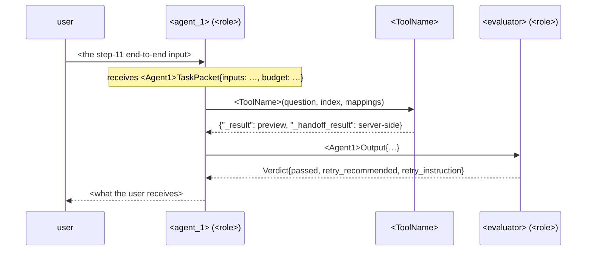

# The agent-topology form — interview script

Loaded by `agent-system-design` at step 1 and read again at every step. It is the
script the `llm-coordinator` persona (alias `hermsdorff`, INTERVIEW mode) follows
under `patterns/3-Agent-topology-interview.md`. Twelve steps, in order, one per
message; each has the question as Claude asks it, the options with a one-line
trade-off, how the recommendation is derived from the answers already in the spec,
the section of `templates/agent-topology.md` the answer fills, and a
"do not proceed until" line that is the gate to the next step.

Runtime first: the language and agent runtime are the developer's answer to the
stack question (`rules/base.md` "New projects — stack first"), settled before step
1 — never defaulted to Python because the references below are Python. The pattern
catalog, its reference implementations, `langgraph-patterns` and the `.py` paths in
`templates/agent-topology.md` all assume Python; when the answer is another
runtime, say so before step 1, then walk the same twelve steps on the generic rules.

Grounding: every `file:line` below is real code. `demo/` is
`labv-opensearch-agent-demo/backend` (the LangGraph reference), `assist/` is
`labv-assist/app` (the single-agent grounded pipeline). A recommendation that cites
one of them is a recommendation the developer can open and check; a recommendation
that cites nothing says "no reference implementation" out loud.

Conventions for every step:

- Ask the question, list the options, give **one** recommendation with its reason,
  then stop. The message ends with the question, not with an assumption.
- The developer's answer is written into the spec before the next step is asked.
  Free-text answers are recorded verbatim under the step's section, then shaped
  into the table the section calls for; the developer sees the shaped version and
  confirms it in the same turn.
- "Whatever you think" is not an answer: restate the recommendation as a proposal
  and ask for a yes or a change. Only the developer's word closes a step.
- The developer may revisit an earlier step at any time; the spec section is
  rewritten and every later step that depended on it is re-asked.

---

## Step 1 — Topology

**Ask:** "What is the shape of the work? Pick a pattern from the catalog — one id, or
a named combination — and I will record why."

Before asking, Claude establishes two facts from the request and states them:

- Is the work a **linear pipeline** (fixed stages, at most one corrective retry) or
  a **tool loop** (the model decides which tool to call next, observes, repeats)?
- Is there **one** model-driven decision maker or **several** with distinct
  responsibilities?

**Options** (each is a `references/patterns/<id>.md`; read the two or three that
apply before recommending):

| id | Pick it when | Trade-off |
|---|---|---|
| `grounded-pipeline` | One generation whose output must be checked against its own input data | No loop, no graph; a deterministic check does the auditing (`assist/domain/grounding.py:74-88`); one corrective retry only (`assist/domain/use_cases/describe.py:290-313`) |
| `typed-pipeline` | Fixed stages, each with a Pydantic in/out, testable one at a time | Rigid by design; a new stage is a code change, never a prompt change |
| `rule-first-router` | Most inputs can be classified deterministically; the model handles the residue | Cheapest and most predictable; the rules must be maintained as the data drifts |
| `react-tool-loop` | One agent picks among tools until it can answer; an evaluator judges; bounded retry | The demo's shape (`demo/graph/workflow.py:239-265`); needs the harness of step 7 or it runs away |
| `evaluator-optimizer` | A generator and a critic with a standard verdict schema | Doubles the model calls; the retry guard must exist in the node **and** the routing function (`demo/graph/workflow.py:48-65`) |
| `supervisor-workers` | Several specialists with disjoint tools; one router dispatches typed task packets and assembles outputs | Adds a hop per task; forces the decision whether the supervisor sees worker reasoning or only outputs |
| `fanout-aggregate` | Independent sub-tasks that can run at once; a reducer merges or votes | Cost is N× per run; must decide what one failed branch does to the whole |
| `plan-execute-replan` | The task needs a plan that survives partial failure | Three prompts to maintain; the plan schema is the contract |
| `user-approval-interrupt` | The **product** must ask its **user** before an action with external effect | A product feature, not this gate; composes with any of the above |
| `handoff-swarm` | Agents transfer control explicitly and no single view of the run is needed | The file says when it is the wrong choice; rarely first pick |

**Recommendation rule:**

- Linear + one decision maker → `grounded-pipeline` when the output is checked
  against data, else `typed-pipeline`; add `rule-first-router` in front when a
  deterministic classifier can absorb most inputs. Say plainly: this needs no graph
  (`langgraph-patterns` §1), it is a plain `async` use case per `python-patterns`.
- Tool loop + one decision maker → `react-tool-loop`; add `evaluator-optimizer` when
  the answer quality must be judged before it is returned.
- Tool loop + several decision makers with disjoint tools → `supervisor-workers`;
  `fanout-aggregate` when their sub-tasks are independent and the run can pay N×.
- Any of the above + an action with external effect the user must confirm → add
  `user-approval-interrupt` to the combination.
- `handoff-swarm` is recommended only when the developer names a reason the
  supervisor is wrong; otherwise its file's "do not use when" is quoted.

**Writes:** front-matter `pattern_ids`, spec §1 — the id(s), the two facts above,
the why, and the rejected alternative with its reason.

**Do not proceed until** the developer has named the pattern id(s) in their own
words and the rejected alternative is recorded.

---

## Step 2 — Agent roster

**Ask:** "For each agent in the topology: what is its purpose in one sentence, which
model role does it run under, and what must it never see?"

**Options per agent:**

| Column | Options | Trade-off |
|---|---|---|
| Model role | `router`, `dsl`, `evaluator`, `narrator`, `compute`, or a new role name | One role per node lets a profile override the model per tenant (`demo/graph/workflow.py:84-90`, `demo/config/data_profile.py:43-47`); a role shared by two agents cannot be tuned apart later |
| Never sees | the raw user message · other agents' reasoning · full tool payloads · credentials · other tenants' data | Each exclusion is a line in step 5's packet and a test in step 11 |

**Recommendation rule:** derived from step 1's pattern file, "Decisions it forces".
`supervisor-workers` recommends the supervisor sees worker **outputs only**
(reasoning stays in the worker's own messages); `react-tool-loop` recommends the
evaluator sees the question and the answer, never the tool payloads (the demo's
evaluator reads a memory summary and the final messages, `demo/graph/nodes.py:412-448`).
One agent per role; a role the pattern does not need is not added "for later".

**Writes:** spec §2 roster table — `agent | purpose | model role | never sees |
tools (filled at step 3)`.

**Do not proceed until** every agent has all three answers and the developer has
confirmed the roster is complete — not "we might add one".

---

## Step 3 — Tools (the longest step, by design)

**Ask, per tool:** "Let's define `<ToolName>`. Eight decisions, one at a time."
Claude asks the eight sub-decisions for **one tool**, records them, then moves to
the next tool. The inventory (3.1) is asked first for all tools, so the developer
sees the whole list before going deep on the first.

Read `references/context-enriched-tools.md` before this step; it holds the
mechanisms the sub-decisions name.

### 3.1 Inventory

**Ask:** "Name, purpose, input schema, output envelope, and which agents may call it."

- Name is `PascalCaseTool` (`demo/graph/workflow.py:93-120`: `ListIndexTool`,
  `IndexMappingTool`, `SearchTool`).
- Input is a Pydantic model whose **every** `Field(description=…)` carries usage
  guidance the model reads — what to pass, when to leave the default
  (`demo/tools/schemas.py:29-33`, `:45-52`). A field without a description is a
  finding.
- Output envelope: `_result` is the preview the model sees; `_handoff_result` is
  the full payload kept server-side and popped before it enters state
  (`demo/tools/search.py:246-249`, `demo/graph/nodes.py:330-355`).
- Callers: the subset of step 2's roster; a tool every agent may call is a
  decision, not a default.

Envelope shape, recorded once in the spec and reused per tool:

```json
{
  "_dsl": { "...": "what the tool executed — for tracing, never for the model to copy" },
  "_result": "what the model sees: a preview, capped by the limit in 3.5",
  "_handoff_result": "full payload, server-side only, consumed through the sentinel in 3.6",
  "_pagination": "optional note when the visible result is a page of a larger set"
}
```

**Recommendation rule:** the roster decides the callers; a retrieval tool's output
gets the two-part envelope; a pure lookup (list, mapping) returns `_result` only.

### 3.2 Dependencies

**Ask:** "Which tool must run before this one, and where is that rule stated?"

- The rule lives in **two** places: the tool description ("Call IndexMappingTool
  first to get mappings", `demo/graph/workflow.py:117`) and the prompt block
  registered together with the tool behind one feature flag
  (`demo/graph/workflow.py:171-174`, `:176-201`: the tool and its prompt lines are
  added under the same `ENABLE_*` setting).
- A dependency stated in the prompt only is invisible to a tool test; stated in the
  description only, it is lost when the prompt is rewritten.

**Recommendation rule:** every retrieval tool depends on a schema/mapping tool;
every data-consuming tool (plot, extract, compute) depends on the retrieval tool
through the sentinel of 3.6, never by the model copying data.

### 3.3 Context the tool needs before acting

**Ask:** "Which of the three context layers does this tool need, who owns each,
how often the machine layer refreshes, and where is the context injected?"

| Layer | What it holds | Owner | Refresh | Where injected |
|---|---|---|---|---|
| Semantic layer | Curated data model: entity naming, lookup fields, join keys | Developer, versioned in the repo (`demo/config/data_profile.py:29` `semantic_layer_path`) | On PR | The tool's own sub-agent prompt |
| Curated context | Per-index field descriptions, gotchas, aggregation fields; a default file plus a per-tenant overlay with declared merge rules — `agg_fields` union, `fields` override by key, `notes` concatenate (`demo/services/index_context_registry.py:124-135`, `:186-199`) | Developer for the default, tenant owner for the overlay | On PR | The tool's own sub-agent prompt (`demo/tools/search.py:146-164` passes it to the DSL agent) |
| Machine facts | Live enums with counts, doc counts, field paths discovered by sampling; gitignored; written by a scheduler; write-guarded — minimum entities and maximum field-loss ratio (`demo/services/index_facts.py:6-8`, `:38-39`, `:282`, `:316`); facts win on mechanical claims; contradictions against the curated text are reported (`:335`) | The system | Weekly + on startup, or the cadence the developer names | The tool's own sub-agent prompt |

- Injection target is the tool's sub-agent, **never the router**: the router picks
  tools, the sub-agent generates queries; context in the router prompt grows with
  every index and pushes the router past its window. The demo does hand the router
  a schema summary (`demo/graph/workflow.py:207-217`) — record it as the exception
  it is, with its size, if the developer chooses the same.
- The live-value aggregations that build the facts are tenant-scoped at
  construction (`demo/services/index_context_registry.py:167-171`); an unscoped
  aggregation enumerates every tenant's values into one tenant's prompt.

**Recommendation rule:** a retrieval tool gets **all three** layers; a pure lookup
gets none; a compute tool gets the semantic layer only (it needs column meaning,
not enums).

### 3.4 Internal reasoning

**Ask:** "Does the tool embed its own model call? Under which role, and with what
self-repair budget?"

- A tool-embedded sub-agent (the DSL agent inside `SearchTool`,
  `demo/tools/search.py:155-164`) runs under its own role so its model can differ
  from the router's (`demo/graph/workflow.py:88`, `:111-113`).
- Self-repair: the previous attempt and its error are fed back
  (`previous_dsl`, `previous_error`), for `N` attempts, then a typed failure — never
  an exception into the graph (`demo/tools/search.py:19` `MAX_DSL_RETRIES = 3`,
  `:168-194`, `:251`).
- The sub-agent's JSON is validated with Pydantic; on `ValidationError` one retry
  carries the error text as feedback (design D10). The demo's regex-and-defaults
  parsing (`demo/agents/dsl_agent.py`) is the anti-pattern `langgraph-patterns` §12
  flags.

**Recommendation rule:** a tool that turns natural language into a query language
embeds a sub-agent with `N = 3`; a tool that only fetches or reshapes embeds none.

### 3.5 Errors and limits

**Ask:** "What are the typed error codes, what hint accompanies an empty result, and
what is the response-size cap?"

- Error codes are `ERROR_<REASON>` prefixes the model can branch on
  (`ERROR_SYNTAX:` at `demo/tools/search.py:185`, `ERROR_RESPONSE_TOO_LARGE:` at
  `:204`); `ERROR_PREFIX` is a protocol constant (`langgraph-patterns` §11).
- An empty result carries a hint (what to try next), not a bare `[]`.
- Over the cap, the tool returns an error that tells the model to **replan** —
  slim `_source`, split the query, page with a stable sort — and keeps the full
  result server-side under `_handoff_result` (`demo/tools/search.py:196-234`).
  A silent truncation is a finding: the model reasons over a page it believes is
  the set.

**Recommendation rule:** cap in characters from settings
(`SEARCH_TOOL_MAX_RESPONSE_CHARS`, `demo/tools/search.py:196`); a handoff bound
separate from the model-visible cap (`_HANDOFF_MAX_CHARS`, `:23`).

### 3.6 Memory of prior calls

**Ask:** "What is the memo key, what is the handoff sentinel, and what stops a small
lookup from overwriting derived data in the same turn?"

- Memo key `index::question` — a repeated call within the turn is served from the
  cache (`demo/graph/nodes.py:118-121`).
- Handoff sentinel `LAST_SEARCH` as the default of the consumer's `data_json`
  field (`demo/tools/schemas.py:45-52`); the executor swaps the sentinel for the
  server-side payload (`demo/graph/nodes.py:74-79`), so the model never copies data.
- The guard: a `raw` result does not overwrite a `derived` one stored earlier in
  the same turn (`demo/graph/nodes.py:343-355`); the kind and the turn index are
  stored next to the data.

**Recommendation rule:** every retrieval tool memoizes by `index::question`; every
consumer of its data reads through the sentinel; the raw-vs-derived guard is
present whenever more than one tool writes the handoff slot.

### 3.7 Scoping

**Ask:** "How is the tenant baked in at construction, which fail-closed guards run
on what the model generates, and which model-supplied ids are overridden
server-side?"

- Tenant at construction: closures or factories over tenant-restricted
  credentials (`create_search_tool(ctx_registry, eff, ctx, opensearch_tenant_id=…)`,
  `demo/graph/workflow.py:109-113`; `effective_profile`, `:76`). The compiled
  graph is cached per `(profile, tenant)` (`demo/services/agent_service.py:57-85`).
- Fail-closed guards on anything the model generates: tenant filter injected,
  forbidden clauses stripped (`strip_script_clauses`, `demo/tools/search.py:175`),
  index prefix checked (`langgraph-patterns` §9).
- Server-side override of any model-supplied session id: the schema says "leave
  empty" (`demo/tools/schemas.py:115-118`) and the executor overwrites it anyway
  (`demo/graph/nodes.py:156-159`).

**Recommendation rule:** all three, for every tool that touches tenant data; a
tool that cannot name its tenant at construction is not registered.

### 3.8 Evals

**Ask:** "What are the golden question → query pairs, and is the curated-vs-facts
contradiction check a test?"

- Golden pairs per tool, pytest, no provider call (design D13); the `eval-harness`
  skill scaffolds them once code exists.
- `detect_contradictions` (`demo/services/index_facts.py:335`) as a test that fails
  when the curated text claims a field the facts do not show.

**Recommendation rule:** at least five pairs per retrieval tool before the first
real run; the contradiction test wherever 3.3 chose curated + facts.

**Writes:** spec §3 — the tool contract table (`tool | purpose | input schema |
envelope | callers | depends on | sub-agent role | self-repair N | error codes |
size cap | memo key | sentinel | tenant binding | guards`) and the context table
(`tool | semantic | curated (default + overlay, merge rules) | facts (refresh,
guards) | injected into`). The step-2 roster's `tools` column is filled now.

**Do not proceed until** every tool in the inventory has all eight sub-decisions
recorded and every roster row lists its tools.

---

## Step 4 — Communication protocol

**Ask:** "How do the agents talk — shared graph state, typed message envelopes, or a
network protocol between services — and is each hop synchronous?"

| Option | Pick it when | Trade-off |
|---|---|---|
| Shared graph state | All agents run in one process under one `StateGraph` | Simplest; one reducer (`add_messages`), every other key replace-on-write (`demo/graph/state.py:8-28`); every node sees every key unless step 5 scopes it |
| Typed message envelopes | Agents in one process but each must see only its packet | A Pydantic envelope per hop; the supervisor assembles; costs a model per hop |
| Network protocol (A2A) | Agents in different services or owned by different teams | Versioned contracts, auth per hop, retries and idempotency become the developer's problem |

Sync vs async per hop: a hop the caller waits on is sync; a fan-out or a
long-running worker is async with a join.

**Recommendation rule:** `react-tool-loop`, `evaluator-optimizer` → shared state.
`supervisor-workers`, `fanout-aggregate`, `plan-execute-replan` → typed envelopes
inside shared state (the packet of step 5 is the envelope). A2A only when the
developer names a second service; then the envelope is the wire schema.

**Writes:** spec §4 — the protocol, one row per hop (`from | to | carrier | sync/async
| envelope type`), and the protocol constants module every string two nodes agree
on will live in (`langgraph-patterns` §11).

**Do not proceed until** every edge that will appear in step 12's flowchart has a
row here.

---

## Step 5 — Context scoping

**Ask:** "For each agent, write its task packet: the inputs it gets, the constraints
it must respect, its budget, and the output contract it must return. The agent gets
its task, not the whole picture."

One frozen Pydantic model per agent, in the spec, in this shape:

```python
from pydantic import BaseModel, ConfigDict, Field


class Budget(BaseModel):
    model_config = ConfigDict(frozen=True, extra="forbid")
    max_tokens: int
    max_tool_calls: int
    timeout_s: float


class <Agent>Constraints(BaseModel):
    model_config = ConfigDict(frozen=True, extra="forbid")
    tool_allowlist: tuple[str, ...]              # step 8 reads this
    forbidden_fields: tuple[str, ...] = ()       # what it must never see (step 2)
    language: str = "en"


class <Agent>TaskPacket(BaseModel):
    """What <agent> receives — its task, not the whole picture."""
    model_config = ConfigDict(frozen=True, extra="forbid")
    run_id: str
    tenant_id: str
    task: str = Field(description="The one thing this agent must do, in one sentence")
    inputs: <AgentInputs>                        # typed; only what this agent needs
    constraints: <Agent>Constraints
    budget: Budget
    output_contract: str = "<Agent>Output"      # the schema id the output is validated against


class <Agent>Output(BaseModel):
    model_config = ConfigDict(frozen=True, extra="forbid")
    ...                                          # the fields the next agent consumes
```

- `extra="forbid"` is what makes "never sees" testable: a field that is not in the
  packet cannot be passed.
- The output contract is validated with `model_validate` at the boundary; on
  failure one retry carries the error as feedback (design D10).
- In a single-process graph the packet rides in state under the agent's own key;
  the node reads its packet, never `state["messages"]` wholesale.

**Recommendation rule:** inputs are derived from step 3's callers (an agent gets
the outputs of the tools it may call, nothing else); constraints from step 2's
"never sees" column; budget from step 7 (asked next — leave the numbers as
`<n>` and fill them after step 7, then confirm).

**Writes:** spec §5 — one code block per agent, in roster order.

**Do not proceed until** every roster agent has a packet and an output model, and
the developer has confirmed each `never sees` line is absent from its packet.

---

## Step 6 — Memory per agent

**Ask:** "What does each agent remember — nothing, a summary buffer, or a store —
scoped to the session, the user or the tenant, and what survives a turn?"

| Option | Pick it when | Trade-off |
|---|---|---|
| None | The agent is a pure function of its packet | Cheapest; every turn starts cold |
| Summary buffer | Multi-turn conversation with a token budget | Raw turns until the budget, then a rolling summary; `save_turn` may call the model, so it runs off the event loop (`langgraph-patterns` §8) |
| Store | Artifacts, last dataset, resolved ids must survive turns | The service re-seeds them into the input state each turn (`demo/services/agent_service.py:250-253`, `:306-317`); a persistence layer to own |

Scope key: `company__user__profile__session` derived from JWT claims
(`demo/utils/session_scope.py:4-22`); a client-supplied id is only the last
segment and is unwrapped if the full key comes back (`:25-46`).

**Recommendation rule:** the router/supervisor gets the summary buffer; tool
sub-agents get none; the store holds only what step 3.6 named (handoff data,
artifacts). What survives a turn is listed explicitly; everything else is dropped.

**Writes:** spec §6 memory table — `agent | memory kind | scope | survives a turn |
storage key`.

**Do not proceed until** every agent has a row, including the `none` rows.

---

## Step 7 — Harness

**Ask:** "Where does a run enter, and what bounds it: iteration cap, recursion
limit, wall-clock timeout, retry budget, token/cost budget, and which node
evaluates?"

Three independent bounds, all present (`langgraph-patterns` §4):

| Bound | Where it lives | Reference |
|---|---|---|
| Iteration cap | The routing function | `should_continue`, 15 at `demo/graph/workflow.py:36` |
| Recursion limit | Sized from the retry budget: `(max_retries + 1) × cap + buffer` | `demo/services/agent_service.py:244-248` |
| Wall-clock timeout | `asyncio.wait_for` around the whole run | `demo/services/agent_service.py:301-324`, `QUERY_TIMEOUT_SECONDS` in `demo/config/settings.py:119-122` |
| Retry budget | State key, decremented by the evaluator, mirrored in the routing guard | `demo/graph/workflow.py:48-65` |
| Token/cost budget | Per role, accounted in the callback or the tool result | `demo/services/agent_service.py:632-649` |
| Evaluator | A node with a typed verdict; retry only on `retry_recommended` **and** a non-empty `retry_instruction` | `demo/graph/workflow.py:63` |

**Recommendation rule:** start from the demo's numbers (15 iterations, 1 retry,
recursion `max(50, (retries+1)×15+10)`) and let the developer change them; a
pipeline pattern has no iteration cap and a single timeout. Now fill the `<n>`
budgets left in step 5's packets and confirm them.

**Writes:** spec §7 harness table — `bound | value | where enforced`; the entry
point (`api/` route or CLI) as one line.

**Do not proceed until** every bound has a number and a place, and the step-5
budgets are filled.

---

## Step 8 — Guardrails

**Ask:** "Tenant scoping, per-agent tool allowlist, input and output sanitization —
what is each, and where does it run?"

- Tenant scoping is already decided per tool (3.7); here it is confirmed per
  agent: which tenant fact each agent receives and where it came from (the JWT
  claim, with an optional profile-level override for demo data —
  `references/tenant-profiles.md`).
- Tool allowlist per agent is the `tool_allowlist` in step 5's constraints; the
  executor refuses a call outside it.
- Sanitization runs in three layers: input regex + allowlist at the API edge, a
  guardrail block in the system prompt, an output sanitizer on the final answer
  plus a token gate on streamed output (`langgraph-patterns` §9).

**Recommendation rule:** all three layers for any agent whose output reaches the
user; input sanitization only for agents that read the raw user message (step 2).

**Writes:** spec §8 guardrail list — one line per guard: `guard | agent(s) | where
it runs | fails closed?`.

**Do not proceed until** the developer has confirmed each guard's "fails closed"
answer — a guard that degrades to "allow" is recorded as such, on purpose.

---

## Step 9 — Failure policy

**Ask:** "Per agent: when it fails, does the run degrade to a warning or fail? Is
there a fallback agent?"

| Option | Pick it when | Reference |
|---|---|---|
| Degrade to warning | The agent's contribution is additive | labv-assist's document retrieval and identity call: every failure path leaves the measured description plus a warning (`assist/domain/use_cases/describe.py:128-169`, `:203-261`) |
| Fail the run | Without this agent the answer is wrong, not merely poorer | The typed failure after N self-repair attempts (`demo/tools/search.py:251`) |
| Fallback agent | A cheaper or simpler agent can answer the same packet | A second node behind the same conditional edge; the packet does not change |

**Recommendation rule:** derived from step 2's purpose column — an agent whose
purpose is "enrich", "narrate", "format" degrades; an agent whose purpose is
"retrieve", "compute", "decide" fails the run unless a fallback is named.

**Writes:** spec §9 policy table — `agent | on failure | fallback | what the user
sees`.

**Do not proceed until** every agent has a row and the "what the user sees" cell
is a sentence, not "error".

---

## Step 10 — Observability

**Ask:** "How is a run identified, what is traced per agent, and how are tokens
accounted per role?"

- `run_id` in state and on every event; the correlation id from the request
  middleware per `rules/observability.md`.
- A per-agent span (chain / llm / tool) with the packet id, the model role and the
  outcome; the trace collector builds the tree (`langgraph-patterns` §10).
- Token accounting per role and per model, tagged in the callback or the tool
  result — the known undercount is summing only the AI messages in state, which
  misses every model call a tool makes internally
  (`demo/services/agent_service.py:644-649`).
- Usage recorded once per prompt version in a `finally`, so a failed run is metered
  too (`assist/domain/use_cases/describe.py:113-126`).

**Recommendation rule:** every agent from step 2 and every tool sub-agent from
step 3.4 gets a role tag; the evaluator's verdict is logged as a structured event.

**Writes:** spec §10 — the id scheme, the span list, the token accounting rule.

**Do not proceed until** the developer has named where the trace goes (log,
LangSmith, OpenTelemetry) — "later" is recorded as a decision with a date.

---

## Step 11 — Evals

**Ask:** "Before the first real run: which golden set exists per tool, per agent,
and end-to-end?"

- Per tool: question → query pairs (step 3.8).
- Per agent: task packet → output contract; the fixture is a packet from step 5,
  the assertion is `Output.model_validate` plus the fields the next agent reads.
- One end-to-end: a fixed input through the whole topology with every provider
  call faked (design D13: no test calls the provider).
- Runtime scoring is only the evaluator node and a deterministic check such as
  the numeric grounding check (`assist/domain/grounding.py:74-88`).

**Recommendation rule:** the counts come from step 3's inventory and step 2's
roster; the end-to-end case is the sample run step 12 will draw.

**Writes:** spec §11 eval plan — `level | fixture | assertion | count | owner`.

**Do not proceed until** the developer has confirmed the end-to-end input that
step 12 will use.

---

## Step 12 — Diagram review and approval

**Ask:** "Here are the two diagrams derived from §1–§11. Do they match what you
decided? Say 'approved' or name the change."

Render both with the real names from the spec; the skeletons:

```mermaid
flowchart TD
    START([START]) --> <agent_1>
    <agent_1> -->|continue| <tools>
    <tools> --> <agent_1>
    <agent_1> -->|evaluate| <evaluator>
    <agent_1> -->|end| END([END])
    <evaluator> -->|retry: retry_recommended and retry_instruction and retry_count < max_retries| <agent_1>
    <evaluator> -->|end| END
```

Every conditional edge carries its label — the string the routing function returns
(`demo/graph/workflow.py:250-261`); an unlabelled edge from a decision node is a
finding.



The sequence diagram shows **one sample run** — the step-11 end-to-end input — with
what each agent **receives** (its packet) and **returns** (its output contract) on
every arrow.

When the developer says "approved":

1. Spec front-matter: `status: approved`, `approved_by: <developer>`,
   `approved_on: <date>`.
2. Change record, under `## Human decisions`, exactly:

   ```
   <date> | <developer> | topology-approval | approved | docs/specs/<date>-<slug>-agent-topology.md
   ```

   The reason is `topology-approval` from `registries/policy.json` `hitl.reasons`;
   the change record's `spec:` field points at the topology spec.
3. Say so in one line and stop. `langgraph-patterns` may be loaded from the next
   message on; the wave plan is derived per `rules/parallelism.md` from §2 and §3.

When the developer names a change: go back to the step that owns it, rewrite that
section, re-ask every step that depended on it, and re-render.

**Writes:** spec §12 — the two Mermaid blocks; the front-matter fields above; the
approval line in the change record.

**Do not proceed until** the approval line exists in the change record. Before it,
no `graph/`, `agents/` or `tools/` file is written, and `langgraph-patterns` is not
loaded.
