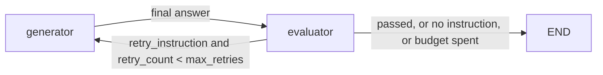

## Use when
- The generator's output can be judged against the question and the evidence it used (tool traces, session notes), and a short instruction can fix it.
- A second pass is worth its cost for the product (analytical answers, reports) — not for every chat turn.

## Do not use when
- The check is deterministic (numbers in the data, schema validity): use grounded-pipeline's ground-check, not a model judge.
- Nothing tells the judge what evidence exists: a critic without traces rates style.
- The budget is one call: an evaluator doubles the floor.

## Decisions it forces
- Step 1 topology: an `evaluator` node after the generator — any generator (react-tool-loop, supervisor-workers, plan-execute-replan).
- Step 2 roster: the `evaluator` role on a cheaper model; it sees the context package (question, answer, tool summary, previous verdict), never credentials or full result sets.
- Step 4 protocol: the verdict schema — `passed`, `retry_recommended`, `retry_instruction | None`, `diagnosis` — validated with Pydantic (D10).
- Step 6 memory: whether the previous verdict is fed to the next evaluation (yes: it stops the judge repeating itself).
- Step 7 harness: `max_retries` per run, `allow_retry` per request; the generator's iteration budget resets on retry.
- Step 9 failure policy: evaluator unavailable or invalid → the answer ships unaudited with a warning, never a 500.
- Step 10 observability: the verdict stored per run; retries counted per session.

## LangGraph shape
State adds `evaluate`, `allow_retry`, `evaluation_result`, `retry_count`, `max_retries` (langgraph-patterns §2). Node `evaluator` builds the context package, calls the judge under `nostream` (§6), validates the verdict; on retry it appends `RETRY_PREFIX + instruction + original question` as a message, increments `retry_count`, resets `iteration` (§4). Edge `evaluator → {generator | END}` by `should_retry`, **whose guard is the node's guard verbatim**: `allow_retry and retry_recommended and retry_instruction and retry_count < max_retries`. The generator widens its window back to the original question when the latest message carries `RETRY_PREFIX` (§11 owns the constant).

## Failure modes
- Guard in the node but not in the routing function (or the reverse): a null instruction routes to `generator` with no retry message — an infinite loop that never consumes budget. The demo's `should_retry` docstring records it.
- Verdict parsed with `json.loads` plus `setdefault`: a malformed verdict becomes `passed=False, retry=False` silently (`agents/evaluator_agent.py:85-106`). Validate, retry once with the error, then degrade.
- Retry instruction injected as a user message: the final answer narrates "I am correcting…". Nexxus injects it as a system note instead.
- The judge sees no traces: it rejects grounded answers for style. Give it the tool summary and the session notes.

## Eval strategy
- Verdict schema: golden `context package → verdict` with a fake judge, including one invalid JSON to exercise the retry.
- Routing: table-driven test of `should_retry` over (allow_retry, recommended, instruction, count, max) — every row.
- End-to-end: a fake generator that fails once and a fake judge that asks for one retry; assert exactly one retry and the `iteration` reset.

## Example
- Guard mirrored: `labv-opensearch-agent-demo/backend/graph/workflow.py:48-65` and `graph/nodes.py:464-471`.
- Context package and judge call: `graph/nodes.py:432-460`, `agents/evaluator_agent.py:49-76`.
- Typed verdict plus system-note retry (the shape to copy): `portal_nexxus/backend/src/infrastructure/agent/graph.py:58-61,84-107,156-177`.
