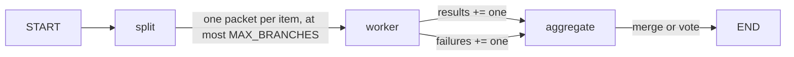

> Active implementation uses Mastra on Node.js/TypeScript, hosted by NestJS providers. Any Python
> file citations below are historical design evidence only, not executable
> guidance. TypeScript/zod recommendations translate historical constraints;
> they are not claims about the cited Python code's APIs.
> Resolve JS APIs from installed dependencies. Eval/test strategies
> are plans until integration and explicit current-task final-stage approval.

## Use when
- N sub-tasks of the same shape, independent of each other, whose results are merged (per-document extraction, per-index search, per-section review) or voted (self-consistency).
- N is known only at runtime, after a previous node computed the list.

## Do not use when
- Branches depend on each other's results (plan-execute-replan).
- N is unbounded or user-sized: a fan-out over 5,000 records is a queue job, not a graph run (the bounded concurrency rule in rules/backend.md applies).
- A single agent with a batched tool does the same work in one call.

## Decisions it forces
- Step 1 topology: `split → N × worker → aggregate`; the worker is one node, instantiated once per scoped worker packet.
- Step 3 tools: the worker's tools bound once and shared by every branch (tenant baked in, §9).
- Step 4 protocol: the branch input schema (what one worker packet carries) and the reducer on the collecting key.
- Step 5 context scoping: a branch gets its item plus the shared constraints, never the whole list.
- Step 7 harness: max branches per run; per-branch timeout; concurrency limit (a semaphore inside the worker, or batching in `split`).
- Step 9 failure policy: **what happens when one branch fails** — drop it and warn, fail the run, or retry that branch once. Decided before code; a reducer cannot express it.
- Step 10 observability: branch index in every span; tokens summed per branch.

## Mastra shape
A Mastra workflow splits typed items, schedules independent worker steps with bounded concurrency, and aggregates typed results only after the selected join policy is satisfied. Each worker receives one scoped packet; aggregation orders results explicitly rather than relying on completion order or shared mutable arrays.
Enforce `MAX_BRANCHES`, per-branch timeout and shared token/cost budget before scheduling. Declare all-or-nothing, partial-result or quorum behavior for failed branches. Choose supported parallel/iteration primitives from the installed Mastra version; do not assume graph superstep or reducer semantics.

## Failure modes
- No reducer on the collecting key: the last branch wins and the rest is lost silently.
- Reducer order assumed: `array append reducer` appends in completion order. Carry the item id inside each result.
- One branch raising ends the whole superstep: catch inside `worker`, return a `Failure` entry, let step 9's policy decide in `aggregate`.
- Unbounded fan-out: N model calls at once, provider rate limit, the whole run fails. Cap and throttle.

## Eval strategy
- Worker: golden `item → Result` with a fake model.
- Reducer and aggregate: pure tests — a merge of K results, a vote with ties, one failure under each step-9 policy.
- End-to-end: three items with one failing branch; assert the aggregate under the chosen policy and `results.length + failures.length == 3`.

## Example — historical design provenance
none yet — the demo's tool executor runs one batch of tool calls with bounded Promise scheduling (`labv-opensearch-agent-demo/backend/graph/nodes.py:316-318`), a fan-out inside one node rather than a workflow branch fan-out; that is the lighter choice when the branches are tool calls the router already chose.
