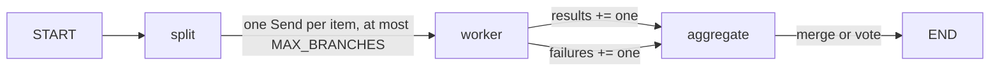

## Use when
- N sub-tasks of the same shape, independent of each other, whose results are merged (per-document extraction, per-index search, per-section review) or voted (self-consistency).
- N is known only at runtime, after a previous node computed the list.

## Do not use when
- Branches depend on each other's results (plan-execute-replan).
- N is unbounded or user-sized: a fan-out over 5,000 records is a queue job, not a graph run (the `asyncio.gather` rule in rules/backend-python.md applies).
- A single agent with a batched tool does the same work in one call.

## Decisions it forces
- Step 1 topology: `split → N × worker → aggregate`; the worker is one node, instantiated once per `Send`.
- Step 3 tools: the worker's tools bound once and shared by every branch (tenant baked in, §9).
- Step 4 protocol: the branch input schema (what one `Send` carries) and the reducer on the collecting key.
- Step 5 context scoping: a branch gets its item plus the shared constraints, never the whole list.
- Step 7 harness: max branches per run; per-branch timeout; concurrency limit (a semaphore inside the worker, or batching in `split`).
- Step 9 failure policy: **what happens when one branch fails** — drop it and warn, fail the run, or retry that branch once. Decided before code; a reducer cannot express it.
- Step 10 observability: branch index in every span; tokens summed per branch.

## LangGraph shape
State: `items: list[Item]`, `results: Annotated[list[Result], operator.add]` (the one reducer here — branches append, in completion order), `failures: Annotated[list[Failure], operator.add]`, `run_id` (langgraph-patterns §2). The worker node may declare its own input schema; `Send("worker", {"item": item, "constraints": …})` delivers exactly that dict.
Nodes: `split`, `worker`, `aggregate`.
Edges: `START → split`; `add_conditional_edges("split", fan_out)` where `fan_out(state) -> list[Send]` returns one `Send("worker", payload)` per item (`Send` from `langgraph.types`); `worker → aggregate` (the aggregator runs once every branch of the superstep has finished); `aggregate → END`.
Caps: `len(items) <= MAX_BRANCHES` enforced in `split`; `asyncio.wait_for` per branch inside `worker`; `recursion_limit` sized for one superstep (§4).

## Failure modes
- No reducer on the collecting key: the last branch wins and the rest is lost silently.
- Reducer order assumed: `operator.add` appends in completion order. Carry the item id inside each result.
- One branch raising ends the whole superstep: catch inside `worker`, return a `Failure` entry, let step 9's policy decide in `aggregate`.
- Unbounded fan-out: N model calls at once, provider rate limit, the whole run fails. Cap and throttle.

## Eval strategy
- Worker: golden `item → Result` with a fake model.
- Reducer and aggregate: pure tests — a merge of K results, a vote with ties, one failure under each step-9 policy.
- End-to-end: three items with one failing branch; assert the aggregate under the chosen policy and `len(results) + len(failures) == 3`.

## Example
none yet — the demo's tool executor runs one batch of tool calls with `asyncio.gather` (`labv-opensearch-agent-demo/backend/graph/nodes.py:316-318`), a fan-out inside one node rather than a `Send` fan-out; that is the lighter choice when the branches are tool calls the router already chose.
