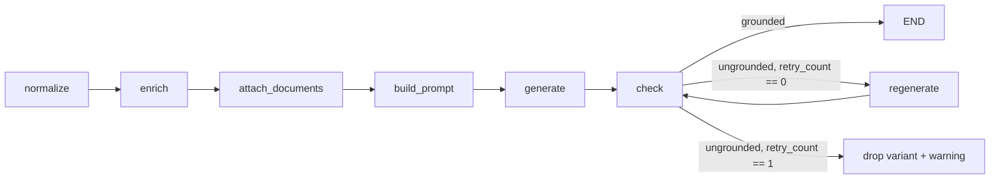

## Use when
- One record in, one text out; every number in the output must come from the input.
- The steps are fixed before the run; the only branch is "did the check pass".
- Optional enrichments (retrieval, a second call) may fail without failing the request.

## Do not use when
- The model must choose tools, or the number of steps depends on what it finds (react-tool-loop).
- The output is a classification or a structured record, not prose (typed-pipeline, rule-first-router).
- The check cannot be deterministic: a model judge with a retry loop is evaluator-optimizer.

## Decisions it forces
- Step 1 topology: no graph — a plain `async` use case (langgraph-patterns §1); one corrective retry, never two.
- Step 2 roster: one generation role and one optional identity role, same provider port, different prompt versions, separate usage rows.
- Step 3 tools: the retrieval adapter — term-filtered, tenant mandatory, never widening on no-match.
- Step 5 context scoping: an allowlist decides what reaches the prompt (`FieldDescriptor`); every size cap lives in one `limits.py`.
- Step 7 harness: one call plus one retry; provider timeout; no iteration concept.
- Step 8 guardrails: unescapable data fence; the correction goes into the system message so the user message stays byte-identical.
- Step 9 failure policy: enrichments degrade to a warning; no surviving variant → typed domain error, never an ungrounded text.
- Step 10 observability: one usage row per prompt version, metered in `finally`, correlation id carried.
- Step 11 evals: golden record → description pairs judged by the grounding function; the no-answer case in the set.

## LangGraph shape
No graph. The use case is the pipeline: `normalize → enrich → attach_documents → build_prompt → generate → ground_check → regenerate once → warnings`. If a second branch ever appears, lift it into a graph with state keys `record`, `prompt`, `candidates`, `warnings`, `retry_count` (all replace-on-write, no reducer), nodes `generate`, `check`, `regenerate`, and one conditional edge from `check`.

## Failure modes
- Grounding check too strict (units, identifiers, thousands separators): correct outputs rejected, regenerations paid twice. The check reads every plausible number reading.
- Retrieval widens on no-match: a chat-style fallback puts another record's datasheet into this record's description.
- Aggregate prompt size unbounded: per-value caps with no total let one record bill maximum input tokens.
- A second corrective retry: the third answer is not better, only more expensive. The policy is one.

## Eval strategy
- Golden set: record → expected description properties (numbers present, units, language), scored by `ungrounded_numbers` and a length check; no provider call.
- The three prompt tests of rules/llm-apps.md: fence-escape probe, no-customer-string denylist, prompt-version pin.
- Retrieval measured on its own: golden record → expected chunk set, Recall@K.

## Example
- Use case: `labv-assist/app/domain/use_cases/describe.py:61-126` (pipeline), `:171-201` (accept variants), `:290-313` (the one corrective retry).
- Ground check: `app/domain/grounding.py:74-88`. Caps: `app/domain/limits.py:8-34`.
- Allowlist: `app/normalizers/fields/descriptor.py:23-40`. Retrieval, never widening: `app/adapters/opensearch_documents.py:131-161,169-195`.
