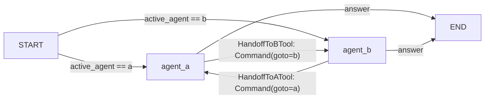

## Use when
- A small number of peers (2–4) with clearly separated domains, where the current agent is the best judge of when it is out of its domain.
- Conversations stay with one agent for many turns and switch rarely (triage → billing → back).
- A supervisor would only forward every message unchanged.

## Do not use when
- **Read this first. Whenever a plan or an assembly step exists, supervisor-workers is the better first choice.** A supervisor gives one place for the hop cap, the packet contracts, the failure policy and the trace; a swarm spreads those across every agent's prompt.
- Agents share tools or data: the handoff carries state, and two agents editing the same keys is the reducer problem with no reducer.
- More than four agents: the handoff graph is quadratic and nobody owns the path.
- The topology is being designed for the first time: start with one agent (react-tool-loop); add a supervisor when roles split; consider a swarm only once the supervisor is provably idle.

## Decisions it forces
- Step 1 topology: the handoff matrix — which agent may hand to which (never everyone to everyone).
- Step 2 roster: each peer's domain in one sentence; the active agent is state.
- Step 3 tools: one `HandoffTo<Agent>Tool` per allowed edge, with a typed reason and summary; no shared data tools.
- Step 4 protocol: what a handoff carries — the summary and the last user message, not the transcript, unless step 4 says otherwise and why.
- Step 6 memory: per agent or shared; the active agent persisted per thread so the next turn resumes there.
- Step 7 harness: handoffs-per-turn cap (2) plus per-agent iteration cap; a ping-pong must hit the cap, not the recursion limit.
- Step 9 failure policy: a handoff to an unknown target or beyond the cap → the current agent answers with a warning.
- Step 10 observability: the handoff chain per turn as a span list.

## LangGraph shape
State: `messages` (`add_messages`), `active_agent: str`, `handoffs: int`, `handoff_summary: str | None`, `run_id` (langgraph-patterns §2).
Nodes: one per agent — each a react-tool-loop subgraph or a node factory with its own tools — and no supervisor.
Handoff: the handoff tool returns `Command(goto="agent_b", update={"active_agent": "agent_b", "handoffs": state["handoffs"] + 1, "handoff_summary": …})` (`Command` from `langgraph.types`); from inside a subgraph the target lives in the parent, so `Command(goto=…, graph=Command.PARENT)`. The tool executor must be the custom one (§3): it returns the `Command` instead of a `ToolMessage`.
Edges: `START → <active_agent>` through a conditional edge on `active_agent`; every agent → `END` when it answers; handoff edges exist only through `Command`, so the matrix is enforced by which handoff tools each agent is given (§5 allowlist).
Caps: `handoffs` checked inside the handoff tool + per-agent iteration cap + `recursion_limit` + `asyncio.wait_for` (§4).

## Failure modes
- Ping-pong: A hands to B, B hands back, forever. Only the `handoffs` cap stops it, and it must live in the tool, not the prompt.
- Transcript handed over wholesale: every agent's context grows to the union. Hand over a summary.
- Handoff matrix in prompts only: the model hands to an agent it should not. The allowlist of handoff tools is the enforcement.
- Nobody owns the final answer: two agents answer in one turn. The routing ends the turn at the first answer.

## Eval strategy
- Per agent: golden `message → answer | handoff(target, summary)` with a fake model.
- Matrix: for every agent, assert its tool list contains exactly its allowed handoffs.
- Cap: fake models that always hand off; assert the turn ends with the cap and the warning within `handoffs + 1` agent calls.

## Example
none yet — the developer's repos have no peer handoffs, and the recommendation stands: reach for supervisor-workers first.
