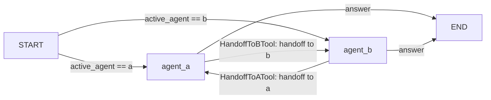

> Active implementation uses Mastra on Node.js/TypeScript, hosted by NestJS providers. Any Python
> file citations below are historical design evidence only, not executable
> guidance. TypeScript/zod recommendations translate historical constraints;
> they are not claims about the cited Python code's APIs.
> Resolve JS APIs from installed dependencies. Eval/test strategies
> are plans until integration and explicit current-task final-stage approval.

## Use when
- A small number of peers (2–4) with clearly separated domains, where the current agent is the best judge of when it is out of its domain.
- Conversations stay with one agent for many turns and switch rarely (triage → billing → back).
- A supervisor would only forward every message unchanged.

## Do not use when
- **Read this first. Whenever a plan or an assembly step exists, supervisor-workers is the better first choice.** A supervisor gives one place for the hop cap, the packet contracts, the failure policy and the trace; a swarm spreads those across every agent's prompt.
- Agents share tools or data: the handoff carries state, and two agents editing the same keys is the reducer problem with no reducer.
- More than four agents: the handoff graph is quadratic and nobody owns the path.
- The topology is being designed for the first time: start with one agent (react-tool-loop); add a supervisor when roles split; consider a swarm only once the supervisor is provably idle.

## Decisions it forces
- Step 1 topology: the handoff matrix — which agent may hand to which (never everyone to everyone).
- Step 2 roster: each peer's domain in one sentence; the active agent is state.
- Step 3 tools: one `HandoffTo<Agent>Tool` per allowed edge, with a typed reason and summary; no shared data tools.
- Step 4 protocol: what a handoff carries — the summary and the last user message, not the transcript, unless step 4 says otherwise and why.
- Step 6 memory: per agent or shared; the active agent persisted per thread so the next turn resumes there.
- Step 7 harness: handoffs-per-turn cap (2) plus per-agent iteration cap; a ping-pong must hit the cap, not the workflow transition cap.
- Step 9 failure policy: a handoff to an unknown target or beyond the cap → the current agent answers with a warning.
- Step 10 observability: the handoff chain per turn as a span list.

## Mastra shape
A Mastra workflow or bounded routing coordinator owns explicit handoff decisions between Mastra agents. A handoff returns a strict target, scoped task packet and summary; only registered targets are accepted. Each target receives its own allowed tools and memory rather than the prior agent's full state.
Persist the active agent and handoff count in typed run state. Enforce handoffs-per-turn and per-agent step caps, token budget and timeout. Do not implement unbounded model-driven ping-pong; return a typed exhausted outcome.

## Failure modes
- Ping-pong: A hands to B, B hands back, forever. Only the `handoffs` cap stops it, and it must live in the tool, not the prompt.
- Transcript handed over wholesale: every agent's context grows to the union. Hand over a summary.
- Handoff matrix in prompts only: the model hands to an agent it should not. The allowlist of handoff tools is the enforcement.
- Nobody owns the final answer: two agents answer in one turn. The routing ends the turn at the first answer.

## Eval strategy
- Per agent: golden `message → answer | handoff(target, summary)` with a fake model.
- Matrix: for every agent, assert its tool list contains exactly its allowed handoffs.
- Cap: fake models that always hand off; assert the turn ends with the cap and the warning within `handoffs + 1` agent calls.

## Example — historical design provenance
none yet — the developer's repos have no peer handoffs, and the recommendation stands: reach for supervisor-workers first.
