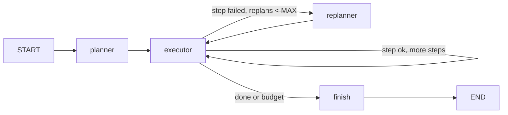

> Active implementation uses Mastra on Node.js/TypeScript, hosted by NestJS providers. Any Python
> file citations below are historical design evidence only, not executable
> guidance. TypeScript/zod recommendations translate historical constraints;
> they are not claims about the cited Python code's APIs.
> Resolve JS APIs from installed dependencies. Eval/test strategies
> are plans until integration and explicit current-task final-stage approval.

## Use when
- The task needs several dependent steps whose order is not fixed in code, and a step's outcome can invalidate later steps.
- The plan itself is a useful artifact (shown to the product's user, logged, evaluated).
- Steps run through tools or workers that return typed results, so "failed" is decidable.

## Do not use when
- One tool loop already replans implicitly through observations (react-tool-loop) and the plan would only be narrated, not enforced.
- Steps are independent (fanout-aggregate) or fixed (typed-pipeline).
- The replanner would be a second full planner call per step: cap replans, or the pattern is a budget leak.

## Decisions it forces
- Step 1 topology: `planner → executor → (replanner | finish)`; the executor runs one step per node invocation, never the whole plan in a loop.
- Step 2 roster: `planner` and `replanner` on a stronger model; `executor` on the cheap one or with no model at all.
- Step 3 tools: the executor's tool allowlist; the planner holds none.
- Step 4 protocol: the `Plan` schema — ordered steps with `id`, `tool`, `args`, `depends_on`, `status` — and the `StepResult` contract.
- Step 5 context scoping: the executor gets one step and the results it depends on; the replanner gets the plan, the failed step and its error, not the transcript.
- Step 7 harness: max steps per plan; max replans per run; per-step timeout; total wall-clock.
- Step 9 failure policy: which failures replan (tool error with hint, empty result) and which end the run (guardrail rejection, budget).
- Step 11 evals: golden `request → plan`; golden `plan + failure → revised tail`.

## Mastra shape
A Mastra workflow calls a planner agent for a strict `Plan`, executes one validated step at a time, and invokes a replanner agent only for an eligible failed tail. Completed steps and idempotency records survive replanning; the revised tail cannot repeat completed effects.
Validate tool names against the allowlist and enforce `MAX_STEPS`, `MAX_REPLANS`, per-step/total timeouts and total token/cost budget. The finish step returns a typed outcome when complete or exhausted.

## Failure modes
- The replanner rewrites the whole plan: completed steps re-run and side effects repeat. It returns only the tail from the failed step.
- The executor runs the plan in a single node loop inside one node: no per-step cap, trace or interrupt point. One step per invocation.
- Plan validated loosely: a step naming a tool outside the allowlist reaches the executor. Validate `tool` against the allowlist in the schema.
- Unbounded replans on a deterministic failure (a guardrail rejecting the same query): step 9 must classify that failure as terminal.

## Eval strategy
- Planner: golden `request → Plan`, exact match on tool names and dependency order, fake model.
- Replanner: golden `(Plan, failed step, error) → revised tail`.
- Routing: table test of `next_step` over (ok or failed, cursor, replans).
- End-to-end: fake tools where step 2 fails once; assert one replan, step 1 not re-run, the final result.

## Example — historical design provenance
none yet — no planner exists in the developer's repos. The demo's `ERROR_RESPONSE_TOO_LARGE` message (`labv-opensearch-agent-demo/backend/tools/search.py:203-212`) is a replan instruction handed to a react loop — the lightweight alternative to this pattern.
