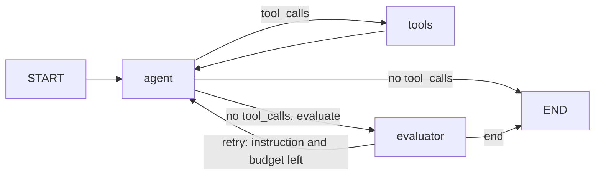

> Active implementation uses Mastra on Node.js/TypeScript, hosted by NestJS providers. Any Python
> file citations below are historical design evidence only, not executable
> guidance. TypeScript/zod recommendations translate historical constraints;
> they are not claims about the cited Python code's APIs.
> Resolve JS APIs from installed dependencies. Eval/test strategies
> are plans until integration and explicit current-task final-stage approval.

## Use when
- One model role decides the next tool from what it observed, and the answer needs several dependent calls (list → mapping → search → plot).
- The tools carry their own context and their own sub-agents (`references/context-enriched-tools.md`), so the loop stays one agent: the "multi" lives inside the tools.
- Answer quality can be judged after the fact and a second pass with feedback is worth its cost.

## Do not use when
- The steps are known before the run (grounded-pipeline, typed-pipeline): a loop where the model picks the same three tools every time is a pipeline with an extra model call.
- Roles must not see each other's context, or the roster has more than one agent of distinct purpose (supervisor-workers).
- The product's user must confirm actions with external effect — add user-approval-interrupt to this loop.

## Decisions it forces
- Step 1 topology: exactly one router role; every other model call lives inside a tool or in the evaluator.
- Step 2 roster: roles `router`, tool sub-agents (`dsl`, `compute`), `evaluator`, `narrator`; what the router never sees (raw DSL, full result sets, credentials).
- Step 3 tools: the eight sub-decisions per tool; which tools consume the `LAST_SEARCH` hand-off.
- Step 4 protocol: typed workflow state; `_result` preview to the model, `_handoff_result` server-side.
- Step 5 context scoping: the window starts at the latest user message; older tool results are compressed.
- Step 6 memory: summary buffer per session key; artifacts and last data re-seeded each turn.
- Step 7 harness: iteration cap, workflow transition cap, wall-clock timeout, retry budget, evaluator on/off per request.
- Step 8 guardrails: tenant bound at NestJS provider construction; input and output guards at the API edge.
- Step 9 failure policy: tool error → informative typed tool result; iteration cap → end with the last text; evaluator failure → answer ships unaudited.
- Step 10 observability: `run_id` in state; token accounting per role, including calls made inside tools.
- Step 11 evals: golden question → query per tool; task packet → answer contract for the router; one end-to-end.

## Mastra shape
A Mastra agent owns the tool loop and receives only the permitted tools and scoped conversation context. A NestJS provider owns trusted tenant context, server-side artifacts, memoization and full handoff payloads; only capped previews enter model-visible results.
An optional Mastra workflow evaluates the agent's typed output and requests bounded corrective generation. Enforce tool-call/agent-step caps, retry and token budgets, and a propagated timeout separately. Validate the verdict before routing; a retry needs both a non-empty instruction and remaining budget.

## Failure modes
- Retry guard in the node but not in the routing function: a null instruction loops forever without consuming retries (the demo's `should_retry` docstring records the bug and the fix).
- The router copies a large tool result into the next tool's argument: solved by the hand-off sentinel, not by prompting.
- Iteration cap reached mid-plan: the run ends with whatever text exists; step 9 must say what the product shows.
- Verdict parsed with regex-and-defaults: a malformed verdict passes silently (`agents/evaluator_agent.py:85-106` is the anti-pattern; D10 requires zod plus one retry).
- Token undercount: model calls made inside tools are not in graph state (`services/agent_service.py:644-649`).

## Eval strategy
- Per tool: golden `question → query` pairs asserted on the generated DSL after guardrails, no provider call.
- Per agent: golden `task packet → output contract` (the router's final message shape; the evaluator's typed verdict).
- One end-to-end golden run with a fake model through the Mastra provider/workflow, asserting the step sequence and that every cap fires.
- Runtime evaluator plus deterministic checks are the only in-product scoring (D13).

## Example — historical design provenance
- Wiring and both routing functions: `labv-opensearch-agent-demo/backend/graph/workflow.py:31-65,239-265`.
- State: `graph/state.py:8-28`. Tool executor with hand-off, memo and derived-data guard: `graph/nodes.py:294-409`.
- Evaluator retry with iteration reset: `graph/nodes.py:462-473`; retry window in the agent node: `agents/opensearch_agent.py:47-56`.
- Caps: `services/agent_service.py:248,296-323`.
