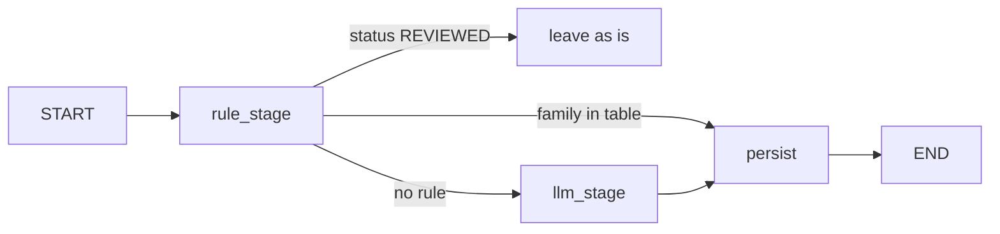

## Use when
- Most inputs carry structure a rule can read (a prefix, a family, a code); the model is for the long tail.
- Cost or latency per item matters and the item volume is high.
- The rule's answer must be auditable and never overwritten by a probabilistic one.

## Do not use when
- No rule covers a meaningful share of inputs: the gate is a `False` that always falls through.
- The rules would encode the model's job (a dozen regexes approximating semantics): use the model with a golden set.
- The two paths must agree on a state the model may revise — that is evaluator-optimizer.

## Decisions it forces
- Step 1 topology: a deterministic gate before any model call; usually the first stage of a typed-pipeline.
- Step 2 roster: the rule set is a "role" with a version (`rule/v1`) stamped like a model name.
- Step 4 protocol: the record carries who classified it (`rule/v1` or `<provider>/<model>`); both paths write the same fields.
- Step 5 context scoping: the model stage receives only the residue, most frequent first, so a wrong answer on a rare item costs least.
- Step 7 harness: no retry on the rule path; the model path keeps typed-pipeline's one validation retry.
- Step 9 failure policy: a rule never fails; a failed model batch stays pending; human-reviewed records are untouchable on both paths.
- Step 11 evals: the rule table is a golden set by construction; the residue gets its own.

## LangGraph shape
No graph (langgraph-patterns §1) — a routing function in front of a pipeline. If embedded in a graph: state keys `record`, `classified_by`, `theme`; nodes `rule_stage`, `llm_stage`, `persist`; one conditional edge `rule_stage → {persist | llm_stage}`; no reducer.

## Failure modes
- The rule table grows into a parser: every new prefix is a deploy. Keep it a lookup on a family the normalizer already extracted.
- Rule and model write different fields or statuses: reports disagree. One writer function for both paths.
- The residue is not sorted: a model error lands on the most frequent template.
- The rule path silently claims items it should not (a prefix collision): the golden set needs negative cases per family.

## Eval strategy
- Rule table: every family → expected (theme, severity, routes) as a parametrized test, plus negatives (a function text that is not an interruption).
- Residue share: on a real-base golden set, assert what fraction reaches the model; a regression here is a cost regression.
- Model residue: typed-pipeline's golden batch.

## Example
- `portal_nexxus/backend/src/infrastructure/classifier/rule_classifier.py:14-48` (the table; `REVIEWED` never overwritten; `RULE_MODEL` stamped).
- Residue ordering and batching: `src/application/use_cases/classify_pending.py:32-54`.
- The family the rule keys on: `src/infrastructure/classifier/normalizer.py:48-61`.
