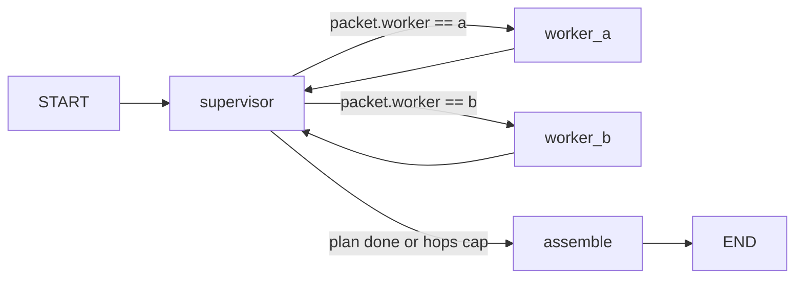

## Use when
- Several agents of distinct purpose (search, compute, write) whose prompts, tools and contexts must stay apart.
- Someone must own the plan and the final assembly; workers should not need to know each other.
- Different roles want different models or budgets.

## Do not use when
- One agent with context-enriched tools already covers the work (react-tool-loop): a supervisor adds a model call per hop and loses the workers' observations.
- Sub-tasks are independent and identical in shape (fanout-aggregate).
- Control should pass between peers with no central plan (handoff-swarm — rarely the right call).

## Decisions it forces
- Step 1 topology: supervisor plus N workers; whether workers may call each other (default: no).
- Step 2 roster: per worker its purpose, model role, and what it must never see (other workers' context; the raw user message when a packet suffices).
- Step 3 tools: a per-worker tool allowlist; the supervisor holds no data tools, only dispatch.
- Step 4 protocol: **does the supervisor see worker reasoning or only outputs?** Default: outputs only — the worker returns its output contract; its messages stay in its own state.
- Step 5 context scoping: one Pydantic task packet per worker (inputs, constraints, budget, output contract).
- Step 7 harness: supervisor hop cap; per-worker iteration cap; total wall-clock.
- Step 9 failure policy: per worker, degrade-to-warning or fail-the-run; a fallback worker or none.
- Step 10 observability: one `run_id`; a span per worker call; tokens per role.

## LangGraph shape
State: `messages` (`add_messages`), `plan: list[TaskPacket]`, `results: dict[str, WorkerOutput]`, `hops: int`, `run_id` (langgraph-patterns §2). A worker is a compiled subgraph with its own state schema; the parent hands it the packet and reads back only the output contract at the subgraph boundary.
Nodes: `supervisor`, one node per worker, `assemble`.
Edges: `START → supervisor`; `supervisor → {worker_a | worker_b | assemble}` by a routing function on the next packet's `worker` field (or the supervisor node returns `Command(goto=…, update=…)`); every worker → `supervisor`; `assemble → END`.
Caps: `hops` checked in the routing function + `recursion_limit` + `asyncio.wait_for` (§4).

## Failure modes
- Supervisor reads worker transcripts: context grows per hop and the supervisor starts redoing the worker's job. Outputs only, unless the step-4 decision says otherwise and why.
- Packet without an output contract: the supervisor parses prose. Validate every worker output with Pydantic, one retry with the error (D10).
- Worker loops inside its subgraph with no cap of its own: the parent's `recursion_limit` is the only bound and fires late.
- Two workers sharing a tool with different tenants or credentials: bind per worker at build time (§9).

## Eval strategy
- Per worker: golden `task packet → output contract`, run with a fake model.
- Supervisor: golden `user request → plan` (ordered packets), exact match on worker names and constraints.
- One end-to-end golden with fakes for every role, asserting the hop sequence and that no worker saw another's context (assert on the packets, not the prose).

## Example
none yet — no supervisor exists in the developer's repos. The react-tool-loop demo is the single-agent baseline to beat before choosing this pattern.
