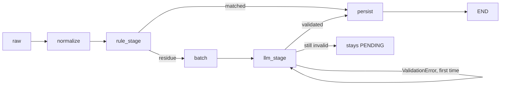

> Active implementation uses Mastra on Node.js/TypeScript, hosted by NestJS providers. Any Python
> file citations below are historical design evidence only, not executable
> guidance. TypeScript/zod recommendations translate historical constraints;
> they are not claims about the cited Python code's APIs.
> Resolve JS APIs from installed dependencies. Eval/test strategies
> are plans until integration and explicit current-task final-stage approval.

## Use when
- Batch or stream processing where every record passes the same stages in the same order.
- Each stage has a typed input and output; the model, if any, is one stage among deterministic ones.
- Stages must be testable alone with fixtures, and swappable (a rule stage today, a model stage tomorrow).

## Do not use when
- The order of steps depends on what the model finds (react-tool-loop).
- The output is prose that needs a grounding loop (grounded-pipeline).
- One stage dominates and the rest is glue: write the use case, skip the ceremony.

## Decisions it forces
- Step 1 topology: typed Mastra workflow; deterministic stages call application helpers.
- Step 2 roster: which stage embeds a model call and under which role; what that stage never sees (raw payloads it does not need).
- Step 4 protocol: the typed record between stages — frozen dataclass or zod model, one per boundary.
- Step 5 context scoping: the model stage receives a batch of normalized records, not raw events.
- Step 7 harness: batch size; one validation retry per batch with the error as feedback; what stays pending when a batch fails.
- Step 9 failure policy: a failed model batch stays `PENDING` for the next pass; human-reviewed records are never overwritten.
- Step 10 observability: which stage classified the record, with model and prompt version stamped on it.
- Step 11 evals: golden fixtures per stage; a golden batch against the model stage with a fake provider.

## Mastra shape
A Mastra workflow composes schema-validated stages: `normalize → rule_stage → llm_stage (only unresolved inputs) → persist`. The LLM stage calls a Mastra agent. Stage outputs define the next input contract; batching and aggregation have explicit ordering and failure policies. NestJS providers own external dependencies, trusted context and run budgets.

## Failure modes
- A stage mutating its input in place: the next stage cannot be tested with the original fixture. Return new values.
- Model stage validated with regex-and-defaults: one wrong theme corrupts the taxonomy silently. zod, one retry with the error, then pending (D10).
- Batch too large: index drift (`item.index` outside the batch). Keep `batch_max` small; ignore out-of-range indices loudly.
- Human curation overwritten on re-run: the status check must sit in every stage that writes.

## Eval strategy
- Per stage: golden fixture → expected typed output (normalizer against a real-base golden set; rule stage exact match).
- Model stage: golden batch → expected classifications with a fake provider returning canned JSON, including one invalid answer to exercise the retry.
- End-to-end: one pending queue through every stage, asserting the report counters.

## Example — historical design provenance
- Stages: `portal_nexxus/backend/src/infrastructure/classifier/normalizer.py:76-86`, `rule_classifier.py:27-48`, `llm_classifier.py:24-46` (validate plus one retry with feedback), `episodes.py:54-84` (a stateful deterministic stage).
- Orchestration: `src/application/use_cases/classify_pending.py:29-57`.
