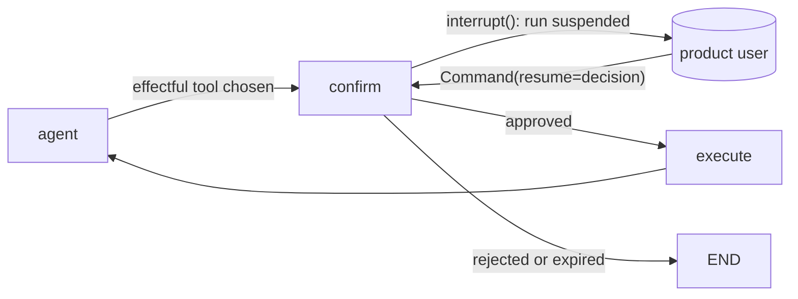

**This is a product pattern.** The person who confirms is the product's **user**, at runtime, in the product's UI. It is not the design gate: the **developer's** approval of the topology (hitl reason `topology-approval`) happens once, in the Claude session, before any code. Picking this pattern never replaces that approval (D17).

## Use when
- A step has an effect outside the system (send, delete, pay, write to a third party) and rules/llm-apps.md requires human confirmation before it.
- The user must see exactly what will happen (the rendered action, not the model's intent) and may edit it.
- The run may stay suspended for minutes or days and resume on another request.

## Do not use when
- The action is reversible and cheap: confirm after, not before — an undo beats an interrupt.
- The "user" would be the developer approving a design: that is the gate, recorded in the change record, not a graph node.
- There is no durable place for the suspended state (no checkpointer): the interrupt cannot resume.

## Decisions it forces
- Step 1 topology: which node interrupts — a dedicated `confirm` node before the effectful tool, never inside the tool.
- Step 4 protocol: the payload shown to the user (typed: action, arguments, preview) and the resume value (typed: `approved`, `edited_args | None`, `reason`).
- Step 6 memory: a **checkpointer is mandatory** (`interrupt()` needs one); `thread_id` in `config["configurable"]`; retention of suspended threads.
- Step 7 harness: how long a suspended run lives; what happens on expiry.
- Step 8 guardrails: the resume value is untrusted input — validated with Pydantic; the effectful tool re-checks tenant and allowlists after resume; the model never sees the approval token.
- Step 9 failure policy: rejected → the run ends with a typed outcome; expired → cancelled, never auto-approved.
- Step 10 observability: who approved, when, with which edits — an audit row per interrupt.

## LangGraph shape
State: this pattern's keys `pending_action: Action | None` and `approval: Approval | None`, plus the host pattern's (langgraph-patterns §2). Compile with a checkpointer (`MemorySaver` in tests, a durable one in production); invoke with `config={"configurable": {"thread_id": …}}`.
Node `confirm`: `decision = interrupt(pending_action.model_dump())` (`interrupt` from `langgraph.types`) — the graph suspends and the payload surfaces to the caller under `__interrupt__`; on resume the **node re-runs from its start**, so nothing with a side effect may precede the `interrupt()` call. Resume: `graph.invoke(Command(resume=decision_dict), config)` (`Command` from `langgraph.types`); validate the value into `Approval`.
Edges: `agent → confirm` when the chosen tool is effectful; `confirm → {execute | END}` by `approved`; `execute → agent`.

## Failure modes
- A side effect placed before `interrupt()` in the same node runs twice: once before suspension, once on resume.
- No checkpointer: the interrupt cannot be resumed — found late, in production.
- Resume value trusted: a client posts `approved=true` with edited args that escape the tenant filter. Validate and re-guard after resume.
- Approval semantics mixed with the developer gate in the spec: reviewers cannot tell who approves what. Keep the vocabulary.

## Eval strategy
- Node test: run to the interrupt with `MemorySaver`; assert the `__interrupt__` payload is the rendered action; resume with approved, rejected and invalid payloads.
- Guard test: an edited argument outside the allowlist is rejected after resume.
- No model in these tests: the interrupt is deterministic plumbing.

## Example
none yet — no product in the developer's repos suspends a run for its user. The demo's tools are read-only (`labv-opensearch-agent-demo/backend/utils/guardrails.py:194-224` strips script clauses; nothing writes), which is why it never needed this.
