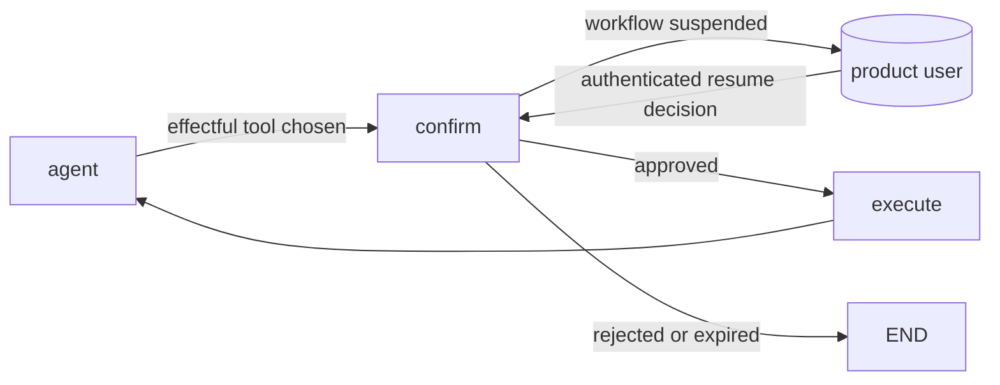

> Active implementation uses Mastra on Node.js/TypeScript, hosted by NestJS providers. Any Python
> file citations below are historical design evidence only, not executable
> guidance. TypeScript/zod recommendations translate historical constraints;
> they are not claims about the cited Python code's APIs.
> Resolve JS APIs from installed dependencies. Eval/test strategies
> are plans until integration and explicit current-task final-stage approval.

**This is a product pattern.** The person who confirms is the product's **user**, at runtime, in the product's UI. It is not the design gate: the **developer's** approval of the topology (hitl reason `topology-approval`) happens once, in the Claude session, before any code. Picking this pattern never replaces that approval (D17).

## Use when
- A step has an effect outside the system (send, delete, pay, write to a third party) and rules/llm-apps.md requires human confirmation before it.
- The user must see exactly what will happen (the rendered action, not the model's intent) and may edit it.
- The run may stay suspended for minutes or days and resume on another request.

## Do not use when
- The action is reversible and cheap: confirm after, not before — an undo beats an interrupt.
- The "user" would be the developer approving a design: that is the gate, recorded in the change record, not a graph node.
- There is no durable place for the suspended state (no durable workflow snapshot storage): the interrupt cannot resume.

## Decisions it forces
- Step 1 topology: which node interrupts — a dedicated `confirm` node before the effectful tool, never inside the tool.
- Step 4 protocol: the payload shown to the user (typed: action, arguments, preview) and the resume value (typed: `approved`, `edited_args | None`, `reason`).
- Step 6 persistence: durable Mastra workflow snapshots are mandatory; bind run
  identity and retention to authenticated tenant/user context. Conversation memory
  alone does not persist a suspended workflow.
- Step 7 harness: how long a suspended run lives; what happens on expiry.
- Step 8 guardrails: the resume value is untrusted input — validated with zod; the effectful tool re-checks tenant and allowlists after resume; the model never sees the approval token.
- Step 9 failure policy: rejected → the run ends with a typed outcome; expired → cancelled, never auto-approved.
- Step 10 observability: who approved, when, with which edits — an audit row per interrupt.

## Mastra shape
A Mastra workflow prepares a typed action preview and suspends at a dedicated confirmation step before any external effect. Persist its run snapshot with durable storage, and retain the run id, authenticated owner/tenant binding, expiry and action version server-side.
A NestJS endpoint authenticates the product user's decision and validates the resume payload before resuming the correct run. The resumed step re-checks scope and allowlists; only an explicit valid approval executes the action. Use Mastra suspend/resume behavior verified against the installed version; make effects idempotent and never assume LangGraph node replay semantics.

## Failure modes
- An effect placed before confirmation can execute without approval; repeated
  requests/retries can duplicate it unless the effect is idempotent.
- No durable snapshot storage: a suspended run cannot resume after a restart.
- Resume value trusted: a client posts `approved=true` with edited args that escape the tenant filter. Validate and re-guard after resume.
- Approval semantics mixed with the developer gate in the spec: reviewers cannot tell who approves what. Keep the vocabulary.

## Eval strategy
- Final-stage test plan: suspend with isolated workflow storage; assert the action
  preview, authenticated run binding and approved/rejected/invalid resume outcomes.
- Guard test: an edited argument outside the allowlist is rejected after resume.
- No provider calls in these planned cases: suspension and approval routing are deterministic.

## Example — historical design provenance
none yet — no product in the developer's repos suspends a run for its user. The demo's tools are read-only (`labv-opensearch-agent-demo/backend/utils/guardrails.py:194-224` strips script clauses; nothing writes), which is why it never needed this.
