# Agent topology — <system or feature name>

> Written by the `agent-system-design` form (`/engineos:design-agents`), one section
> per step, in step order, as the developer answers. Sections are filled in order;
> a later section is never filled before the one above it. `<placeholders>` are
> replaced by the developer's answers — a placeholder left in an approved spec is a
> defect. The change record's `spec:` field points at this file and its
> `## Human decisions` carries the approval line from §12.

Change record: `.engineos/changes/<YYYY-MM-DD>-<slug>.md`
Grounding repos consulted: <paths, or "none">

## 1. Topology

- Shape of the work: <linear pipeline | tool loop>
- Decision makers: <one | several — which>
- Pattern id(s): `<id>`<, `<id>`>
- Why: <the reason in the developer's words>
- Rejected alternative: `<id>` — <why not>
- Graph needed: <yes — LangGraph | no — plain async use case per python-patterns>

## 2. Agent roster

| Agent | Purpose (one sentence) | Model role | Never sees | Tools (from §3) |
|---|---|---|---|---|
| `<agent_1>` | <purpose> | `<router | dsl | evaluator | narrator | compute | …>` | <raw user message / other agents' reasoning / tool payloads / credentials / other tenants' data> | `<ToolA>`, `<ToolB>` |
| `<agent_2>` | <purpose> | `<role>` | <…> | <…> |

## 3. Tools

Envelope shape shared by every tool that returns data:

```json
{ "_dsl": "<what was executed>", "_result": "<preview the model sees, capped>", "_handoff_result": "<full payload, server-side only>", "_pagination": "<optional note>" }
```

### 3a. Tool contract table

| Tool | Purpose | Input schema (every field described) | Envelope | Callers | Depends on | Sub-agent role | Self-repair N | Error codes | Size cap | Memo key | Handoff sentinel | Tenant binding | Fail-closed guards |
|---|---|---|---|---|---|---|---|---|---|---|---|---|---|
| `<ToolNameTool>` | <purpose> | `<ToolNameInput>` | <`_result` only / `_result` + `_handoff_result`> | `<agent_1>` | `<OtherTool>` — stated in <description + prompt block behind flag `<ENABLE_X>`> | <none / `<role>`> | <n> | `ERROR_<REASON>`, … | <n chars → replan> | `<index::question>` / none | `<LAST_SEARCH>` / none | <closure over tenant-restricted credentials at construction> | <tenant filter injected, forbidden clauses stripped, index prefix checked, session id overridden> |

### 3b. Context table

| Tool | Semantic layer (owner, refresh) | Curated context (default + overlay; merge rules) | Machine facts (refresh cadence; write guards) | Injected into |
|---|---|---|---|---|
| `<ToolNameTool>` | <yes — developer, on PR / no> | <yes — `<default file>` + `<overlay file>`; union / override by key / concatenate / no> | <yes — <weekly + startup>; min entities <n>, max field-loss ratio <r> / no> | <the tool's own sub-agent prompt> |

### 3c. Tool evals

| Tool | Golden pairs (question → query) | Curated-vs-facts contradiction test |
|---|---|---|
| `<ToolNameTool>` | <n> | <yes / n.a.> |

## 4. Communication protocol

- Carrier: <shared graph state | typed message envelopes | network protocol (A2A)>
- Protocol constants module: `<graph/protocol.py>`

| From | To | Carrier | Sync / async | Envelope type |
|---|---|---|---|---|
| `<agent_1>` | `<agent_2>` | <state key `<key>` / envelope / HTTP> | <sync | async + join> | `<Agent2TaskPacket>` |

## 5. Context scoping — task packets

One frozen Pydantic model per agent, in roster order. `extra="forbid"` makes §2's
"never sees" testable.

```python
class <Agent1>TaskPacket(BaseModel):
    """What <agent_1> receives — its task, not the whole picture."""
    model_config = ConfigDict(frozen=True, extra="forbid")
    run_id: str
    tenant_id: str
    task: str
    inputs: <Agent1Inputs>
    constraints: <Agent1Constraints>      # tool_allowlist, forbidden_fields, language
    budget: Budget                        # max_tokens <n>, max_tool_calls <n>, timeout_s <n> (from §7)
    output_contract: str = "<Agent1Output>"


class <Agent1>Output(BaseModel):
    model_config = ConfigDict(frozen=True, extra="forbid")
    <field>: <type>
```

```python
class <Agent2>TaskPacket(BaseModel):
    ...
```

## 6. Memory

| Agent | Memory kind | Scope | Survives a turn | Storage key |
|---|---|---|---|---|
| `<agent_1>` | <none | summary buffer | store> | <session | user | tenant> | <what, exactly — or "nothing"> | `<company__user__profile__session>` |

## 7. Harness

Entry point: `<api/routes/<name>.py | cli>`

| Bound | Value | Where enforced |
|---|---|---|
| Iteration cap | <n> | <routing function `should_continue`> |
| Recursion limit | <(max_retries + 1) × cap + buffer> | <service, `graph.ainvoke(config={"recursion_limit": …})`> |
| Wall-clock timeout | <n s> | <`asyncio.wait_for` around the run> |
| Retry budget | <n> | <state `max_retries`, mirrored in `should_retry`> |
| Token / cost budget | <n tokens / <currency> per run> | <callback per role> |
| Evaluator | `<evaluator>` — verdict `<Verdict>` | <conditional edge: retry only on `retry_recommended` and non-empty `retry_instruction`> |

## 8. Guardrails

| Guard | Agent(s) | Where it runs | Fails closed? |
|---|---|---|---|
| Tenant scoping — <source of the tenant fact> | <all> | <tool construction> | <yes> |
| Tool allowlist | `<agent_1>` | <tool executor, from `constraints.tool_allowlist`> | <yes> |
| Input sanitization | <agents that read the raw user message> | <API edge> | <yes / no — on purpose because …> |
| Output sanitization + token gate | <agents whose output reaches the user> | <final node / stream> | <yes> |

## 9. Failure policy

| Agent | On failure | Fallback | What the user sees |
|---|---|---|---|
| `<agent_1>` | <degrade to warning | fail the run> | <`<fallback_agent>` / none> | <a sentence> |

## 10. Observability

- Run id: <where minted, where carried>; correlation id: <request middleware>
- Spans: <one per agent and per tool sub-agent — chain / llm / tool, with role tag>
- Token accounting: <per role and per model, in <callback | tool result>; internal tool model calls included>
- Usage record: <once per prompt version, in a `finally`>
- Trace destination: <log | LangSmith | OpenTelemetry | decided later on <date>>

## 11. Evals

| Level | Fixture | Assertion | Count | Owner |
|---|---|---|---|---|
| Per tool | question → query | <query equals / matches> | <n> | <who> |
| Per agent | `<Agent>TaskPacket` → `<Agent>Output` | `model_validate` + <fields the next agent reads> | <n> | <who> |
| End-to-end | <the one input §12 draws> | <final output contract> | 1 | <who> |

No test calls the provider. Runtime scoring: <evaluator node + deterministic check `<name>`>.

## 12. Diagrams and approval

### Flowchart — nodes and conditional edges (labels are the routing function's return values)

```mermaid
flowchart TD
    START([START]) --> <agent_1>
    <agent_1> -->|continue| <tools>
    <tools> --> <agent_1>
    <agent_1> -->|evaluate| <evaluator>
    <agent_1> -->|end| END([END])
    <evaluator> -->|retry| <agent_1>
    <evaluator> -->|end| END
```

### Sequence — one sample run (the §11 end-to-end input): what each agent receives and returns

```mermaid
sequenceDiagram
    participant U as user
    participant A1 as <agent_1> (<role>)
    participant T as <ToolNameTool>
    participant E as <evaluator> (<role>)
    U->>A1: <input>
    Note over A1: receives <Agent1>TaskPacket{…}
    A1->>T: <ToolNameTool>(<args>)
    T-->>A1: {"_result": …, "_handoff_result": server-side}
    A1->>E: <Agent1>Output{…}
    E-->>A1: <Verdict>{passed, retry_recommended, retry_instruction}
    A1-->>U: <what the user receives>
```



### Approval

Recorded in the change record under `## Human decisions`:

```
<YYYY-MM-DD> | <developer> | topology-approval | approved | docs/specs/<YYYY-MM-DD>-<slug>-agent-topology.md
```

Only after this line exists: front-matter `status: approved`, `langgraph-patterns`
loaded, wave plan derived from §2 and §3 per `rules/parallelism.md`.
